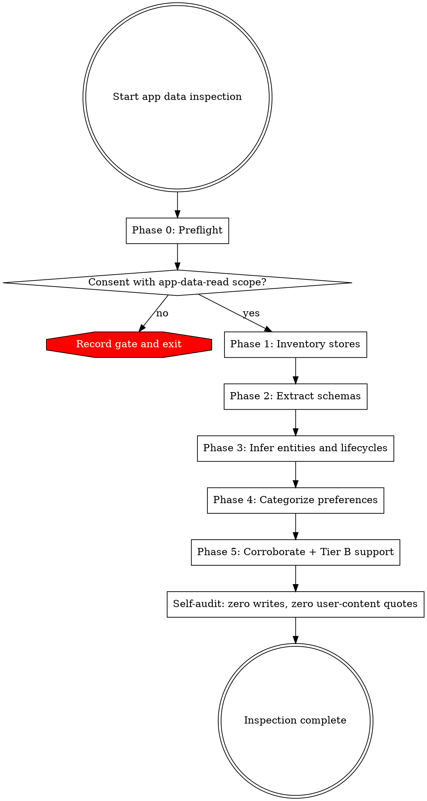

# App Data Inspection Methodology

The app's own data store is its most honest self-description. Schemas, lifecycle enums, foreign keys, and preference keys encode behavior the UI only hints at: what entities exist, what states they pass through, what relationships bind them, what the app remembers between launches. This skill defines how to read all of that without ever touching it. Every operation is read-only. The app does not need to be running, and this skill never launches it.

## When This Mode Applies

App data inspection is one of four macOS host-observation modes that run against a user-installed application:

| Skill | Role | Observes |
|-------|------|----------|
| `macos-bundle-analysis` | `bundle-inspector` | The app bundle: signing, entitlements, resources |
| `macos-runtime-observation` | `applescript-explorer` | The running app via its scripting interface |
| `macos-visual-exploration` | `ui-observer` | The running app's visible UI |
| `app-data-inspection` (this skill) | `data-inspector` | The app's persistent data stores on disk |

This mode activates when the orchestrator schedules the `data-inspector` role against a macOS target. It consumes two inputs from `macos-bundle-analysis`:

- `workspace/raw/macos/bundle/signing.md` — the entitlements list the **group container ID**, your primary pointer to where data lives
- `workspace/raw/macos/bundle/capability-inventory.md` — hints about what stores to expect (iCloud sync, Core Data, custom formats)

A PASS verdict recorded in `workspace/raw/macos/bundle/signing.md` is a hard precondition — FAIL, UNKNOWN, or a missing file fails the carve-out: record it in `preflight-data.md` and exit (matching `macos-runtime-observation`). The generic location strategy in Phase 0 applies ONLY to locating data stores when bundle-derived location hints are absent — it never substitutes for the signature verdict.

## Host Execution Carve-Out

Host-side inspection is permitted ONLY when every one of these conditions holds: the target is a user-installed application, it is signed and notarized, the signature has been verified, consent is recorded in `workspace/consent/macos-host-observation.md`, and every interaction with the target is read-only. If any condition fails, the container rule in the runtime-observation and container-execution skills governs, and this mode does not run on the host.

Consent is verified, NEVER created. The consent file must contain a `**Granted scopes:**` line including the scope `app-data-read`. A missing file or missing scope is a hard gate: record the gate in `preflight-data.md` and exit. Do not proceed "just for the schema." This skill does not require the `app-launch` scope — it never starts the app.

## The Read-Only Contract

These are hard rules with mechanisms, not intentions. Violating any of them invalidates the entire run.

1. **Every SQLite open uses the read-only URI form:** `sqlite3 "file:$DB?mode=ro"` — never a bare path, never `mode=rw`. Only SELECT, PRAGMA, `.tables`, and `.schema` statements. Never `PRAGMA wal_checkpoint` (it writes to the main database file), never `VACUUM`, never `.recover`, never ATTACH to a writable path. The `mode=ro` URI makes accidental writes fail at the SQLite layer instead of relying on discipline alone.
2. **Set `.timeout 200` on every session.** If SQLITE_BUSY persists despite the timeout, do not retry aggressively and do not checkpoint. Fall back to the newest snapshot under the sibling `Backups/` directory — nothing writes there — and note the snapshot's staleness in every claim derived from it.
3. **Preference access is `defaults read` only.** Never write, never delete, never edit a plist in place.
4. **Never create, modify, or delete anything under the app's containers.** Never copy whole databases into the workspace — a full database is personal data. Workspace extracts are schema plus minimal illustrative values (type codes, status flags, counts) only.
5. **WAL warning:** copying only `main.sqlite` while the app runs silently loses recent writes sitting in the `-wal` sidecar. If a copy is ever genuinely needed, prefer reading in place with `mode=ro`, or use a `Backups/` snapshot instead.

## Inspection Phases



### Phase 0: Preflight

**Output:** `workspace/raw/macos/app-data/preflight-data.md`

Record three results before anything else:

1. **Consent and scope.** Verify `workspace/consent/macos-host-observation.md` exists and its `**Granted scopes:**` line includes `app-data-read`. Missing either ⇒ record the gate and exit.
2. **Signature.** Read `workspace/raw/macos/bundle/signing.md` and confirm a recorded PASS verdict. FAIL, UNKNOWN, or a missing file ⇒ the carve-out does not apply ⇒ record in `preflight-data.md` and exit (matching `macos-runtime-observation`). Never self-verify as a substitute — the generic location strategy below covers only store location, never the signature verdict.
3. **Store locations.** Locate every candidate data store.

Location strategy — generic, with Things as the worked example:

```bash
# Primary: group container from the entitlements (see bundle signing.md)
ls -d ~/Library/Group\ Containers/$GROUP_ID*/ 2>/dev/null
# Things worked example — glob the per-install random suffix:
DB=$(ls ~/Library/Group\ Containers/JLMPQHK86H.com.culturedcode.ThingsMac/ThingsData-*/"Things Database.thingsdatabase"/main.sqlite 2>/dev/null | head -1)
# Also check: ~/Library/Containers/$BUNDLE_ID/Data/Library/Application Support/
#             ~/Library/Application Support/<app name>/
# Multiple candidate DBs (old migrations, "Database Moved" readmes): pick the one with the
# newest mtime AND verify with a row-count sanity check; record the rejects.
```

On permission denial (EPERM reading `Group Containers/`), print the remediation path for the user — "System Settings > Privacy & Security > Full Disk Access > enable <parent terminal app>" — and record the gate in `preflight-data.md`. A recorded gate is a deliverable, not a failure.

### Phase 1: Store Inventory

**Output:** DBQ records in `dbq-log.md`; inventory table in `preflight-data.md`.

Enumerate every store found, whether or not you will analyze it:

- SQLite files — `file` output plus a header check (`SQLite format 3` magic)
- Property lists — binary and XML
- JSON files
- LevelDB directories (`CURRENT`, `MANIFEST-*`, `.ldb` files)
- Core Data stores — `.sqlite` with Z-prefixed tables; note the `ZENTITY`-style table naming and the `Z_PRIMARYKEY` metadata table conventions
- Binary caches and proprietary formats — recorded, not decoded

Produce a table of stores with size, mtime, format, and whether each was chosen for analysis. Every store gets a row; every rejection gets a reason.

### Phase 2: Schema Extraction

**Output:** `workspace/raw/macos/app-data/schema.md`

For each chosen SQLite store, record verbatim:

- `.tables` — the full table list
- `.schema` — complete DDL: tables, columns with declared types, indexes, triggers, foreign keys, views
- Per-table row counts (`SELECT count(*)`)
- `PRAGMA user_version` and `PRAGMA schema_version` — record these explicitly as staleness anchors for incremental analysis: a later run compares them to detect schema drift without re-extracting everything

**Worked-example caveat:** these schemas are undocumented and migration-scarred. Things' `TMTask` table has 41 columns, a polymorphic `type` column (0 = to-do, 1 = project, 2 = heading), a `status` column (0 = incomplete, 2 = canceled, 3 = completed), prefix artifacts like `rt1_` and `t2_` left by past migrations, and MIXED date encodings — REAL Unix epochs alongside INTEGER packed-bitfield dates. Do NOT assume epoch on integer date columns. Record structure verbatim at `confidence=confirmed`; every semantic interpretation starts at `confidence=assumed`.

### Phase 3: Entity and Lifecycle Inference

**Output:** `workspace/raw/macos/app-data/entities.md`

- Infer entities from tables, foreign keys, and junction tables.
- Enumerate the status/type code VALUES actually observed: `SELECT DISTINCT` with counts. Counts are fine; content is not.
- Record relationship cardinalities (one-to-many via FK, many-to-many via junction table).
- Infer lifecycles from date/state column combinations — e.g., `stopDate` set together with `status=3` suggests completion semantics — at `confidence=assumed` until corroborated.
- Opaque BLOBs are recorded as opaque. Never decode a BLOB by guessing at its format; flag it for runtime corroboration by the scripting or UI modes.

### Phase 4: Preferences

**Output:** `workspace/raw/macos/app-data/defaults.md`

Run `defaults read "$BUNDLE_ID"` and record the full dump, redacting obviously personal values (recent file paths, account names, search history). Then categorize every key in a table:

| Category | Meaning | Examples |
|----------|---------|----------|
| User-configurable | Appears in the Settings UI or in documented tweaks | Appearance, badge behavior, start-of-week |
| Internal state | The app talking to itself | Window frames, one-shot "has shown welcome" flags, migration markers |
| Apple/framework keys | `NS*`/`Apple*` prefixes | Note their presence, then ignore them |

A key's purpose is `assumed` unless corroborated — the strongest corroboration is the visual skill's Settings-window captures showing the corresponding control. Cross-reference `ui-observer` output where it exists.

### Phase 5: Corroboration and Tier B Support

**Output:** updates to `entities.md`; diff artifacts in `workspace/raw/macos/app-data/backup-diffs/`.

**Cross-check against scripting.** Compare entities and enum values against the `applescript-explorer`'s scripting dumps. App-data is its OWN evidence group: a database read and a live scripting query of the same entity ARE independent sources, so agreement escalates the claim to `confidence=confirmed`.

**Before/after snapshots for user-driven Tier B probes.** Tier B probes — the user performs an action in the app — are requested and consented under `macos-runtime-observation`'s protocol. This skill supplies the diffs:

```bash
# Full-table diffs: STRUCTURAL columns only (uuid, status, dates, counts) — never title/notes
sqlite3 "file:$DB?mode=ro" "SELECT uuid,status,creationDate,stopDate FROM TMTask ORDER BY uuid" > .../backup-diffs/state-before.txt
# user performs the described action
sqlite3 "file:$DB?mode=ro" "..." > .../backup-diffs/state-after.txt
diff state-before.txt state-after.txt > state-diff.txt   # the diff decodes column semantics: assumed -> confirmed
# Probe-scoped queries MAY include title — the probe string was specified by the agent, not authored by the user
sqlite3 "file:$DB?mode=ro" "SELECT uuid,title,status,stopDate FROM TMTask WHERE title LIKE 'GREENFIELD-PROBE-%'"
```

The user's action is the controlled input; the diff is the observed output. One clean diff converts a column-semantics claim from `assumed` to `confirmed`. Full-table before/after snapshots select structural columns only; probe-scoped queries (`WHERE title LIKE 'GREENFIELD-PROBE-%'`) may include the title column under the narrow exception in safety rule 6, because those strings were specified by the agent. When a mutation's semantics involve a content column (e.g. a rename), observe the change via `length()` or null-transitions, never the content itself. Snapshots stay in `backup-diffs/` as raw evidence; no user content from them is ever quoted in a claim or any other artifact.

**Backup cadence.** Also diff the live database against the newest `Backups/` snapshot. The delta characterizes backup cadence and staleness — that is behavioral data about the app, worth a cited claim of its own.

## DBQ Record Format

Every query or read operation gets a record ID: `DBQ-NNN` — three-digit zero-padded, sequential, immutable. One ID per operation, logged in `dbq-log.md`:

```markdown
## DBQ-014

**Command:** sqlite3 "file:$DB?mode=ro" "SELECT type, count(*) FROM TMTask GROUP BY type"
**Target:** main.sqlite (group container)
**Result:** 3 distinct type values: 0 (n=412), 1 (n=23), 2 (n=57)
```

If a record is invalidated (wrong database, stale snapshot), annotate it — do not renumber and do not reuse the ID.

## Provenance

All claims from this mode use `source=app-data-observation` with `agent=data-inspector`, citing DBQ records:

```markdown
- Tasks are stored in a single polymorphic table; the `type` column discriminates to-dos, projects, and headings
  <!-- cite: source=app-data-observation, ref=workspace/raw/macos/app-data/dbq-log.md#DBQ-014, confidence=assumed, agent=data-inspector -->
```

**Cite schema and semantics only — NEVER quote user content.** No task titles, no note bodies, no names, no paths containing names. Minimal illustrative values only: type codes, status flags, counts.

### Confidence Calibration

| Claim Kind | Confidence | Why |
|------------|-----------|-----|
| Schema structure read verbatim (DDL, row counts, PRAGMA versions) | `confirmed` | Reproducible direct observation |
| Column/key SEMANTICS (what a code value means, what a date column encodes) | `assumed` | Interpretation, until corroborated by a scripting cross-check from `applescript-explorer` or a user-driven Tier B before/after diff |
| Synthesis across observations (lifecycle models, entity relationships as behavior) | `inferred` | Reasoning over multiple observations |

**Evidence-group note:** app-data is its own evidence group. A DB read plus a live scripting query of the same entity are independent sources ⇒ `confirmed`. Two SELECT queries against the same database are not.

## Output Structure

```
workspace/raw/macos/app-data/
├── preflight-data.md      # Consent/scope check, signature result, store locations, gates
├── schema.md              # Verbatim DDL, row counts, PRAGMA versions per store
├── entities.md            # Inferred entities, enum values with counts, cardinalities, lifecycles
├── defaults.md            # Categorized preference dump (personal values redacted)
├── dbq-log.md             # Sequential DBQ-NNN records: command, target, result summary
└── backup-diffs/          # Before/after snapshots and diffs for Tier B probes, backup-cadence diffs
```

Everything here is RAW. Nothing from this directory reaches `workspace/output/` or `workspace/public/` without sanitization.

## Failure Modes and Degradation

Every failure mode produces a deliverable. Never discard a blocked path — document it.

| Failure | Degradation Path |
|---------|-----------------|
| TCC/Full Disk Access denial | Print the System Settings remediation path; continue with `defaults read` only if the preference domain is readable; otherwise record the gate in `preflight-data.md` as the deliverable |
| SQLITE_BUSY persists past `.timeout 200` | Read the newest `Backups/` snapshot instead; attach a staleness note to every claim derived from it |
| No SQLite store (plist/proprietary only) | Plist analysis via `plutil -p`; proprietary formats recorded as opaque with `file`/`strings` surface only |
| Encrypted store | Record the encryption as a behavioral finding (the app encrypts at rest); stop — never attempt to decrypt |
| Multiple ambiguous databases | Analyze the newest (mtime + row-count sanity check); record the others as rejects with reasons |

## Safety Rules

1. Every SQLite open uses `"file:$DB?mode=ro"`; SELECT/PRAGMA/`.tables`/`.schema` only; never `wal_checkpoint`, `VACUUM`, `.recover`, or ATTACH to a writable path.
2. `.timeout 200`; on persistent SQLITE_BUSY, fall back to `Backups/` snapshots and note staleness.
3. `defaults read` only; never write or delete a preference.
4. Never create, modify, or delete anything under the app's containers; never copy whole databases into the workspace; extracts are schema plus minimal illustrative values.
5. Respect the WAL warning: prefer in-place `mode=ro` reads or `Backups/` snapshots over copying live database files.
6. Never quote user content in any workspace artifact — no titles, notes, or names; structural values only. Narrow exception: agent-specified probe strings (`GREENFIELD-PROBE-%` titles from Tier B probes) may appear — the agent authored them, not the user.
7. Never launch the target app; this mode requires no running process.
8. Self-audit before finishing: re-read every artifact you wrote and assert the zero-writes / zero-user-content claims in the Definition of Done.

## Definition of Done

- [ ] `preflight-data.md` records consent/scope verification, signature result, and store-location results (including any gates)
- [ ] Every discovered store is inventoried — analyzed, or rejected with a reason
- [ ] `schema.md` is complete: verbatim DDL, per-table row counts, `PRAGMA user_version` and `schema_version`
- [ ] `entities.md` covers lifecycle enums (observed values with counts) and relationship cardinalities
- [ ] `defaults.md` is categorized: user-configurable / internal state / framework keys
- [ ] At least one cross-check against `applescript-explorer` scripting output where both exist
- [ ] `dbq-log.md` is sequential and complete — every read operation has a DBQ record
- [ ] Self-audit line present, asserting zero write operations and zero user-content quotes across all artifacts
- [ ] Gaps section: what read-only inspection could not determine, and which mode fills each gap
