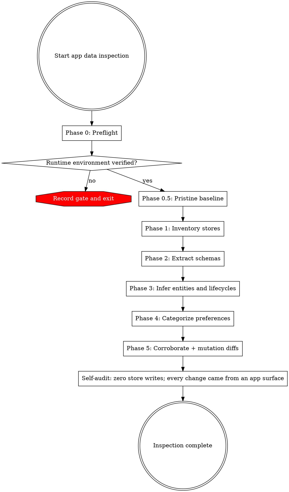

# App Data Inspection Methodology

The app's own data store is its most honest self-description. Schemas, lifecycle enums, foreign keys, and preference keys encode behavior the UI only hints at: what entities exist, what states they pass through, what relationships bind them, what the app remembers between launches. This skill defines how to read all of that. Reads stay strictly non-mutating — not for privacy but for fidelity: the app must remain the sole writer, or the deltas you came to measure mean nothing. The app is now running and being driven through its own surfaces, so the store is a moving target, not a static file on disk.

## When This Mode Applies

App data inspection is one of four macOS evidence modes that run against a disposable install of the target:

| Skill | Role | Observes |
|-------|------|----------|
| `macos-bundle-analysis` | `bundle-inspector` | The app bundle: signing, entitlements, resources |
| `macos-runtime-observation` | `applescript-explorer` | The running app via its scripting interface |
| `macos-visual-exploration` | `ui-observer` | The running app's visible UI |
| `app-data-inspection` (this skill) | `data-inspector` | The app's persistent data stores on disk |

This mode activates when the orchestrator schedules the `data-inspector` role against a macOS target. It consumes inputs from `macos-bundle-analysis`:

- `workspace/raw/macos/bundle/signing.md` — the entitlements list the **group container ID**, your primary pointer to where data lives
- `workspace/raw/macos/bundle/capability-inventory.md` — hints about what stores to expect (iCloud sync, Core Data, custom formats)
- correlate every store-level claim against the in-environment `macos-bundle` analysis when one exists — the VM re-runs bundle analysis whenever the executed binary differs from the host bundle (`workspace/raw/macos/bundle/environment-diff.md`), and that re-run describes the binary actually producing these stores

The signature verdict in `workspace/raw/macos/bundle/signing.md` gates the run only under `host-direct` — Block E below defines exactly when. Inside a disposable VM a bad signature costs a VM, not the user, so it is recorded as data rather than treated as a gate. The generic location strategy in Phase 0 applies ONLY to locating data stores when bundle-derived location hints are absent — it never substitutes for the signature verdict where one is required.

## The Runtime Environment

This skill never runs against the user's own account or the user's own data. It runs inside a disposable runtime environment chosen at dispatch time and recorded in `workspace/environment/runtime-environment.md`: a throwaway macOS VM, or a throwaway user account on this Mac. The environment is pristine -- a fresh install of the target, a fresh account, no real data in it -- so analysis is READ+WRITE. You may create, edit, and delete through the app's own surfaces, run destructive flows, and manufacture states that do not occur naturally. Nothing you break belongs to anyone.

**Environment verification.** Read `workspace/environment/runtime-environment.md`. It must exist, and its `**Environment:**` line must read `vm-tart`, `vm-lume`, or `host-direct`. A value of `none`, a missing line, or a missing file is a hard environmental gate: record it in `preflight-data.md` and exit without touching the target. You VERIFY this artifact; you NEVER create or edit it. When `**Environment:**` is `host-direct`, `workspace/raw/macos/bundle/signing.md` must additionally record a PASS verdict -- record the gate and exit otherwise. For `vm-tart` and `vm-lume`, copy the artifact's `**Signature verdict:**` into your preflight table as data; it does not gate the run, because a bad signature inside a disposable VM costs a VM.

**host-direct caveat.** A VM is pristine by construction. A `host-direct` account is pristine only because it was freshly created -- the `**Disposable-account affirmation:**` line in the artifact is the user's statement that the account is empty and expendable. Artifacts produced under `host-direct` reflect whatever is actually in that account. Say so in the preflight file.

## Running Commands in the Environment

Every command in this skill runs inside the environment, through the helpers defined by the `macos-vm-execution` skill. Never write a bare `ssh`, and never call `sqlite3`, `defaults`, or `plutil` against the target directly.

| Helper | Use for |
|--------|---------|
| `gf_exec '<cmd>'` | Non-GUI work: `sqlite3`, `defaults read`, `plutil`, `ls`, file plumbing |
| `gf_gui '<cmd>'` | Anything that touches the window server (used here only to drive an app-surface mutation for a diff) |
| `gf_windows` | Enumerate on-screen windows: TSV with the header row `id pid layer alpha owner title x y w h`, one row per window, FRONT-TO-BACK. It runs `$GF_GUEST_WORKSPACE/tools/gf-windowlist` through `gf_gui`, for the session-attachment reason below. This skill does not enumerate windows; the row is here so the convention reads identically in all three runtime skills |
| `gf_get <guest-path> <host-path>` | Pull evidence back to `workspace/` |
| `gf_put <host-path> <guest-path>` | Push a script or fixture in |

`gf_gui` exists because of one failure mode: when the SSH session is not attached to the guest's Aqua session, a GUI command returns an empty AX tree, an empty window list, or a wallpaper-only screenshot -- with exit status 0. It looks exactly like a finding and is not one. Whether a bare call is attached is image- and configuration-dependent (on a base image that auto-logs in the same user you SSH as, bare calls have been observed to work), and that is precisely what makes the failure dangerous: it is silent and it travels. Routing every GUI command through `gf_gui` is free when attachment is already implicit and load-bearing when it is not. `gf_gui` wraps the command in `launchctl asuser` against the auto-login session so it lands in the real GUI session. On `host-direct` both helpers are pass-throughs. This matters here even though this skill only reaches for `gf_gui` in Phase 5: an app-surface mutation sent over bare SSH would drive a detached session, change nothing, and hand you an empty before/after diff that reads as a false "this column does not move" finding.

`GF_ENV`, `GF_VM`, `GF_SSH`, and `GF_GUEST_WORKSPACE` arrive in your dispatch prompt. Write output under `$GF_GUEST_WORKSPACE/...` and `gf_get` it to the matching path under `workspace/raw/macos/...` before you finish. The Layer 1 gate counts files on the host: evidence still sitting in the guest does not exist.

## Store-Read Discipline

The environment is disposable and the data in it is synthetic, so these rules are about FIDELITY, not privacy. You read the store and never write it for one reason: the app must remain the only writer, or the deltas you came to measure are corrupted at their source. These are hard rules with mechanisms, not intentions.

1. **Every SQLite open uses the read-only URI form:** `sqlite3 "file:$DB?mode=ro"` — never a bare path, never `mode=rw`. Only SELECT, PRAGMA, `.tables`, and `.schema` statements. Never `PRAGMA wal_checkpoint` (it writes to the main database file), never `VACUUM`, never `.recover`, never ATTACH to a writable path. The `mode=ro` URI makes an accidental write fail at the SQLite layer instead of relying on discipline alone — and an accidental write here would silently corrupt the very deltas the mutation diffs exist to measure.
2. **Set `.timeout 200` on every session.** If SQLITE_BUSY persists despite the timeout, do not retry aggressively and do not checkpoint. Fall back to the newest snapshot under the sibling `Backups/` directory — nothing writes there — and note the snapshot's staleness in every claim derived from it.
3. **Preference access is `defaults read` only.** Never write a preference from the shell. To CHANGE a preference, change it inside the app's Settings UI and read the result back — the app stays the writer (Phase 4.1).
4. **Never write anything INTO the app's containers** — no create, modify, or delete under them. Copying stores OUT is fine and often right: the data is synthetic, so copying a whole database into `workspace/raw/macos/app-data/` is allowed and encouraged. Copy by reading the files out, never by writing into the container.
5. **WAL warning.** The app is running and mutating while you read. A copy of `main.sqlite` without its `-wal` and `-shm` sidecars loses every un-checkpointed write sitting in the WAL. Copy all three files together, or quit the app through its own surface first so the WAL is checkpointed.

## Inspection Phases



### Phase 0: Preflight

**Output:** `workspace/raw/macos/app-data/preflight-data.md`

Record these results before anything else:

1. **Environment.** Verify `workspace/environment/runtime-environment.md` per the Runtime Environment section: it must exist and `**Environment:**` must read `vm-tart`, `vm-lume`, or `host-direct`. A value of `none`, a missing line, or a missing file ⇒ record the gate and exit. You VERIFY this artifact; you NEVER create or edit it.
2. **Signature.** Read `workspace/raw/macos/bundle/signing.md`. Under `host-direct` a recorded PASS verdict is required — FAIL, UNKNOWN, or a missing file ⇒ record the gate and exit. Under `vm-tart`/`vm-lume` copy the `**Signature verdict:**` into your preflight table as data; it does not gate the run, because a bad signature inside a disposable VM costs a VM. Never self-verify as a substitute — the generic location strategy below covers only store location, never the signature verdict.
3. **Store locations.** Locate every candidate data store.

Location strategy — every value comes from the bundle inventory, every command through `gf_exec`:

```bash
# Primary: group container from the entitlements (see bundle signing.md)
gf_exec 'ls -d ~/Library/Group\ Containers/'"$GROUP_ID"'*/ 2>/dev/null'
# Glob for SQLite stores beneath it — vendors nest them under per-install random
# suffixes and renamed directories, so never hardcode intermediate path segments:
DB=$(gf_exec 'find ~/Library/Group\ Containers/'"$GROUP_ID"'* -name "*.sqlite" 2>/dev/null' | head -1)
# Also check (each via gf_exec):
#   ~/Library/Containers/$BUNDLE_ID/Data/Library/Application Support/
#   ~/Library/Application Support/<app name>/
# Multiple candidate DBs (old migrations, "Database Moved" readmes): pick the one with the
# newest mtime AND verify with a row-count sanity check; record the rejects.
```

On permission denial (EPERM reading `Group Containers/`), print the remediation path — "System Settings > Privacy & Security > Full Disk Access > enable <parent terminal app>" — and record the gate in `preflight-data.md`. In a VM this denial is an image defect: a provisioned base is supposed to carry the Full Disk Access grant (see `macos-vm-execution` §9), so an FDA denial inside the guest means the base was built wrong, not that the user must click. Record it as a provisioning gate. A recorded gate is a deliverable, not a failure.

### Phase 0.5: The Pristine Baseline

**Output:** `workspace/raw/macos/app-data/baseline/`

Capture the store BEFORE any sibling seeds a corpus. This baseline is the zero against which every later diff is measured; skip it and no mutation diff can be trusted.

- **Schema at zero.** Full `.schema` plus a per-table `SELECT count(*)` with the app freshly installed and never driven. A non-empty table in a fresh install is shipping seed data — note every such table and its starting count.
- **A complete store copy.** `gf_get` every store file — `main.sqlite`, its `-wal` and `-shm` sidecars, and every plist — into `baseline/`. Copy all three SQLite files together (Store-Read rule 5).
- **Factory defaults.** `gf_exec 'defaults read "$BUNDLE_ID"'` captured before any Settings-UI change, saved as the factory-default reference for Phase 4.1.

Every later schema, count, and preference delta is stated relative to this baseline.

### Phase 1: Store Inventory

**Output:** DBQ records in `dbq-log.md`; inventory table in `preflight-data.md`.

Enumerate every store found (each read through `gf_exec`), whether or not you will analyze it:

- SQLite files — `file` output plus a header check (`SQLite format 3` magic)
- Property lists — binary and XML
- JSON files
- LevelDB directories (`CURRENT`, `MANIFEST-*`, `.ldb` files)
- Core Data stores — `.sqlite` with Z-prefixed tables; note the `ZENTITY`-style table naming and the `Z_PRIMARYKEY` metadata table conventions
- Binary caches and proprietary formats — recorded, not decoded

Produce a table of stores with size, mtime, format, and whether each was chosen for analysis. Every store gets a row; every rejection gets a reason.

### Phase 2: Schema Extraction

**Output:** `workspace/raw/macos/app-data/schema.md`

For each chosen SQLite store, record verbatim:

- `.tables` — the full table list
- `.schema` — complete DDL: tables, columns with declared types, indexes, triggers, foreign keys, views
- Per-table row counts (`SELECT count(*)`)
- `PRAGMA user_version` and `PRAGMA schema_version` — record these explicitly as staleness anchors for incremental analysis: a later run compares them to detect schema drift without re-extracting everything

**Schema caveat:** these schemas are undocumented and migration-scarred. Expect wide tables (dozens of columns), polymorphic `type` columns (one table serving several entity kinds behind small integer codes), `status` enums with non-contiguous values, column-name prefix artifacts left by past migrations, and MIXED date encodings — REAL Unix epochs alongside INTEGER packed-bitfield dates in the same table. Do NOT assume epoch on integer date columns. Record structure verbatim at `confidence=confirmed`; every semantic interpretation starts at `confidence=assumed`.

### Phase 3: Entity and Lifecycle Inference

**Output:** `workspace/raw/macos/app-data/entities.md`

- Infer entities from tables, foreign keys, and junction tables.
- Enumerate the status/type code VALUES actually observed: `SELECT DISTINCT` with counts. Enumerate the observed enum values in full — every row is yours, so nothing is elided.
- Record relationship cardinalities (one-to-many via FK, many-to-many via junction table).
- Infer lifecycles from date/state column combinations — e.g., `stopDate` set together with `status=3` suggests completion semantics — at `confidence=assumed` until corroborated.
- Opaque BLOBs are recorded as opaque. Never decode a BLOB by guessing at its format; flag it for runtime corroboration by the scripting or UI modes.

### Phase 4: Preferences

**Output:** `workspace/raw/macos/app-data/defaults.md`

Run `gf_exec 'defaults read "$BUNDLE_ID"'` and record the full dump. Values are synthetic, so nothing is redacted — but note the environment on the artifact (under `host-direct` the dump reflects the throwaway account). Then categorize every key in a table:

| Category | Meaning | Examples |
|----------|---------|----------|
| User-configurable | Appears in the Settings UI or in documented tweaks | Appearance, badge behavior, start-of-week |
| Internal state | The app talking to itself | Window frames, one-shot "has shown welcome" flags, migration markers |
| Apple/framework keys | `NS*`/`Apple*` prefixes | Note their presence, then ignore them |

A key's purpose is `assumed` unless corroborated — the strongest corroboration is the Settings-UI delta below, or the visual skill's Settings-window captures showing the corresponding control. Cross-reference `ui-observer` output where it exists.

#### 4.1 Preference Deltas

The precise key a control writes is recoverable by delta. After each single change in the app's Settings UI, re-run `defaults read "$BUNDLE_ID"` and diff against the pristine baseline (Phase 0.5) or the immediately prior read. One control moved at a time isolates exactly which key changed and how the value encodes — taking a key's purpose from `assumed` to `confirmed` in a single step, without needing the visual skill's Settings capture. Record each as a DBQ pair (before-read, after-read) naming the control you toggled.

### Phase 5: Corroboration and Mutation Diffs

**Output:** updates to `entities.md`; diff artifacts in `workspace/raw/macos/app-data/mutation-diffs/`.

**Cross-check against scripting.** Compare entities and enum values against the `applescript-explorer`'s scripting dumps. App-data is its OWN evidence group: a database read and a live scripting query of the same entity ARE independent sources, so agreement escalates the claim to `confidence=confirmed`.

**Agent-driven mutation diffs.** This is the highest-value thing the skill does, and the read+write environment is what makes it possible. Bracket a single app-surface mutation with two reads and diff them. The mutation must go through an app surface — you may drive it yourself with `gf_gui` (a menu click, a keystroke into the running app), or it may come from `applescript-explorer` or `ui-observer` acting on the same environment — but it NEVER comes from writing the store directly, and it always earns a `dbq-log.md` note naming the surface and the action.

```bash
# Baseline: full rows of the entity table under study ($TABLE, from the Phase 2
# schema extraction) — synthetic data, nothing off-limits
gf_exec 'sqlite3 "file:$DB?mode=ro" "SELECT * FROM $TABLE ORDER BY rowid"' > .../mutation-diffs/state-before.txt
# Perform ONE app-surface mutation (drive it via gf_gui, or hand off to a sibling) — logged as a DBQ note
gf_gui 'osascript -e "<one app-surface action>"'
# After
gf_exec 'sqlite3 "file:$DB?mode=ro" "SELECT * FROM $TABLE ORDER BY rowid"' > .../mutation-diffs/state-after.txt
diff state-before.txt state-after.txt > .../mutation-diffs/state-diff.txt   # decodes column semantics: assumed -> confirmed
# Probe-scoped view of just the rows your corpus created:
gf_exec 'sqlite3 "file:$DB?mode=ro" "SELECT * FROM $TABLE WHERE title LIKE '\''GREENFIELD-PROBE-%'\''"'
```

One clean diff converts a column-semantics claim from `assumed` to `confirmed`: the mutation is the controlled input, the diff is the observed output. Three things keep the diff honest:

- **Null-diff noise floor.** Background sync, autosave, and indexing write on their own. Run two reads with NO mutation between them first and record whatever moves — that churn is the noise floor every real diff is read against.
- **WAL timing.** A just-made change may still sit in the `-wal` sidecar, unread by a fresh `mode=ro` snapshot. Wait and re-read before concluding a mutation left no trace.
- **Delete semantics.** Diff delete-to-trash and delete-from-trash as SEPARATE mutations — they touch different columns (a trashed flag versus row removal), and collapsing them hides the distinction.

**Backup cadence.** Also diff the live database against the newest `Backups/` snapshot. The delta characterizes backup cadence and staleness — that is behavioral data about the app, worth a cited claim of its own.

## DBQ Record Format

Every query or read operation gets a record ID: `DBQ-NNN` — three-digit zero-padded, sequential, immutable. One ID per operation, logged in `dbq-log.md`:

```markdown
## DBQ-014

**Command:** sqlite3 "file:$DB?mode=ro" "SELECT type, count(*) FROM ZTASK GROUP BY type"
**Target:** main.sqlite (group container)
**Result:** 3 distinct type values: 0 (n=412), 1 (n=23), 2 (n=57)
```

If a record is invalidated (wrong database, stale snapshot), annotate it — do not renumber and do not reuse the ID.

## Provenance

All claims from this mode use `source=app-data-observation` with `agent=data-inspector`, citing DBQ records:

```markdown
- Tasks are stored in a single polymorphic table; the `type` column discriminates to-dos, projects, and headings
  <!-- cite: source=app-data-observation, ref=workspace/raw/macos/app-data/dbq-log.md#DBQ-014, confidence=assumed, agent=data-inspector -->
```

**Quote whatever you need — it is all synthetic.** A `GREENFIELD-PROBE-AS-007` row appearing verbatim in a diff is the whole point of the diff, not a leak. The one caveat: under `host-direct`, artifacts reflect the throwaway account the session runs in, so record the environment on every artifact so a reader knows what the values are.

### Confidence Calibration

| Claim Kind | Confidence | Why |
|------------|-----------|-----|
| Schema structure read verbatim (DDL, row counts, PRAGMA versions) | `confirmed` | Reproducible direct observation |
| Column/key SEMANTICS (what a code value means, what a date column encodes) | `assumed` | Interpretation, until corroborated by a scripting cross-check from `applescript-explorer` or an app-surface mutation diff (Phase 5) |
| Synthesis across observations (lifecycle models, entity relationships as behavior) | `inferred` | Reasoning over multiple observations |

**Evidence-group note:** app-data is its own evidence group. A DB read plus a live scripting query of the same entity are independent sources ⇒ `confirmed`. Two SELECT queries against the same database are not.

## Output Structure

```
workspace/raw/macos/app-data/
├── preflight-data.md      # Environment + signature check, store locations, gates
├── baseline/              # Pristine schema, zero-state row counts, factory defaults, full store copy
├── schema.md              # Verbatim DDL, row counts, PRAGMA versions per store
├── entities.md            # Inferred entities, enum values with counts, cardinalities, lifecycles
├── defaults.md            # Categorized preference dump (environment noted)
├── dbq-log.md             # Sequential DBQ-NNN records: command, target, result summary
└── mutation-diffs/        # Before/after snapshots and diffs around app-surface mutations, backup-cadence diffs
```

Everything here is RAW. Nothing from this directory reaches `workspace/output/` or `workspace/public/` without sanitization.

## Failure Modes and Degradation

Every failure mode produces a deliverable. Never discard a blocked path — document it.

| Failure | Degradation Path |
|---------|-----------------|
| Environment unreachable | The environment never became reachable, or its artifact reads `none`/missing ⇒ record the gate in `preflight-data.md` and exit; the pipeline continues with static modes |
| Store does not exist yet | A pristine install may not create the store until first launch or first save. Record the empty state as the baseline, ask a sibling to launch and seed a corpus, then re-run Phase 1 |
| Full Disk Access denial in the guest | This is an image defect, not a user prompt — a provisioned base should carry the FDA grant (`macos-vm-execution` §9). Record it as a provisioning gate in `preflight-data.md`; continue with `defaults read` only if the preference domain is still readable |
| SQLITE_BUSY persists past `.timeout 200` | Read the newest `Backups/` snapshot instead; attach a staleness note to every claim derived from it |
| No SQLite store (plist/proprietary only) | Plist analysis via `plutil -p`; proprietary formats recorded as opaque with `file`/`strings` surface only |
| Encrypted store | Record the encryption as a behavioral finding (the app encrypts at rest); stop — never attempt to decrypt |
| Multiple ambiguous databases | Analyze the newest (mtime + row-count sanity check); record the others as rejects with reasons |
| Diff empty after a mutation | Check WAL timing (the write may still be in `-wal`) and that the mutation actually landed; once both are cleared, an empty diff is itself a finding — the column you expected to move did not |
| Diff full of churn | Subtract the null-diff noise floor and narrow to the columns that actually moved; if the signal is swamped, roll back and re-run with a tighter mutation |
| Rollback discarded evidence un-retrieved | `gf_get` every diff artifact BEFORE any `gf_rollback` — rollback destroys the guest filesystem and anything not pulled is gone |

## Store Discipline Rules

1. Every SQLite open uses `"file:$DB?mode=ro"`; SELECT/PRAGMA/`.tables`/`.schema` only; never `wal_checkpoint`, `VACUUM`, `.recover`, or ATTACH to a writable path.
2. `.timeout 200`; on persistent SQLITE_BUSY, fall back to `Backups/` snapshots and note staleness.
3. `defaults read` for inspection only; change a preference exclusively through the app's Settings UI, never from the shell.
4. Never write anything INTO the app's containers; copying stores OUT into the workspace is fine and encouraged — the data is synthetic.
5. Respect the WAL warning: the app is running as you read, so copy `main.sqlite` together with its `-wal` and `-shm` sidecars, or quit the app through its own surface first.
6. You MAY drive the app through its own surfaces via `gf_gui` to produce a diff, but you NEVER become the store's writer — every observed change goes through an app surface, never a direct write.
7. Self-audit before finishing: re-read every artifact you wrote and assert zero store writes, and that every observed change traces to a named app-surface action.

## Definition of Done

- [ ] `preflight-data.md` records environment verification, signature result (required only under `host-direct`), and store-location results (including any gates)
- [ ] `baseline/` holds the pristine schema, zero-state row counts, factory defaults, and a full copy of every store file
- [ ] Every discovered store is inventoried — analyzed, or rejected with a reason
- [ ] `schema.md` is complete: verbatim DDL, per-table row counts, `PRAGMA user_version` and `schema_version`
- [ ] `entities.md` covers lifecycle enums (full observed values with counts) and relationship cardinalities
- [ ] `defaults.md` is categorized (user-configurable / internal state / framework keys) with at least one key decoded by a Settings-UI delta
- [ ] At least one column-semantics claim taken `assumed → confirmed` by a bracketed mutation diff, with the noise floor recorded
- [ ] At least one cross-check against `applescript-explorer` scripting output where both exist
- [ ] `dbq-log.md` is sequential and complete — every read operation has a DBQ record
- [ ] Self-audit line present: zero store writes, and every observed change traced to a named app-surface action
- [ ] Every artifact `gf_get`'d back to the host (the Layer 1 gate counts files on the host)
- [ ] Gaps section: what inspection could not determine, and which mode fills each gap
