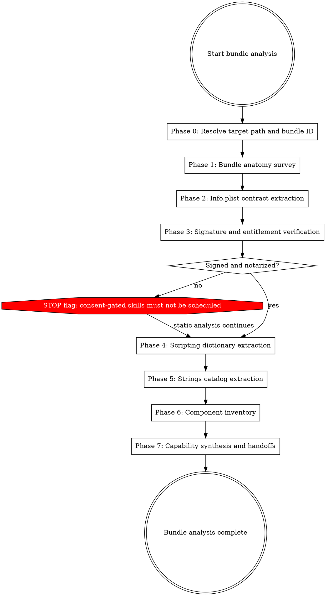

# macOS Bundle Analysis Methodology

Extract behavioral intelligence from a macOS application bundle without ever launching it. A `.app` bundle is a directory of vendor-shipped declarations — Info.plist contracts, entitlements, scripting dictionaries, strings catalogs — and most of it is machine-readable ground truth that requires zero permissions to read.

## When This Mode Applies

macOS bundle analysis activates when:
- The discovery inventory identifies a `.app` bundle at the target path (any path containing `Contents/Info.plist`)
- A bundle identifier is resolved to an installed app via `mdfind "kMDItemCFBundleIdentifier == '$BUNDLE_ID'"`
- Another mode discovers an embedded `.app` bundle during analysis

This mode requires **zero permissions** and **never launches the target**. It runs BEFORE any consent gate; its outputs are the scheduling input for the consent-gated siblings (`macos-runtime-observation`, `macos-visual-exploration`, `app-data-inspection`). All raw output goes to `workspace/raw/macos/bundle/`; the only exceptions are three contract summaries in `workspace/public/contracts/` (machine-readable vendor declarations, not proprietary expression).

## Role in the macOS Skill Family

| Skill | Role | Consent Gate | Consumes From This Skill |
|-------|------|-------------|--------------------------|
| `macos-bundle-analysis` (this skill) | `bundle-inspector` | None — static, read-only | — |
| `macos-runtime-observation` | `applescript-explorer` | Yes | READ/MUTATING classification, capability inventory, signature verdict |
| `macos-visual-exploration` | `ui-observer` | Yes | READ/MUTATING classification, capability inventory, signature verdict |
| `app-data-inspection` | `data-inspector` | Yes | Container and group container IDs from entitlements, signature verdict |

The signature verdict (PASS/FAIL in `signing.md`) is a **hard precondition** for all three consent-gated skills. FAIL means they are not scheduled, full stop; static analysis continues.

## The READ vs MUTATING Classification (Defined Here, Consumed by Siblings)

This skill DEFINES the command classification that `macos-runtime-observation` and `macos-visual-exploration` consume. Every sdef command gets exactly one class:

| Class | Criteria |
|-------|----------|
| **MUTATING** | Verb is `make`, `delete`, `move`, `duplicate`, `save`, or `set` on app objects, or any app-specific imperative (`empty trash`, `log completed now`, ...) |
| **READ** | `get`, `count`, `exists`, and properties-of retrieval |
| **MUTATING** (default) | **Any command that is unknown or ambiguous.** When in doubt, classify MUTATING. |

The default matters: a misclassified READ that mutates user data is unrecoverable; a misclassified MUTATING that only reads costs one round of consent. Err toward MUTATING.

## Analysis Phases



### Phase 0: Target Resolution

Resolve the bundle path and identifier before anything else:

```bash
# If given only a bundle ID, resolve the installed copy
APP=$(mdfind "kMDItemCFBundleIdentifier == '$BUNDLE_ID'" | head -1)
test -f "$APP/Contents/Info.plist" || echo "NOT A BUNDLE"
# Canonical bundle ID from the bundle itself (never trust the input string)
BUNDLE_ID=$(plutil -extract CFBundleIdentifier raw "$APP/Contents/Info.plist")
```

### Phase 1: Bundle Anatomy → `survey.md`

Map the bundle's physical structure:

```bash
find "$APP/Contents" -maxdepth 2 -type d | sort \
  > workspace/raw/macos/bundle/survey-dirs.txt
du -sh "$APP/Contents/MacOS" "$APP/Contents/Frameworks" \
       "$APP/Contents/Resources" "$APP/Contents/PlugIns" 2>/dev/null
file "$APP/Contents/MacOS/"*
lipo -archs "$APP/Contents/MacOS/$(plutil -extract CFBundleExecutable raw "$APP/Contents/Info.plist")"
ls -d "$APP/Contents/_MASReceipt" 2>/dev/null   # present => Mac App Store distribution
```

Record in `survey.md`: directory tree with sizes, executable format and architectures, `_MASReceipt` presence (`inferred` evidence of Mac App Store distribution), presence/absence of Frameworks/, PlugIns/, XPCServices/, Library/LoginItems/, `Assets.car`, and the `.lproj` directory count (localization breadth).

### Phase 2: Info.plist Contracts → `info-plist.md` + `workspace/public/contracts/macos-plist-contracts.md`

Info.plist is a vendor-shipped machine-readable contract. Save the full dump, then extract targeted tables:

```bash
plutil -p "$APP/Contents/Info.plist" > workspace/raw/macos/bundle/info-plist-full.txt
for KEY in CFBundleURLTypes CFBundleDocumentTypes UTExportedTypeDeclarations \
           UTImportedTypeDeclarations NSServices; do
  plutil -extract "$KEY" json -o - "$APP/Contents/Info.plist" 2>/dev/null
done
```

Extract and tabulate these contract surfaces:

| Key | What It Declares |
|-----|-----------------|
| `CFBundleURLTypes` | URL schemes handled (scheme, role, name). Flag: "declared contract — analysis agents never open scheme URLs; corroborate from official docs or user-invoked observation only" |
| `CFBundleDocumentTypes` | Document types opened/edited (extensions, UTIs, role) |
| `UTExportedTypeDeclarations` / `UTImportedTypeDeclarations` | Custom UTIs defined or consumed |
| `NSServices` | System-wide Services menu entries |
| `NS*UsageDescription` (all) | Behavioral claims about what the app touches: calendars, contacts, camera, Apple Events, ... |
| `NSAppleScriptEnabled` / `OSAScriptingDefinition` | Whether a scripting dictionary exists and where |
| `LSMinimumSystemVersion` | Minimum macOS version |
| `CFBundleShortVersionString` / `CFBundleVersion` | Version under analysis (pin every claim to it) |
| `SUFeedURL` | Sparkle appcast URL — implies auto-update behavior |

All of these are `source=machine-readable-contract`, `confidence=confirmed` — the vendor shipped the declaration; there is nothing to interpret. The public contract summary at `workspace/public/contracts/macos-plist-contracts.md` carries the same tables (declarations only, no proprietary expression).

### Phase 3: Signature and Entitlements → `signing.md` + `workspace/public/contracts/macos-entitlements.md`

```bash
codesign -dvvv "$APP" > workspace/raw/macos/bundle/codesign-info.txt 2>&1
codesign -d --entitlements :- "$APP" > workspace/raw/macos/bundle/entitlements.plist 2>/dev/null
codesign --verify --deep --strict "$APP" 2>&1
spctl -a -vv "$APP" 2>&1        # Gatekeeper assessment: notarized / Mac App Store / rejected
```

`signing.md` records signing identity, team ID, hardened runtime flag, verification result, Gatekeeper source — and a **PASS/FAIL verdict on its own line, never omitted**. PASS requires `codesign --verify --deep --strict` success AND `spctl -a` acceptance. FAIL sets the STOP flag: consent-gated siblings are not scheduled, full stop. Static analysis continues regardless.

Read entitlements as behavioral claims (keys abbreviated; all under `com.apple.security.`):

| Entitlement | Behavioral Claim |
|-------------|-----------------|
| `app-sandbox` | App data lives in `~/Library/Containers/` (and group containers) |
| `application-groups` | **Group container IDs tell the `app-data-inspection` skill exactly where data lives** — list every ID and call out this handoff explicitly |
| `automation.apple-events` | The app scripts OTHER apps (check `scripting-targets` for which ones) |
| `network.client` / `network.server` | Outbound / inbound network behavior |
| `personal-information.*` | Access to calendars, contacts, location, photos |
| `files.*` | File access scope (user-selected, downloads, bookmarks) |
| `temporary-exception.*` | Sandbox escape hatches — often reveal legacy data paths and helper processes |

Entitlement contents are `source=machine-readable-contract`, `confidence=confirmed`. The contract summary goes to `workspace/public/contracts/macos-entitlements.md`.

### Phase 4: Scripting Dictionary → `sdef/dictionary.sdef` + `scripting-dictionary.md` + `workspace/public/contracts/macos-sdef.md`

```bash
mkdir -p workspace/raw/macos/bundle/sdef
sdef "$APP" > workspace/raw/macos/bundle/sdef/dictionary.sdef 2>/dev/null

# Parse with xmllint (fallback: grep over the XML if xmllint chokes)
SDEF=workspace/raw/macos/bundle/sdef/dictionary.sdef
xmllint --xpath '//suite/@name' "$SDEF"
xmllint --xpath "//suite[@name=\"$SUITE\"]/class/@name" "$SDEF"   # per-suite drill-down
xmllint --xpath '//command/@name' "$SDEF"
```

If `sdef` produces no output, record "no scripting API" explicitly (an absence is a finding) and skip to Phase 5.

For each suite, `scripting-dictionary.md` contains: a **class table** (name, plural, properties with type and r/rw access), a **command table** (name, parameters, direct parameter type), **elements/containment** (the object model tree), and **enumerations** (the app's controlled vocabularies).

**Apply the READ/MUTATING classification to EVERY command** using the rule defined at the top of this skill. The classification column is mandatory — a command table without it is incomplete output.

**Hunt hidden surface.** Search for `hidden="yes"` attributes and underscore-prefixed names:

```bash
grep -n 'hidden="yes"' workspace/raw/macos/bundle/sdef/dictionary.sdef
grep -o 'name="_[^"]*"' workspace/raw/macos/bundle/sdef/dictionary.sdef | sort -u
```

Worked example: Things 3 exposes `_private_experimental_ json` read-only properties that return entire objects as JSON — an undocumented bulk-export surface. Flag such finds as high-value, `confidence=inferred`, annotated "undocumented; verify at runtime".

The sdef XML content is `source=machine-readable-contract`, `confidence=confirmed` (the vendor shipped it). Hidden/experimental entries get `inferred` because their behavior — unlike their existence — is undeclared. The public summary goes to `workspace/public/contracts/macos-sdef.md`.

### Phase 5: Strings Catalog → `text-catalog.md` + `strings-catalog/*.json`

The `.lproj/*.strings` files are the app's **entire user-visible text catalog** — every alert, button label, error message, and empty state, in machine-parseable form. This is the single highest-value static source for "User-Visible Text" (implementer need #5 in the analysis-pipeline skill).

```bash
mkdir -p workspace/raw/macos/bundle/strings-catalog
find "$APP/Contents/Resources" -name "*.strings" -path "*en.lproj*" | while read -r F; do
  plutil -convert json -o - "$F" \
    > "workspace/raw/macos/bundle/strings-catalog/$(basename "$F" .strings).json"
done
# .loctable (merged localization tables) do not convert cleanly; dump readable form
find "$APP/Contents/Resources" -name "*.loctable" | while read -r F; do
  plutil -p "$F" > "workspace/raw/macos/bundle/strings-catalog/$(basename "$F").txt"
done
```

`plutil -convert json` handles binary-plist `.strings` files transparently. One `.json` per table under `strings-catalog/`.

Categorize in `text-catalog.md`:

| Category | What It Reveals |
|----------|----------------|
| Errors and alerts | Validation rules, failure modes, limits |
| Confirmation prompts | Destructive-action flows ("Are you sure you want to delete...") |
| Empty states | What the app shows with no data, onboarding nudges |
| Menu and command labels | The full action vocabulary |
| Onboarding text | First-run flow content |
| Notifications | User-facing notification and reminder text, badge/alert wording |
| Date/format templates | Formatting behavior, pluralization rules |

**Caveat:** a string proves the vocabulary exists, not that the behavior is reachable. "App can display this text" is `inferred`; behavior inferred from the text ("app confirms before deleting") is `assumed` until a runtime mode observes it.

Also mine the App Intents / Shortcuts surface:

```bash
find "$APP/Contents" -name "*.intentdefinition" -path "*Base.lproj*" | while read -r F; do
  plutil -p "$F" > "workspace/raw/macos/bundle/strings-catalog/$(basename "$F").txt"
done
```

Intent definitions declare the Shortcuts action surface: action names, parameters, and response templates.

### Phase 6: Component Inventory → `components.md`

```bash
ls "$APP/Contents/Frameworks" 2>/dev/null
ls "$APP/Contents/PlugIns" 2>/dev/null
ls "$APP/Contents/XPCServices" 2>/dev/null
ls "$APP/Contents/Library/LoginItems" 2>/dev/null
for EXT in "$APP/Contents/PlugIns/"*.appex; do
  plutil -extract NSExtension.NSExtensionPointIdentifier raw "$EXT/Contents/Info.plist" 2>/dev/null
done
EXEC=$(plutil -extract CFBundleExecutable raw "$APP/Contents/Info.plist")
otool -L "$APP/Contents/MacOS/$EXEC" | head -40
```

Record:
- **Frameworks list** with a one-line purpose guess per framework (purpose guesses are `assumed`)
- **Third-party detection** — `Sparkle.framework` implies auto-update via appcast; its absence plus `_MASReceipt` implies Mac App Store updates
- **PlugIns** — each `.appex` with its `NSExtensionPointIdentifier` (widget, share, intents, ...)
- **XPCServices and LoginItems** — helper processes and their bundle IDs
- **Linked frameworks** from `otool -L` as capability hints: `libsqlite3` (SQLite storage), `CloudKit` (sync), `WebKit` (embedded web views), `WidgetKit`, `EventKit`, ...

Do NOT analyze the executables themselves — disassembly, symbols, and deep strings work belong to the `binary-analysis` skill. This phase only inventories what exists and hands off (Phase 7).

### Phase 7: Capability Synthesis and Handoffs → `capability-inventory.md` + `binary-handoff.md`

Synthesize everything into a capability inventory. Record IDs are `CAP-NNN` (three-digit zero-padded, sequential, immutable — never renumber). CAP record format:

```markdown
### CAP-007: AppleScript read surface for task objects
**Evidence:** sdef class "to do" with 14 readable properties
**Ref:** workspace/raw/macos/bundle/scripting-dictionary.md:88
**Mutation class:** READ
**Verify via:** macos-runtime-observation (scripting-read scope)
<!-- cite: source=machine-readable-contract, ref=workspace/raw/macos/bundle/scripting-dictionary.md:88, confidence=confirmed, agent=bundle-inspector -->
```

Every CAP names the downstream mode that should verify it (`Verify via:`). **This table IS the dispatch input for the sibling skills** — the orchestrator schedules `macos-runtime-observation`, `macos-visual-exploration`, and `app-data-inspection` scopes directly from it. A capability without a `Verify via:` line is unfinished.

`binary-handoff.md` mirrors the binary-analysis handoff pattern (`workspace/raw/binary/source-handoff.md`): Mach-O paths (main executable plus each framework binary), architectures per binary, stripped status (`nm "$APP/Contents/MacOS/$EXEC" | head` — empty means stripped), and which strings categories Phase 5 already covered, so binary agents do not duplicate the `.strings` extraction.

## Failure Modes and Degradation

| Failure | Response |
|---------|----------|
| `sdef` returns nothing | Record "no scripting API" as an explicit finding in `scripting-dictionary.md`; `macos-runtime-observation` skips its scripting phases |
| Strings shipped only as `.loctable` | Dump with `plutil -p`; if unparseable, note the gap in `text-catalog.md` rather than leaving the section silently empty |
| Unsigned or failed verification | Write FAIL verdict to `signing.md`, set the STOP flag for consent-gated skills; static analysis continues |
| `xmllint` chokes on sdef quirks (nonstandard entities, DTD fetch) | Fall back to `grep`/`grep -o` over the raw XML; note the degraded parse in output |
| Bundle not installed in `/Applications` | Analyze in place; note that runtime modes need an installed, launchable copy |

## Provenance Rules

### Source Types

| Source | Use For | Origin | Confidence |
|--------|---------|--------|------------|
| `machine-readable-contract` | Vendor-shipped machine-readable declarations: Info.plist contract keys, sdef content, entitlements | PUBLIC-safe contract | `confirmed` by definition |
| `bundle-analysis` | Bundle resources read verbatim: `.strings` catalogs, framework/resource inventories | RAW | `inferred` for structural facts from single authoritative tool output that are NOT contract declarations |
| `bundle-analysis` | Interpretive claims: framework purpose guesses, behavior inferred from strings | RAW | `assumed` |

### Example Citations

```markdown
- The app registers the `things` URL scheme with role Viewer
  <!-- cite: source=machine-readable-contract, ref=Contents/Info.plist, confidence=confirmed, agent=bundle-inspector -->

- The app displays a confirmation prompt before emptying the trash
  <!-- cite: source=bundle-analysis, ref=workspace/raw/macos/bundle/strings-catalog/Alerts.json:12, confidence=assumed, agent=bundle-inspector -->

- The main executable links libsqlite3, indicating SQLite-backed storage
  <!-- cite: source=bundle-analysis, ref=workspace/raw/macos/bundle/components.md:31, confidence=inferred, agent=bundle-inspector -->
```

`ref` is a bundle-relative or workspace-relative path, with `:line` where useful. `agent` is always `bundle-inspector`.

## Output Structure

```
workspace/raw/macos/bundle/
├── survey.md                    # Phase 1: bundle anatomy
├── info-plist.md                # Phase 2: contract tables
├── info-plist-full.txt          # Phase 2: full plutil -p dump
├── signing.md                   # Phase 3: signature + entitlements, PASS/FAIL verdict
├── entitlements.plist           # Phase 3: raw entitlements
├── sdef/
│   └── dictionary.sdef          # Phase 4: raw scripting dictionary XML
├── scripting-dictionary.md      # Phase 4: suites, classes, commands (READ/MUTATING)
├── text-catalog.md              # Phase 5: categorized user-visible text
├── strings-catalog/
│   ├── Localizable.json         # Phase 5: one JSON per .strings table
│   └── ...
├── components.md                # Phase 6: frameworks, plugins, XPC, linked libs
├── capability-inventory.md      # Phase 7: CAP-NNN records (dispatch input)
└── binary-handoff.md            # Phase 7: handoff to binary-analysis

workspace/public/contracts/
├── macos-plist-contracts.md     # Contract summary: URL schemes, doc types, UTIs, usage keys
├── macos-sdef.md                # Contract summary: scripting surface
└── macos-entitlements.md        # Contract summary: entitlement claims
```

## Safety Rules

1. **Never execute the target** or any binary in the bundle — no launching, no `open`, no running bundled helper tools. Analysis tools (`plutil`, `sdef`, `codesign`, `otool`) read the bundle; nothing in the bundle ever runs.
2. **Read-only file access** to the bundle. Never write into, modify, or re-sign it.
3. **Everything is RAW** except the three `workspace/public/contracts/` summaries (machine-readable vendor declarations only). Strings catalogs, inventories, and notes never leave `workspace/raw/`.
4. **Do not `defaults read` or touch app data** — containers, preferences, and databases are `app-data-inspection`'s job, behind its consent gate. This skill reports WHERE data lives (from entitlements), never what is in it.
5. **Record absences explicitly** — "no sdef", "no Sparkle", "no URL schemes" are findings. Silence is indistinguishable from not having looked.
6. **Cite as you go** — every behavioral claim gets an inline `<!-- cite: -->` immediately after the claim, per provenance-methodology.

## Definition of Done

- [ ] All 9 output files exist: `survey.md`, `info-plist.md`, `signing.md`, `sdef/dictionary.sdef`, `scripting-dictionary.md`, `text-catalog.md`, `components.md`, `capability-inventory.md`, `binary-handoff.md` (plus `strings-catalog/*.json` and the three `public/contracts/` summaries)
- [ ] Signature verdict (PASS/FAIL) recorded in `signing.md` — never omitted
- [ ] Every sdef command classified READ or MUTATING (unknown/ambiguous defaulted to MUTATING)
- [ ] Every CAP record has a `Verify via:` line and a citation
- [ ] Strings tables converted to JSON and categorized in `text-catalog.md`
- [ ] Hidden sdef entries (`hidden="yes"`, underscore-prefixed) flagged with `confidence=inferred` and "verify at runtime"
- [ ] Gaps section lists what static analysis could NOT determine and which mode fills each gap

## Pipeline Position

The cheapest, safest macOS mode; always runs first. No consent, no permissions, no running app — yet it produces the dispatch table (capability inventory), the safety classification (READ/MUTATING), and the go/no-go signal (signature verdict) that every other macOS mode depends on.
