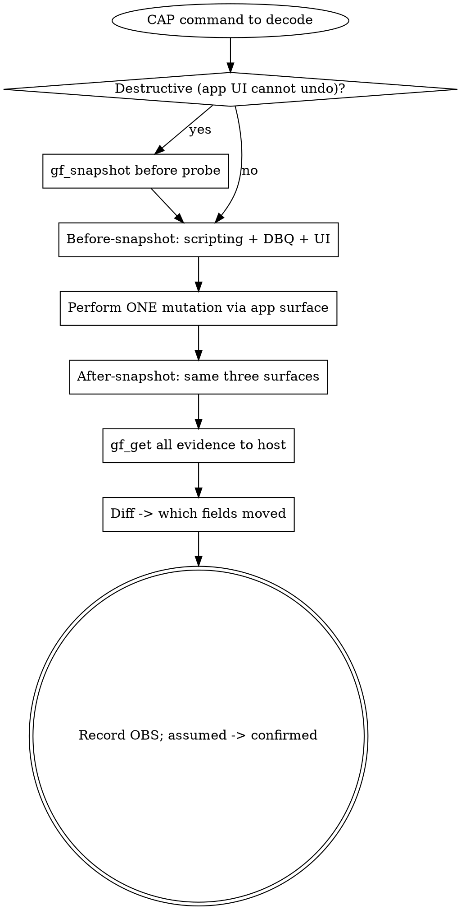

# macOS Runtime Observation

Runtime observation of a native macOS application through its scripting interface. The target runs in a disposable environment -- a Tart/Lume VM or a throwaway user account -- so this skill trades the container's hard isolation for the environment's disposability, and observation is full read+write.

## The Principle

**Run it. Change it. Record what changed.**

Everything the runtime-observation skill says about witnessed facts applies unchanged. Only the substrate differs: instead of `docker exec` into a sandbox, you send Apple Events to the app running inside a disposable environment.

## The Runtime Environment

This skill never runs against the user's own account or the user's own data. It runs inside a disposable runtime environment chosen at dispatch time and recorded in `workspace/environment/runtime-environment.md`: a throwaway macOS VM, or a throwaway user account on this Mac. The environment is pristine -- a fresh install of the target, a fresh account, no real data in it -- so analysis is READ+WRITE. You may create, edit, and delete through the app's own surfaces, run destructive flows, and manufacture states that do not occur naturally. Nothing you break belongs to anyone.

**Environment verification.** Read `workspace/environment/runtime-environment.md`. It must exist, and its `**Environment:**` line must read `vm-tart`, `vm-lume`, or `host-direct`. A value of `none`, a missing line, or a missing file is a hard environmental gate: record it in `preflight.md` and exit without touching the target. You VERIFY this artifact; you NEVER create or edit it. When `**Environment:**` is `host-direct`, `workspace/raw/macos/bundle/signing.md` must additionally record a PASS verdict -- record the gate and exit otherwise. For `vm-tart` and `vm-lume`, copy the artifact's `**Signature verdict:**` into your preflight table as data; it does not gate the run, because a bad signature inside a disposable VM costs a VM.

**host-direct caveat.** A VM is pristine by construction. A `host-direct` account is pristine only because it was freshly created -- the `**Disposable-account affirmation:**` line in the artifact is the user's statement that the account is empty and expendable. Artifacts produced under `host-direct` reflect whatever is actually in that account. Say so in the preflight file.

## Running Commands in the Environment

Every command in this skill runs inside the environment, through the helpers defined by the `macos-vm-execution` skill. Never write a bare `ssh`, and never call `osascript`, `screencapture`, or a System Events query directly.

| Helper | Use for |
|--------|---------|
| `gf_exec '<cmd>'` | Non-GUI work: sqlite, `ls`, `plutil`, `defaults read`, file plumbing |
| `gf_gui '<cmd>'` | Anything that touches the window server: AppleScript/JXA against the app, System Events, AX queries, `screencapture` |
| `gf_get <guest-path> <host-path>` | Pull evidence back to `workspace/` |
| `gf_put <host-path> <guest-path>` | Push a script or fixture in |

`gf_gui` exists because of one failure mode: over SSH, a GUI command runs outside the guest's Aqua session and returns an empty AX tree, an empty window list, or a wallpaper-only screenshot -- with exit status 0. It looks exactly like a finding and is not one. `gf_gui` wraps the command in `launchctl asuser` against the auto-login session so it lands in the real GUI session. On `host-direct` both helpers are pass-throughs.

`GF_ENV`, `GF_VM`, `GF_SSH`, and `GF_GUEST_WORKSPACE` arrive in your dispatch prompt. Write output under `$GF_GUEST_WORKSPACE/...` and `gf_get` it to the matching path under `workspace/raw/macos/...` before you finish. The Layer 1 gate counts files on the host: evidence still sitting in the guest does not exist.

## Relationship to the runtime-observation Skill

This skill inherits from runtime-observation the way runtime-observation inherits container mechanics from container-execution: by deference, not duplication. Unless overridden below, the parent skill governs the phase order (exploration -> nominal -> boundary -> error -> state), the `OBS-{NNN}` record format and ID rules, observation-to-claim conversion ("absence of observation is not evidence"), error-handling posture (every failure produces data), and contradiction flagging for `spec-verifier`.

Environment-specific overrides:

| Parent rule | Override |
|-------------|----------|
| All execution inside containers | Replaced by the disposable runtime environment; every command goes through gf_exec/gf_gui |
| Output to `workspace/raw/runtime/` | `workspace/raw/macos/runtime/` |
| `**Environment:** {container name, config state}` | `**Environment:** vm-tart <base-image> / host-direct <account>, <app> <version>, macOS <sw_vers>` |
| Agent names `cli-explorer` etc. | `agent=applescript-explorer` |
| Environment variation (locale, TERM) | Not applicable; the recorded session is not varied |
| CRUD in Phase 2 | Reads in Phase 2; create/update/delete in Phases 5-6, performed by you through the app's own surfaces |

Provenance is unchanged: cite `source=runtime-observation` -- this IS runtime observation, only the substrate differs. Confidence follows provenance-methodology: a reproducible direct query is `confirmed`; schema or column semantics are `assumed` until corroborated; synthesis across observations is `inferred`.

```markdown
<!-- cite: source=runtime-observation, ref=OBS-014, confidence=confirmed, agent=applescript-explorer -->
```

## Read+Write Conduct

Mutation is allowed. Exactly one prohibition survives, and it is about fidelity, not privacy:

**All state changes go through the app's own surfaces -- UI actions, scripting commands, URL schemes, Shortcuts. Never change state by writing the app's data store, preference plists, or container files directly.** A row you INSERT yourself is a row the app never wrote: no side effects, no triggers, no index or sync bookkeeping, no in-memory cache invalidation. The app's reaction to its own write is the thing you are here to observe; a direct write destroys the observation and poisons every claim downstream of it.

Keep the READ/MUTATING classification from `macos-bundle-analysis`, with its meaning changed. It no longer says what is forbidden; it says what is destructive, and destructive work gets sequenced and bracketed: baseline captured, evidence retrieved, snapshot requested (via the `macos-vm-execution` skill's `gf_snapshot`) if a rollback would be expensive. Unknown still classifies as MUTATING -- an unlabeled verb is one you schedule carefully, not one you skip.

Two skill-local rules refine this:

1. **`defaults write` is still out.** Change a preference through the app's Settings UI so the app observes its own change.
2. **Every mutation is logged before it is made** -- an OBS record carrying the exact command, a pre-state reference, and a post-state reference.

**Self-audit obligation.** Before declaring done, review your command history and assert that every state change went through an app surface and that no command wrote to a data store, preference plist, or container file.

## Inputs from macos-bundle-analysis

- **`workspace/raw/macos/bundle/signing.md`** -- the signature verdict. Under `host-direct` a PASS verdict is a hard precondition (a bad signature runs real code in a real account); under `vm-tart`/`vm-lume` the verdict is recorded data, not a gate.
- **`workspace/raw/macos/bundle/capability-inventory.md`** -- CAP-NNN records enumerating the scriptable surface. This is your target list: every class you probe traces to a CAP record, and every sdef command carries the READ/MUTATING classification (make/delete/move/duplicate/save/set = MUTATING; get/count/exists/properties-of = READ; unknown = MUTATING).
- **Correlate against the in-environment `macos-bundle` analysis when one exists.** The VM re-runs bundle and binary analysis when the executed binary differs from the host build; its CAP inventory, sdef classification, and `signing.md` describe the binary you are actually driving. Prefer it. When there is no in-environment re-run, the executed bytes match the host build and the host analysis applies.

## Output Directory Structure

```
workspace/raw/macos/runtime/
  preflight.md           # Every gate result (incl. the GUI-session check), launch policy, launched_by_pipeline flag
  observations/          # OBS-NNN records (parent skill format, Environment line)
  scripting/             # JXA/AppleScript structured dumps, one JSON file per sdef class
  mutations/             # corpus.md (seeded fixture log) + one before/after diff per mutation probe
```

Agents write these under `$GF_GUEST_WORKSPACE/...` in the guest, then `gf_get` each to the matching path under `workspace/raw/macos/runtime/` before finishing. All output is RAW, per the parent skill's Source Origin rules. Never write to `workspace/output/` or `workspace/public/`.

## Phase 0: Preflight

**Goal:** Verify every gate before touching the target. Gates are data -- record every result, passes included, in `workspace/raw/macos/runtime/preflight.md`.

**Gate 1 -- Environment artifact.** Per **The Runtime Environment** above: read `workspace/environment/runtime-environment.md`, confirm it exists, and confirm `**Environment:**` is `vm-tart`, `vm-lume`, or `host-direct`. A value of `none`, a missing line, or a missing file is a hard environmental gate: record it and exit. You verify this artifact; you never create it.

**Gate 2 -- Signature verdict.** Read `workspace/raw/macos/bundle/signing.md`. Under `host-direct`, anything other than PASS -- FAIL, UNKNOWN, file missing -- fails the run; record and exit. Under `vm-tart`/`vm-lume`, copy the verdict into the preflight table as data and continue regardless: a bad signature inside a disposable clone costs a clone.

**Gate 3 -- Environment reachable.**

```bash
gf_exec 'sw_vers -productVersion; id -un'
```

Empty output or an error means the environment never became reachable. Record the gate and skip the runtime phases (the VM lifecycle treats an unreachable environment as a skip, not a crash).

**Gate 4 -- App present.**

```bash
gf_exec 'ls -d /Applications/<App>.app'
```

A miss means the target was never provisioned into the environment. Record the gate and exit.

**Gate 5 -- GUI-session attachment.** This is the single most failure-prone mechanic in the macOS capability, so prove it before trusting any GUI output. Run the same probe BOTH ways:

```bash
gf_exec 'osascript -e '\''tell application "System Events" to count processes'\''   # expect empty / error
gf_gui  'osascript -e '\''tell application "System Events" to count processes'\''   # expect a plausible integer
```

The `gf_exec` form runs outside the Aqua session and should return empty or error; the `gf_gui` form should return a real process count. If BOTH come back empty, there is no window-server session to attach to -- a hard gate (see Failure Modes). A plausible count from `gf_gui` proves `launchctl asuser` reaches the real GUI session, which every later GUI probe depends on.

**Gate 6 -- Automation permission self-test.** TCC mediates Apple Events per (sender, target) pair. Test through `gf_gui` before assuming:

```bash
gf_gui 'osascript -e "tell application id \"$BUNDLE_ID\" to get name"' 2>&1
# -1743 => not permitted. In a VM this is a base-image TCC provisioning defect (§9 of macos-vm-execution),
#   NOT a user action -- report it as an environment defect, not a consent gap.
#   Under host-direct, remediation is System Settings > Privacy & Security > Automation.
# -1728 => the command likely ran outside the Aqua session; re-confirm gf_gui routing (Gate 5) FIRST,
#   then treat a genuine -1728 as cross-session invisibility.
```

Record the exact output either way. Never attempt to script around a TCC denial.

**Gate 7 -- App usable without sign-in.** Launch the app (Phase 1 launch policy) and read the front window / first-run state. If the app presents a trial login-wall or account-creation gate that blocks all functionality, it is a **zero-output source**: record the wall as a finding and stop -- there is nothing to observe behind it, and account creation is the user's call over VNC, not the agent's.

## Phase 1: Exploration

**Goal:** Discover the live scripting surface and establish the launch baseline.

**Launch policy.** Route every launch/liveness check through `gf_gui`. Check whether the app is already running:

```bash
# APP_PROCESS = the executable name from the bundle inventory (Contents/MacOS/<name>)
gf_exec "pgrep -x \"$APP_PROCESS\"" || gf_gui "osascript -e 'tell application \"System Events\" to exists process \"$APP_PROCESS\"'"
```

If not running, launch with `gf_gui 'open -b "$BUNDLE_ID"'` and wait-loop until the process exists (poll `pgrep -x` via `gf_exec`, bounded retries). Record `launched_by_pipeline: true|false` in preflight.md (in a VM record `launched_by_pipeline: n/a (environment discarded)`).

**First launch is the one-time first-run experience.** In a pristine environment the very first launch shows onboarding, welcome flows, and default-state windows that never recur. Record it as an observation, coordinate with `ui-observer` so the visual capture brackets the same first launch, and request a pre-first-launch snapshot (`gf_snapshot pristine`) so onboarding is replayable. The launch itself is an observation.

**Scripting surface probe.** Walk the CAP inventory's sdef class list and dump each top-level class as structured JSON -- one dump per class, written in-guest then pulled. JXA is preferred because it emits JSON directly:

```bash
gf_gui "osascript -l JavaScript -e '
  const app = Application(\"$APP_NAME\");   // CFBundleName from the bundle inventory
  JSON.stringify(app.tasks().map(t => ({ name: t.name(), id: t.id() })));   // <class> pluralized
' > \$GF_GUEST_WORKSPACE/scripting/<class>.json"
gf_get \$GF_GUEST_WORKSPACE/scripting/<class>.json workspace/raw/macos/runtime/scripting/<class>.json
```

Use the AppleScript variant (`tell application ... to get properties of ...`) where JXA's bridge is awkward for property records; capture the record text verbatim and note the dialect. The first invocation after connecting to an app occasionally returns an empty array -- retry once before recording a result (an observed flake, not app behavior).

**Shortcuts surface.** Record the app's Shortcuts exposure with `gf_exec 'shortcuts list'`. `shortcuts run` is now PERMITTED as one of the app's own surfaces, but classify every `shortcuts run` as MUTATING and sequence it in Phase 6. It is **VM-only** -- under `host-direct`, `shortcuts run` touches shared cross-account services and is recorded as not-exercised-in-this-environment. Record the un-exercised Shortcuts surface accordingly.

**Provenance:** Surface dumps are `confirmed`. Interpretations of what a class represents are `inferred` until Phase 2 exercises it.

## Phase 1.5: Seeding the Pristine Environment

**Goal:** The environment is empty, so there is nothing to read yet. Seed a fixture corpus through the app's own surfaces before nominal testing.

Create enough objects, through UI actions and scripting commands, to exercise every CAP class, every enum value, and every relationship the inventory names: at least one instance per class, objects that carry each documented property, and the relationships between them (a project with to-dos, a to-do with tags, a scheduled item, an item in each built-in list). Prefix every title `GREENFIELD-PROBE-AS-<NN>` so the corpus is greppable across sources -- `app-data-inspection` matches `GREENFIELD-PROBE-%` from the database side, and the shared prefix lets the two surfaces line up the same objects.

Log every seeded object to `workspace/raw/macos/runtime/mutations/corpus.md`: the command, the surface, the resulting id. **Do not delete the corpus** -- sibling skills (`app-data-inspection`, `ui-observer`) consume the same seeded state; tearing it down would blind them.

## Phase 2: Nominal Path Testing

**Goal:** Exercise every scriptable class through its READ verbs against the seeded corpus.

For each class in the CAP inventory: **counts** (`count of <class>`); **full property dumps** for the seeded objects (`properties of` -- the corpus is small and yours, so dump it whole); **`whose` filters** with simple predicates on the seeded values. Route every query through `gf_gui`, write in-guest, `gf_get`.

**Cross-check against app-data-inspection.** Where DB reads exist for the same entities: does `count` match the row count? Do property values match column values? Agreement is two independent evidence groups -- escalate to `confirmed` with `corroborated_by=app-data-inspection`. Disagreement is a contradiction: record both and flag it (the scripting layer may filter trashed rows -- that filtering is itself a finding).

**Undocumented properties.** Exercise undocumented JSON-bearing properties where the inventory hints at them (e.g., a hidden underscore-prefixed property returning whole objects as JSON, exposed via `get`). Diff the JSON fields against documented sdef properties: extra fields are discoveries. The values are `confirmed`; the meaning of an undocumented field is `assumed` until corroborated by app-data-inspection or a mutation diff (Phase 5).

## Phase 3: Boundary Testing

**Goal:** Probe edges -- and because the environment is disposable, you may MANUFACTURE the boundaries the corpus does not already contain. Every boundary object goes in through an app surface, like any other mutation, and is logged.

- **Empty collections:** create an empty project or list and observe how the scripting layer represents emptiness (empty array vs. missing value vs. error).
- **Unicode and long titles:** create objects with unicode and very long titles, then record how they round-trip through AppleScript vs. JXA.
- **Date-property encodings:** set a date through the app, then read both the AppleScript-reported date and the packed integer in the corresponding DB row (from app-data-inspection). A matching decode moves the encoding claim from `assumed` to `confirmed`.
- **`whose` operator matrix:** which operators work per property type, and the exact error when one does not.
- **Large collections:** loop the app's own create surface to build a bounded-but-large collection (a stated N, not unbounded), then time and check completeness of full dumps; note truncation if any.

**The rule:** a boundary the app *refuses* to produce is itself a finding -- record the refusal, the exact error, and the surface that rejected it. A boundary you can manufacture, you manufacture.

## Phase 4: Error Probing

**Goal:** Document the error surface -- both read-path and mutation-path errors.

- **Invalid object specifiers:** `get to do id "nonexistent"`, index out of range. Record exact error numbers (e.g., `-1728`) and message text verbatim.
- **Type-mismatched `whose` clauses:** date vs. string, boolean vs. number. Silent coercion vs. `-1700` is a spec-relevant fact.
- **Mutation-path errors:** attempt mutations the app should reject -- set a non-writable property, move an object into an illegal container, complete an already-completed item, set an out-of-range date. Record the error number, the message, and the surface. A rejected mutation documents the app's validation rules.
- **Permission errors:** cross-reference the Phase 0 TCC results -- do not re-trigger permission prompts. The Phase 0 record is the evidence.

Error numbers and messages are `confirmed`; interpretations are `inferred`.

## Phase 5: Mutation Probes

**Goal:** Decode undocumented semantics by mutating the app and diffing what moved. The agent performs the mutations. This is the centerpiece of the skill.



**One variable per probe.** Change exactly one thing so the diff has one cause. **Three-surface bracketing:** before and after every mutation, capture the scripting dump (this skill), coordinate the DBQ before/after with `app-data-inspection`, and coordinate the UI capture with `ui-observer`, so all three surfaces bracket the same action.

**Mutation catalogue.** Work through the MUTATING CAP commands. Each is one probe:

| Mutation | Command (app surface) | Bracket surfaces | Question answered | Destructive? |
|----------|-----------------------|------------------|-------------------|--------------|
| create | `make new to do with properties {...}` | scripting + DBQ + UI | which fields the app populates on insert | n |
| rename | `set name of to do id X to ...` | scripting + DBQ | rename propagation, modification-date bump | n |
| set-property | `set <prop> of to do id X to ...` | scripting + DBQ | write path and side effects of one property | n |
| move | `move to do id X to list ...` | scripting + DBQ + UI | list membership vs. parent field | n |
| reorder | drag in UI / `set index` | scripting + UI | ordering storage (index vs. explicit field) | n |
| complete | `set status of to do id X to completed` | scripting + DBQ + UI | which fields flip on completion | n |
| uncomplete | `set status of to do id X to open` | scripting + DBQ | reversibility of completion | n |
| tag | `set tag names of to do id X to ...` | scripting + DBQ | tag join-table writes | n |
| schedule | `schedule to do id X for <date>` | scripting + DBQ | date packing, reminder side effects | n |
| duplicate | `duplicate to do id X` | scripting + DBQ | which fields copy vs. reset | n |
| delete-to-trash | `delete to do id X` | scripting + DBQ + UI | soft-delete flag vs. row removal | y (trash) |
| delete-from-trash | empty trash (UI) | scripting + DBQ | hard delete, cascade behavior | y (irreversible) |

**Snapshot policy.** Take `gf_snapshot <label>` before anything the app's own UI cannot undo (emptying trash, any hard delete). `gf_get` all evidence to the host BEFORE any rollback -- rollback discards the guest filesystem, so unpulled evidence is gone. `host-direct` has no snapshot: a probe that would depend on rollback safety is sequenced last or recorded not-exercised.

The diff decodes semantics: when it shows exactly which fields a "complete task" mutation touches, those field-semantics claims escalate from `assumed` to `confirmed`, with the OBS before/after diff as the citation. The actor is the agent, and the OBS record carries the exact command it ran.

## Phase 6: Destructive & Lifecycle Flows

**Goal:** Runs last, after every non-destructive probe has its evidence on the host. Exercises the flows that reshape or leave the environment.

- **Trash semantics.** Follow a delete-to-trash object through to delete-from-trash (empty trash) with a `gf_snapshot` in front of the empty. Diff soft-delete flags, then row disappearance, then any cascade to related objects.
- **URL-scheme exercise (VM-only).** Drive every scheme and command from `workspace/raw/macos/bundle/macos-plist-contracts.md` through the app's handler:

  ```bash
  gf_gui "open \"$URL_SCHEME://<command>?<param>=GREENFIELD-PROBE-AS-URL\""   # scheme + commands from the plist contracts
  ```

  Capture the handoff each scheme triggers (which window opens, which object is created, which other app is invoked). Under `host-direct` this is **not-exercised** -- URL-scheme handoffs can escape the account boundary; record it so.
- **`shortcuts run` (VM-only).** Run each shortcut surfaced in Phase 1, bracketed like any mutation. Under `host-direct`, recorded not-exercised.
- **Quit and recovery.** Quit with unsaved state, then force-quit-relaunch, and record the recovery behavior (prompt? silent save? state restored? data lost?). This is behavioral data.

State plainly in the output that URL schemes and `shortcuts run` are VM-only and were skipped under `host-direct`.

## Cleanup and Environment Disposal

Cleanup differs by environment. Quit behavior is still an OBS observation wherever the app is quit -- quit behavior (prompt? silent? state saved?) is behavioral data.

- **vm-tart / vm-lume:** the VM is the cleanup -- `macos-vm-execution` destroys the working clone after the run. Do NOT quit the app, do NOT delete the corpus, do NOT restore any pre-state: sibling skills still need the seeded state, and the whole guest is about to be discarded. Your only cleanup obligation is that every artifact has been `gf_get`'d to the host. Record `launched_by_pipeline: n/a (environment discarded)`.
- **host-direct:** quit the app if `launched_by_pipeline: true` (`gf_gui 'osascript -e "tell application id \"$BUNDLE_ID\" to quit"'`), recording what happens. Leave the corpus in place -- the account is disposable and the user deletes it. Note the leftover corpus in preflight.md.

## Failure Modes and Degradation

Every failure mode produces data. Record it, degrade, continue where possible. The governing distinction: **failures about the target are behavioral data** (record and continue); **failures about the environment are gates** (they narrow options or skip a source, they never crash the pipeline).

| Failure | Signal | Response |
|---------|--------|----------|
| Environment unreachable | Gate 3: empty/error from `gf_exec 'sw_vers ...'` | Record the gate; skip runtime phases; the pipeline continues with static analysis |
| GUI session not attached | Gate 5: `gf_gui` probe empty too | Hard gate. Report as an environment **provisioning defect** (auto-login / launchctl-asuser). Do NOT fall back to `gf_exec` -- bare-SSH GUI output is a false finding |
| App missing | Gate 4: `ls -d /Applications/<App>.app` fails | Record the gate and exit; the target was never provisioned |
| Trial unusable without sign-in | Gate 7: login-wall blocks all function | Zero-output source: record the wall as a finding and stop; account creation is the user's call over VNC |
| Automation permission denied | `-1743` from the Gate 6 self-test | In a VM: a base-image TCC provisioning defect, not a user action. Under host-direct: record remediation (Settings > Privacy & Security > Automation) and degrade |
| Cross-session invisibility | `-1728` against a running process | Check `gf_gui` routing FIRST (the command may have run outside the Aqua session). A genuine `-1728` means Apple Events/AX are per-session; record and abort runtime phases |
| App not scriptable | No sdef; no dictionary | Record the fact; skill contributes launch/process observations only |
| App crashes during observation | Process gone; new DiagnosticReports file | Copy the crash report (a disposable environment holds no personal data) and record the mutation that caused it. The crash is behavioral data |
| Mutation not reversible, no snapshot | A destructive probe with no `gf_snapshot` and (host-direct) no rollback | Sequence it last, or record it not-exercised with the reason; never run an irreversible probe you cannot recover from |
| Signing verdict not PASS | Gate 2 | Under host-direct: record and exit. Under vm-*: record as data and continue (a bad signature costs a disposable clone) |

## What This Skill Is NOT

- NOT UI automation. No UI scripting, clicks, menus, or screenshots -- that is macos-visual-exploration (`ui-observer`). This skill coordinates its mutation brackets with that skill.
- NOT data-file inspection. No SQLite reads, `defaults read`, or plist parsing -- that is app-data-inspection (`data-inspector`). This skill MAY cross-check scripting output against that skill's outputs when both exist.
- NOT a store editor. Mutations happen through the app's own surfaces; writing the app's database, preference plists, or container files to force a state is out of bounds -- see Read+Write Conduct.
- NOT bundle analysis. Static facts (sdef, entitlements, URL schemes) come from macos-bundle-analysis (`bundle-inspector`); this skill confirms them live.

## Definition of Done

- [ ] `preflight.md` complete, every gate result recorded -- including the Gate 5 GUI-session attachment check.
- [ ] Fixture corpus built through app surfaces and logged to `mutations/corpus.md`.
- [ ] Every scriptable class in the CAP inventory queried (with OBS records) or skipped with a recorded reason.
- [ ] Every MUTATING CAP command exercised-with-diff, or recorded not-exercised-with-reason (VM-only surfaces under host-direct).
- [ ] Scripting-vs-data cross-check performed wherever both surfaces exist; agreements escalated with `corroborated_by`, disagreements recorded as contradictions.
- [ ] Self-audit passed: every state change went through an app surface; zero direct writes to any data store, preference plist, or container file.
- [ ] Every artifact written in-guest and `gf_get`'d to `workspace/raw/macos/runtime/`.
- [ ] OBS records sequential, in parent-skill format with the Environment line, every claim cited.
