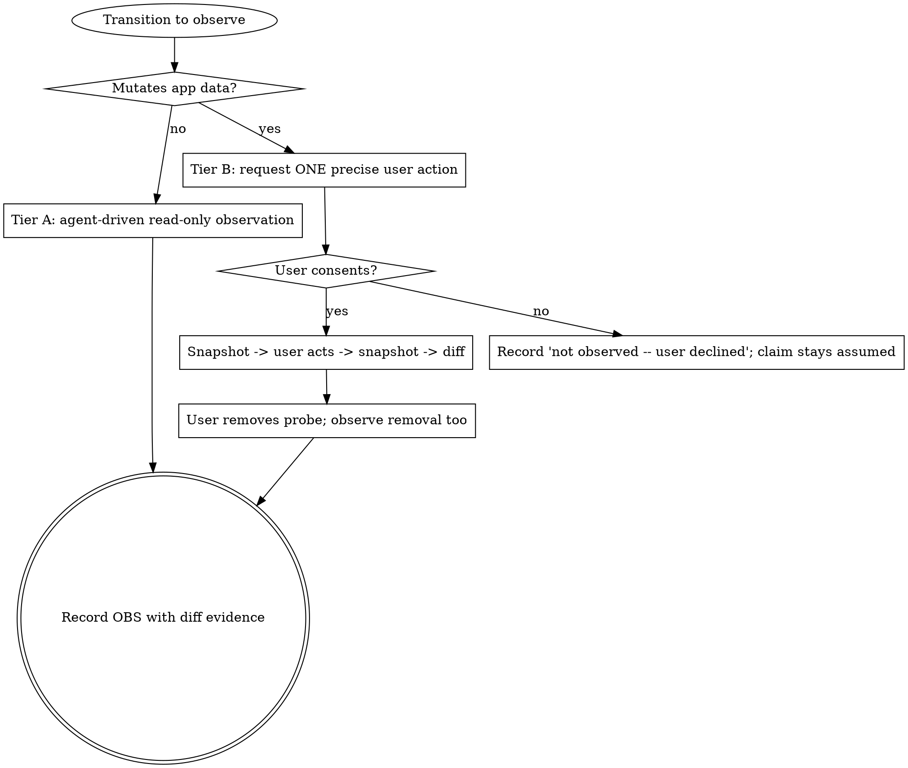

# macOS Runtime Observation

Runtime observation of a native macOS application through its scripting interface. The target runs on the host -- there is no container substrate for a signed Mac app -- so this skill trades the container's isolation for a strict consent gate and an absolute read-only contract.

## The Principle

**Run it. Record it. Cite it -- without ever writing to it.**

Everything the runtime-observation skill says about witnessed facts applies unchanged. Only the substrate differs: instead of `docker exec` into a sandbox, you send read-only Apple Events to a user-installed app in the user's own session. That privilege is narrow and conditional.

## The Host-Execution Carve-Out

Host observation is permitted ONLY when ALL of these hold: (1) the target is a user-installed, signed and notarized (or Mac App Store) macOS application; (2) signature verification passed during bundle analysis; (3) the user granted explicit consent recorded in workspace/consent/macos-host-observation.md; (4) every interaction with app data is read-only. If any condition fails, this skill does not run. The generic container rule in runtime-observation/container-execution still governs every other target type.

This is a hard safety requirement, not a preference. There is no "probably fine" path onto the host.

## Relationship to the runtime-observation Skill

This skill inherits from runtime-observation the way runtime-observation inherits container mechanics from container-execution: by deference, not duplication. Unless overridden below, the parent skill governs the five-phase order (exploration -> nominal -> boundary -> error -> state), the `OBS-{NNN}` record format and ID rules, observation-to-claim conversion ("absence of observation is not evidence"), error-handling posture (every failure produces data), and contradiction flagging for `spec-verifier`.

Host-specific overrides:

| Parent rule | Host override |
|-------------|---------------|
| All execution inside containers | Replaced by the host-execution carve-out above |
| Output to `workspace/raw/runtime/` | `workspace/raw/macos/runtime/` |
| `**Environment:** {container name, config state}` | `**Environment:** host-macos, <app> <version>, macOS <sw_vers>, session user` |
| Agent names `cli-explorer` etc. | `agent=applescript-explorer` |
| Environment variation (locale, TERM) | Not applicable; the user's live session is recorded, not varied |
| CRUD in Phase 2 | Reads only; all create/update/delete is Tier B (user-driven) |

Provenance is unchanged: cite `source=runtime-observation` -- this IS runtime observation, only the substrate differs. Confidence follows provenance-methodology: a reproducible direct query is `confirmed`; schema or column semantics are `assumed` until corroborated; synthesis across observations is `inferred`.

```markdown
<!-- cite: source=runtime-observation, ref=OBS-014, confidence=confirmed, agent=applescript-explorer -->
```

## The Read-Only Contract

These five rules hold from preflight through cleanup:

1. **Only READ-classified verbs.** AppleScript/JXA commands are limited to verbs the bundle capability inventory classified as READ: `get`, `count`, `exists`, `properties of`. MUTATING verbs (`make`, `delete`, `move`, `duplicate`, `save`, `set`) are forbidden. An unclassified verb is MUTATING. Application lifecycle operations -- `activate`, launching via `open -b` (Phase 1 launch policy), and `quit` during sanctioned cleanup -- are process-level actions permitted under the `app-launch` scope; the READ-verb restriction governs verbs targeting the application's data objects.
2. **Never open the app's URL scheme** (`things:///...` or any other). Even "show" commands launch registered handlers. Scheme behavior is documented from static evidence, or observed only when the USER invokes it.
3. **Never `defaults write` or `defaults delete`.** And `defaults read` is not yours either -- it belongs to app-data-inspection.
4. **Never create, modify, or delete anything under the app's containers.** All output goes to `workspace/` only.
5. **UI driving is out of scope** -- that is macos-visual-exploration's job. Anything that would create or change user data is performed by the USER at the agent's request, with per-action consent (Tier B, Phase 5).

Self-audit obligation: before declaring done, review your own command history for MUTATING verbs, `defaults write`, and URL-scheme opens. Finding zero is part of the Definition of Done.

## Inputs from macos-bundle-analysis

- **`workspace/raw/macos/bundle/signing.md`** -- the signature verdict. PASS is a hard precondition (carve-out condition 2).
- **`workspace/raw/macos/bundle/capability-inventory.md`** -- CAP-NNN records enumerating the scriptable surface. This is your target list: every class you probe traces to a CAP record, and every sdef command carries the READ/MUTATING classification the contract enforces (make/delete/move/duplicate/save/set = MUTATING; get/count/exists/properties-of = READ; unknown = MUTATING).

## Output Directory Structure

```
workspace/raw/macos/runtime/
  preflight.md           # Every gate result, launch policy record, launched-by-us flag
  observations/          # OBS-NNN records (parent skill format, host Environment line)
  scripting/             # JXA/AppleScript structured dumps, one JSON file per sdef class
```

All output is RAW, per the parent skill's Source Origin rules. Never write to `workspace/output/` or `workspace/public/`.

## Phase 0: Preflight

**Goal:** Verify every gate before touching the target. Gates are data -- record every result, passes included, in `workspace/raw/macos/runtime/preflight.md`.

**Gate 1 -- Consent artifact.** Verify that `workspace/consent/macos-host-observation.md` exists. You verify this file; you NEVER create it. Format:

```markdown
# Host Observation Consent
- **Target:** Things3.app
- **Bundle ID:** com.culturedcode.ThingsMac
- **Signature check:** passed (see workspace/raw/macos/bundle/signing.md)
- **Granted scopes:** app-launch, scripting-read, visual, app-data-read
- **Optional tools approved:** none
- **Granted:** <ISO timestamp> by user
```

This skill requires scopes `app-launch` + `scripting-read`. Missing file or missing scope: record the gate as data in preflight.md and exit. A consent gap is a finding, not an error.

**Gate 2 -- Signature verdict.** Read `workspace/raw/macos/bundle/signing.md` and confirm PASS. Anything else -- FAIL, UNKNOWN, file missing -- fails the carve-out. Record and exit.

**Gate 3 -- Automation permission self-test.** TCC mediates Apple Events per (sender, target) pair. Test before assuming:

```bash
osascript -e "tell application id \"$BUNDLE_ID\" to get name" 2>&1
# -1743 => not permitted. Remediation: System Settings > Privacy & Security > Automation >
#   <your terminal app> > <target app>. TCC grants cannot be made from the CLI.
# -1728 on a running app => the process belongs to another login session (fast user switching);
#   AX and Apple Events are per-session. Record and abort runtime phases.
```

Record the exact output either way. On `-1743`, record the remediation steps and degrade per the Failure Modes table. Never attempt to script around a TCC denial.

## Phase 1: Exploration

**Goal:** Discover the live scripting surface and establish the launch baseline.

**Launch policy.** Check whether the app is already running:

```bash
pgrep -x "Things3" || osascript -e 'tell application "System Events" to exists process "Things3"'
```

If not running, launch with `open -b "$BUNDLE_ID"` and wait-loop until the process exists (poll `pgrep -x`, bounded retries). Record `launched-by-us: true|false` in preflight.md -- cleanup depends on this flag. The launch itself is an observation.

**Scripting surface probe.** Walk the CAP inventory's sdef class list and dump each top-level class as structured JSON -- one dump per class -- into `workspace/raw/macos/runtime/scripting/`. JXA is preferred because it emits JSON directly:

```bash
osascript -l JavaScript -e '
  const app = Application("Things3");
  JSON.stringify(app.lists().map(l => ({ name: l.name(), id: l.id() })));
' > workspace/raw/macos/runtime/scripting/lists.json
```

Use the AppleScript variant (`tell application ... to get properties of ...`) where JXA's bridge is awkward for property records; capture the record text verbatim and note the dialect. The first invocation after connecting to an app occasionally returns an empty array -- retry once before recording a result (an observed flake, not app behavior).

**Shortcuts surface.** Record the app's Shortcuts exposure with `shortcuts list`. `shortcuts run` is FORBIDDEN for analysis agents: a shortcut is a composite of verbs the CLI cannot inspect, so it can never be verified read-only -- an unverifiable composite is MUTATING under this skill's own rule. Record the un-exercised Shortcuts surface as a gap.

**Provenance:** Surface dumps are `confirmed`. Interpretations of what a class represents are `inferred` until Phase 2 exercises it.

## Phase 2: Nominal Path Testing

**Goal:** Exercise every scriptable class through its READ verbs.

For each class in the CAP inventory: **counts** (`count of <class>`); **first-N property dumps** (full `properties of` for the first few elements -- see the shape without dumping the user's entire dataset); **`whose` filters** with simple predicates on observed values.

**Cross-check against app-data-inspection.** Where DB reads exist for the same entities: does `count` match the row count? Do property values match column values? Agreement is two independent evidence groups -- escalate to `confirmed` with `corroborated_by=app-data-inspection`. Disagreement is a contradiction: record both and flag it (the scripting layer may filter trashed rows -- that filtering is itself a finding).

**Undocumented properties.** Exercise undocumented JSON-bearing properties where the inventory hints at them (e.g., Things' `_private_experimental_ json`, exposed via `get` and therefore READ). Diff the JSON fields against documented sdef properties: extra fields are discoveries. The values are `confirmed`; the meaning of an undocumented field is `assumed` until corroborated by app-data-inspection or a Tier B diff.

## Phase 3: Boundary Testing

**Goal:** Probe edges WITHOUT creating them. The container methodology feeds boundary inputs to the target; here you may only look for boundary conditions already present in the user's data.

- **Empty collections:** how does the scripting layer represent emptiness (empty array vs. missing value vs. error)?
- **Unicode and long titles:** if present in user data, record how they round-trip through AppleScript vs. JXA.
- **Date-property encodings:** compare the AppleScript-reported date with the packed integer in the corresponding DB row (from app-data-inspection). A matching decode moves the encoding claim from `assumed` to `confirmed`.
- **`whose` operator matrix:** which operators work per property type, and the exact error when one does not.
- **Large collections:** timing and completeness of full dumps on the largest lists; note truncation if any.

**The rule:** a boundary case not present in the user's data is recorded as "not testable read-only" -- a gap, cited as such. Never create data to manufacture a boundary. If it matters enough, it becomes a Tier B request.

## Phase 4: Error Probing

**Goal:** Document the error surface with probes that are read-only by construction.

- **Invalid object specifiers:** `get to do id "nonexistent"`, index out of range. Record exact error numbers (e.g., `-1728`) and message text verbatim.
- **Type-mismatched `whose` clauses:** date vs. string, boolean vs. number. Silent coercion vs. `-1700` is a spec-relevant fact.
- **Permission errors:** cross-reference the Phase 0 TCC results -- do not re-trigger permission prompts. The Phase 0 record is the evidence.

An error probe that would require a MUTATING verb to trigger is out of scope; record it as untestable. Error numbers and messages are `confirmed`; interpretations are `inferred`.

## Phase 5: State Observation -- The Two-Tier Action Policy

**Goal:** Observe state transitions without ever causing a data mutation yourself. This is the centerpiece of the skill.



**Tier A (agent-driven, allowed):** read-only scripting and app activation only. Observing derived state -- selection, window state, showing list -- via READ verbs. Activation mutates window-server state, not app data; record the previously frontmost app so cleanup can restore it.

**Tier B (user-driven, required for any data mutation):** the agent requests that the user perform ONE precisely described action:

> "Please create a to-do named GREENFIELD-PROBE-1 in the Inbox, then tell me done."

A dispatched agent has no conversational channel to the user. Tier B consent therefore travels by relay: the agent records each precise Tier B request in its final report, and treats any consent not explicitly granted in its dispatch prompt as NOT granted. The orchestrator relays requests to the user and re-dispatches with the outcome -- a grant plus the user's confirmation that the action was performed, or "declined", in which case the agent records the gap.

Protocol (within a dispatch whose prompt grants the request):

1. **Before-snapshot:** scripting dumps of the affected classes; when app-data-inspection is active, coordinate with the data-inspector's DBQ before-snapshot so both surfaces bracket the same action.
2. **User acts** and confirms (the confirmation arrives via the dispatch prompt).
3. **After-snapshot:** same dumps; diff.
4. **Probe removal:** request, via the same relay, that the user remove the probe -- and observe the removal too. Deletion behavior (trash vs. hard delete, which fields flip) is data.
5. Each Tier B request is its own per-action consent. The blanket consent artifact does not pre-authorize Tier B actions.

The agent NEVER performs Tier B actions via scripting, UI, or URL scheme -- not even for an action the user already approved verbally. The user's hands, the agent's snapshots.

This user-in-the-loop diff is the primary mechanism for decoding undocumented semantics: when the diff shows exactly which fields a "complete task" action touches, those field-semantics claims escalate from `assumed` to `confirmed`, with the OBS diff as the citation.

## Cleanup Guarantees

Cleanup is part of the observation. Every step produces an OBS record -- quit behavior (prompt? silent? state saved?) is behavioral data.

- **Quit only if launched-by-us:** `osascript -e "tell application id \"$BUNDLE_ID\" to quit"`, recording what happens. If the app was already running, leave it running.
- **Restore the previously frontmost app** if Tier A activation changed it.
- **Every Tier B probe removed and verified.** Removal is user-performed (a mutation); verification is agent-performed: a final read confirming the probe no longer exists. A lingering probe blocks the Definition of Done -- ask again.
- **App left in pre-observation state:** same running status, same frontmost app, no probe data.

## Failure Modes and Degradation

Every failure mode produces data. Record it, degrade, continue where possible.

| Failure | Signal | Response |
|---------|--------|----------|
| Automation permission denied | `-1743` from self-test | Skip scripting phases; record gate + remediation in preflight.md; defer to app-data and visual sources |
| App not scriptable | No sdef; no dictionary | Record the fact; skill contributes launch/process observations only |
| Cross-session invisibility | `-1728` against a running process | Record and abort runtime phases; Apple Events and AX are per-session |
| User declines a Tier B request | "declined" outcome relayed in the re-dispatch prompt | Record "not observed -- user declined"; claim stays `assumed`; never retry by other means |
| App crashes during observation | Process gone; new DiagnosticReports file | Record the crash and DiagnosticReports filenames only -- never copy contents without consent. The crash is behavioral data |
| Consent file or scope missing | Preflight Gate 1 | Record the gate as data in preflight.md and exit |
| Signing verdict not PASS | Preflight Gate 2 | Record and exit; the carve-out has failed |

## What This Skill Is NOT

- NOT UI automation. No UI scripting, clicks, menus, or screenshots -- that is macos-visual-exploration (`ui-observer`).
- NOT data-file inspection. No SQLite reads, `defaults read`, or plist parsing -- that is app-data-inspection (`data-inspector`). This skill MAY cross-check scripting output against that skill's outputs when both exist.
- NOT a mutation harness. No consent scope, flag, or user message authorizes a MUTATING verb from this skill. Mutations happen only through Tier B, only by the user's hands.
- NOT bundle analysis. Static facts (sdef, entitlements, URL schemes) come from macos-bundle-analysis (`bundle-inspector`); this skill confirms them live.

## Definition of Done

- [ ] `preflight.md` complete, every gate result recorded -- passes and failures alike.
- [ ] Every scriptable class in the CAP inventory queried (with OBS records) or skipped with a recorded reason.
- [ ] Scripting-vs-data cross-check performed wherever both surfaces exist; agreements escalated with `corroborated_by`, disagreements recorded as contradictions.
- [ ] No write ever issued. Self-audit passed: no MUTATING verbs, `defaults write`, or URL-scheme opens in your own command history.
- [ ] All Tier B probes removed by the user and verified gone by a final read.
- [ ] App left in pre-observation state: quit only if launched-by-us, frontmost app restored.
- [ ] OBS records sequential, in parent-skill format with the host Environment line, every claim cited.
