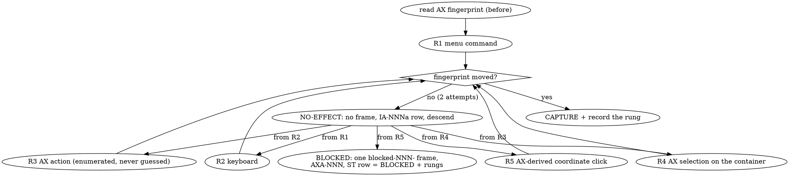
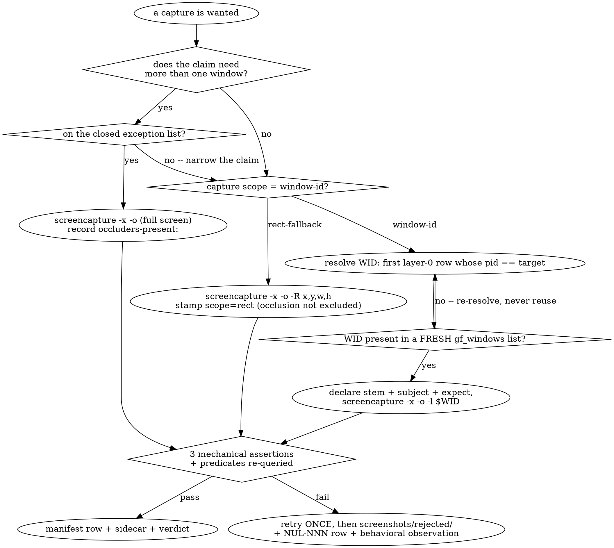

# macOS Visual Exploration Methodology

Document behavioral intelligence through screen capture and Accessibility-tree inspection of a native macOS application. Every screenshot is an empirical observation. Every AX-tree dump is the machine-readable twin of that observation -- each capture ships both. This mode captures what the app SHOWS and what the system PRESENTS, and -- because it runs inside a disposable environment -- it drives the UI read+write to capture what the app DOES.

This skill is the native-macOS sibling of the `visual-exploration` skill. Where that skill drives a browser with Playwright, this skill drives `screencapture` and System Events AX queries inside the environment. The framing, output shapes, and provenance rules mirror `visual-exploration` deliberately; the interaction policy is read+write because the target runs inside a disposable environment -- a fresh VM or a throwaway account -- with no real data to protect.

## When to Use This Mode

macOS visual exploration activates when the target is a native macOS application (an `.app` bundle), `macos-bundle-analysis` has run, and a disposable runtime environment has been chosen and recorded in `workspace/environment/runtime-environment.md` (verified in Phase 0). All output is **RAW** (screenshots and AX dumps capture the target's proprietary UI in detail); it never reaches `workspace/output/` or `workspace/public/`.

## The Runtime Environment

This skill never runs against the user's own account or the user's own data. It runs inside a disposable runtime environment chosen at dispatch time and recorded in `workspace/environment/runtime-environment.md`: a throwaway macOS VM, or a throwaway user account on this Mac. The environment is pristine -- a fresh install of the target, a fresh account, no real data in it -- so analysis is READ+WRITE. You may create, edit, and delete through the app's own surfaces, run destructive flows, and manufacture states that do not occur naturally. Nothing you break belongs to anyone.

**Environment verification.** Read `workspace/environment/runtime-environment.md`. It must exist, and its `**Environment:**` line must read `vm-tart`, `vm-lume`, or `host-direct`. A value of `none`, a missing line, or a missing file is a hard environmental gate: record it in `preflight-visual.md` and exit without touching the target. You VERIFY this artifact; you NEVER create or edit it. When `**Environment:**` is `host-direct`, `workspace/raw/macos/bundle/signing.md` must additionally record a PASS verdict -- record the gate and exit otherwise. For `vm-tart` and `vm-lume`, copy the artifact's `**Signature verdict:**` into your preflight table as data; it does not gate the run, because a bad signature inside a disposable VM costs a VM.

**host-direct caveat.** A VM is pristine by construction. A `host-direct` account is pristine only because it was freshly created -- the `**Disposable-account affirmation:**` line in the artifact is the user's statement that the account is empty and expendable. Artifacts produced under `host-direct` reflect whatever is actually in that account. Say so in the preflight file.

## Running Commands in the Environment

Every command in this skill runs inside the environment, through the helpers defined by the `macos-vm-execution` skill. Never write a bare `ssh`, and never call `osascript`, `screencapture`, or a System Events query directly. Every screenshot and every AX query in this skill goes through `gf_gui`; a `screencapture` that skips it produces a valid PNG of nothing. Captures in this skill are WINDOW-SCOPED by default -- `screencapture -x -o -l $WID` against a window id resolved from `gf_windows` -- and full-screen only as a declared exception. See **The Capture Policy**.

| Helper | Use for |
|--------|---------|
| `gf_exec '<cmd>'` | Non-GUI work: `ls`, `plutil`, file plumbing |
| `gf_gui '<cmd>'` | Anything that touches the window server: AppleScript/System Events, AX queries, `screencapture` |
| `gf_windows` | Enumerate on-screen windows: TSV with the header row `id pid layer alpha owner title x y w h`, one row per window, FRONT-TO-BACK. It runs `$GF_GUEST_WORKSPACE/tools/gf-windowlist` through `gf_gui`, for the session-attachment reason below |
| `gf_get <guest-path> <host-path>` | Pull evidence back to `workspace/` |
| `gf_put <host-path> <guest-path>` | Push a script or fixture in |

`gf_gui` exists because of one failure mode: when the SSH session is not attached to the guest's Aqua session, a GUI command returns an empty AX tree, an empty window list, or a wallpaper-only screenshot -- with exit status 0. It looks exactly like a finding and is not one. Whether a bare call is attached is image- and configuration-dependent (on a base image that auto-logs in the same user you SSH as, bare calls have been observed to work), and that is precisely what makes the failure dangerous: it is silent and it travels. Routing every GUI command through `gf_gui` is free when attachment is already implicit and load-bearing when it is not. `gf_gui` wraps the command in `launchctl asuser` against the auto-login session so it lands in the real GUI session. On `host-direct` both helpers are pass-throughs.

Snippets below spell out the `gf-windowlist` call rather than writing `gf_windows`, so the TSV field numbers the `awk` filters depend on stay visible: `$1` id, `$2` pid, `$3` layer, `$4` alpha, `$5` owner, `$6` title, `$7`-`$10` x y w h. `NR>1` skips the header row.

`GF_ENV`, `GF_VM`, `GF_SSH`, and `GF_GUEST_WORKSPACE` arrive in your dispatch prompt. Write output under `$GF_GUEST_WORKSPACE/...` and `gf_get` it to the matching path under `workspace/raw/macos/...` before you finish. The Layer 1 gate counts files on the host: evidence still sitting in the guest does not exist.

## Why macOS Visual Exploration Matters

Bundle analysis tells you what the app CAN do (capabilities, strings, entitlements). AppleScript exploration tells you what the app exposes to automation. Visual exploration tells you what the app LOOKS LIKE and how its interface is organized: affordances, the complete command surface with keyboard shortcuts, navigation structure (sidebars, tabs, window hierarchy), state representation as the user navigates, and feedback (selection, focus, enabled/disabled state). No other mode captures this.

## Read+Write Conduct

Mutation is allowed. Exactly one prohibition survives, and it is about fidelity, not privacy:

**All state changes go through the app's own surfaces -- UI actions, scripting commands, URL schemes, Shortcuts. Never change state by writing the app's data store, preference plists, or container files directly.** The app's reaction to its own write is the thing you are here to observe; a direct write destroys the observation.

Keep the READ/MUTATING classification from `macos-bundle-analysis`, with its meaning changed. It no longer decides whether you may click; it decides WHEN you click and what you capture around the click. Unknown still classifies as MUTATING -- schedule it late and bracket it, do not skip it.

### NAVIGATION vs. MUTATING

Every UI element gets the same classification `macos-bundle-analysis` applies to scripting commands: make/delete/move/duplicate/save/set verbs, or app-specific imperatives, are MUTATING; anything unknown is MUTATING. Consume its `capability-inventory.md` and strings catalog (`text-catalog.md`) for cross-checks throughout.

- **NAVIGATION** -- view switches, window operations (open/close/minimize/restore of windows, not documents), disclosure triangles, scrolling, tab selection, search fields (typed then cleared and verified). Exercised freely -- but THROUGH THE LADDER, never by an invented click (see **Driving the UI: The Interaction Ladder**). Search-field caveat: typed probes may persist in recent-searches stores outside the agent's view -- use innocuous probe strings and note the possible persistence as an observation.
- **MUTATING** -- anything that creates, changes, or deletes data or settings. Exercised deliberately in Phases 4 and 6, one action at a time, with before+after captures plus an AX sidecar. The dialog a MUTATING action raises is often the most valuable screenshot in the run -- capture it before dismissing.
- **UNKNOWN = MUTATING** -- schedule it late and bracket it; do not skip it.

System Events process/window/appearance attributes -- process visibility, window position/size, and the appearance toggle -- are sanctioned navigation-class operations WITH the mandatory restore obligations stated at each use site, not instances of the app-object `set` ban.

**The same sanction covers every AX attribute the interaction ladder writes: `AXFocused`, `AXSelected`, `AXSelectedRows`, `AXSelectedChildren`, and `AXEnhancedUserInterface`.** Writing these is how you drive the UI without clicking. The prohibition is on writing the APP's own objects -- its data store, its documents, its preference plists -- never on writing the accessibility state of a view. An agent that reads "never `set`" and falls back to synthetic coordinate clicks has misread the rule, and that misreading is what turned a quarter of a real run's frames into pictures of failed clicks. `AXEnhancedUserInterface` carries a restore obligation like the appearance toggle: set it back and note the toggle.

An unexercised element's effect is `inferred` from its label; an element exercised with a before/after pair is `confirmed`. Prefer the second -- the environment is disposable, so there is rarely a reason to leave a MUTATING element merely inferred.

## Driving the UI: The Interaction Ladder

Every interaction in this skill -- navigation and mutation alike -- is driven through one fixed ladder. **Two attempts per rung, descend exactly once, never revisit a rung you left.**

The ladder exists because of a measured failure. In a real run, roughly a QUARTER of the captured frames were pictures of automation failing: synthetic `click at {x, y}` cannot select rows in a custom-drawn table, eleven approaches were logged, none worked, and every failed click still produced a screenshot that looked like evidence. Separately, an `AXMinimized` write against the wrong window returned no error and did nothing. Neither failure announced itself. The ladder plus the verified-effect fingerprint is how they announce themselves now.



### R1 -- menu command

The menu bar is the one surface macOS requires an app to vend to Accessibility, so it works in custom-drawn apps where nothing else does. Start here for anything that has a menu path in `command-surface.md`.

```applescript
tell application "System Events" to tell process "AcmeTasks"
  click menu item "Inbox" of menu 1 of menu bar item "View" of menu bar 1
end tell
```

### R2 -- keyboard

A shortcut read from `command-surface.md`, or focus the container and move inside it. This is the workhorse for list selection.

```applescript
tell application "System Events"
  keystroke "2" using {command down}
end tell
-- or: focus the container, then move within it
tell application "System Events" to tell process "AcmeTasks"
  set value of attribute "AXFocused" of outline 1 of scroll area 1 of splitter group 1 of window 1 to true
  key code 125    -- down arrow; 126 = up, 48 = tab
end tell
```

### R3 -- AX action

Enumerate the actions first. Never guess an action name -- an empty `actions` list is the element telling you it has no affordance, and that answer belongs in `ax-affordance-map.md`.

```applescript
tell application "System Events" to tell process "AcmeTasks"
  set theRow to row 2 of outline 1 of scroll area 1 of splitter group 1 of window 1
  return name of actions of theRow      -- e.g. {"AXPress", "AXShowMenu"}
end tell
-- then, only if the name actually appeared:
-- perform action "AXPress" of theRow
```

### R4 -- AX selection on the container

Write selection state on the CONTAINER, not on the child. Many custom views ignore a press on a row but honour a selection write on the outline or table that owns it.

```applescript
tell application "System Events" to tell process "AcmeTasks"
  set theOutline to outline 1 of scroll area 1 of splitter group 1 of window 1
  set value of attribute "AXSelectedRows" of theOutline to {row 2 of theOutline}
end tell
```

`AXSelected`, `AXSelectedRows`, and `AXSelectedChildren` are all sanctioned writes (see **Read+Write Conduct**).

### R5 -- AX-derived coordinate click

Permitted ONLY with all four of: geometry read LIVE from AX in the same step (never a remembered or eyeballed coordinate), the app frontmost, a verified effect, and a row in `interaction-log.md`.

```applescript
tell application "System Events" to tell process "AcmeTasks"
  set frontmost to true
  set theRow to row 2 of outline 1 of scroll area 1 of splitter group 1 of window 1
  set p to position of theRow
  set s to size of theRow
  click at {(item 1 of p) + ((item 1 of s) div 2), (item 2 of p) + ((item 2 of s) div 2)}
end tell
```

A coordinate click is the only rung an occluder can steal. Run the notification pre-check (**The Capture Policy**, notifications, rule N1) immediately before it.

### The verified-effect fingerprint

**Read a cheap AX fingerprint BEFORE and AFTER every interaction.** One query, no full tree walk: window name, sheet presence, focused element, container selection.

Target the window under study **by name**, not `window 1` -- AX window order is not the on-screen order and `window 1` is frequently an unnamed helper window (observed AX window names in a real target: `""`, `"Today"`, `"Search"`, while `gf_windows` showed the real window titled `Today`). Cross-reference the AX name against the `title` column of the row you resolved the window id from; when they disagree, the `gf_windows` title is the on-screen truth.

```applescript
tell application "System Events" to tell process "AcmeTasks"
  set w to window 1
  set fp to (name of w as text) & " | sheet=" & ((exists sheet 1 of w) as text)
  try
    set fe to value of attribute "AXFocusedUIElement" of w
    set fp to fp & " | focus=" & (role of fe as text) & ":" & (name of fe as text)
  end try
  try
    set selRows to value of attribute "AXSelectedRows" of outline 1 of scroll area 1 of splitter group 1 of w
    set fp to fp & " | sel=" & (name of item 1 of selRows as text)
  end try
  return fp
end tell
```

**Prove the fingerprint discriminates before you trust it.** A fingerprint that returns the same string in
two genuinely different states silently converts every successful interaction into a `NO-EFFECT` and marches the
ladder down to `BLOCKED` for states that were reachable all along. Once per run, in preflight, bracket a state change
you already know works (a menu command that visibly switches views) and confirm the string moves. It often will not:
the guarded clauses are guarded precisely because their AX paths are missing in many apps, and what survives can be a
constant like `| sheet=false`.

When the AX fingerprint cannot discriminate, fall back to a **capture digest** -- the same window-id capture the run
already knows how to take, hashed:

```bash
gf_gui "screencapture -x -o -l $WID $GF_GUEST_WORKSPACE/tmp/fp.png"
gf_exec "shasum -a 256 $GF_GUEST_WORKSPACE/tmp/fp.png | cut -c1-16"
```

`-l` reads the window's live surface, not a cached one -- a resize, a content change, or a dismissed banner all move
the digest. It costs one capture per read, so use it only where the AX fingerprint has been shown to be blind, and
record that blindness as an `AXA-NNN` finding: an app whose view state is invisible to the accessibility layer is an
app whose view state is invisible to assistive technology.

**A fingerprint that lost every optional clause is an ERROR, not a NO-EFFECT.** If both guarded clauses silently failed and all that came back is the constant stub, you have not measured the interaction — you have measured nothing. Re-derive the query against the real tree (or switch to the capture digest) before drawing any conclusion. Descending the ladder on a blind fingerprint manufactures `BLOCKED` rows for states that worked.

**If the fingerprint does not move, the interaction did not happen.** Log `NO-EFFECT` in `interaction-log.md`, do NOT capture a frame, and descend one rung. A frame taken after an unverified interaction is not evidence -- it is a picture of automation failing, and it will be indistinguishable from a real observation the moment it acquires a filename.

After R5 fails twice, the state is `BLOCKED`. Stop. An unbounded search for a click that works is exactly what wasted a quarter of the last run.

### The custom-drawn dead end

A target that draws its own table, list, or canvas is the real blocker, and it gets a closed procedure -- in this order, no improvising.

**When it fires:** at R3, the moment an element's `actions` list comes back empty or its container refuses an `AXSelected` write. Enter this procedure INSTEAD of descending to R5, not after it. That is not a violation of "never revisit a rung": step 1 reaches the state through a DIFFERENT SURFACE (a menu, a shortcut, a scripting verb) rather than re-attempting the element that just refused you, and step 2 focuses a different container than the one that failed. If the procedure runs out, you land on R5 with the coordinate click as the genuine last resort, and `BLOCKED` after that.

**1. Alternate surface, FIRST.** Reaching the state another way is a FULL capture, not a degraded one. Record `Reached via: R1 (alternate surface)` and move on.

- the menu command for the same destination (R1)
- the keyboard shortcut from `command-surface.md` (R2)
- an sdef `select` / `reveal` / `show` command from `scripting/navigation-surfaces.md`, which `applescript-explorer` writes BEFORE you run. Read it; do not re-derive it.
  ```bash
  gf_gui "osascript -e 'tell application id \"$BUNDLE_ID\" to show list \"Inbox\"'"
  ```
- a URL command from the bundle's registered scheme:
  ```bash
  gf_gui "open 'acmetasks://show?id=inbox'"
  ```

**2. Focus plus keyboard.** Focus the container (R2 form above), then arrows, Tab, or type-select. Type-select often works on a view that ignores every press.

**3. `AXEnhancedUserInterface`.** Last technical resort: some apps vend a richer tree only to assistive clients.

```applescript
tell application "System Events" to tell process "AcmeTasks"
  set value of attribute "AXEnhancedUserInterface" to true
end tell
-- re-enumerate, act, then RESTORE unconditionally:
tell application "System Events" to tell process "AcmeTasks"
  set value of attribute "AXEnhancedUserInterface" to false
end tell
```

Restore it unconditionally and note the toggle in `interaction-log.md`. A tree that exists only under `AXEnhancedUserInterface` is itself an `AXA-NNN` finding. **Warning: the toggle can change layout**, so a capture taken while it is on is not comparable to the rest of the run -- say so in that capture's manifest row.

**4. STOP.** One `blocked-NNN-<state>.png` frame of the state you could not leave, an `AXA-NNN` record explaining why in terms of the app's accessibility surface, and a `state-coverage.md` row of `BLOCKED` naming every rung tried.

### interaction-log.md

Every attempt beyond the first working rung gets a row. If R1 works on the first attempt, the target needs no rows; anything else -- including the attempt that finally worked -- is logged. R5 is always logged, even when it works first try. **The file is written either way:** a run with nothing to log writes the single line `No ladder attempts beyond the first working rung.` An absent or empty `interaction-log.md` is indistinguishable from a run that never logged, and the Layer 1 gate fails it.

```markdown
# Interaction Log

| ID | Target | Rung | Attempt | Fingerprint before | Fingerprint after | Verdict | Note |
|----|--------|------|---------|--------------------|-------------------|---------|------|
| IA-014a | sidebar row "Trash" | R3 AXPress | 1 | Today \| sheet=false \| sel=Today | Today \| sheet=false \| sel=Today | NO-EFFECT | actions list was {AXPress} |
| IA-014b | sidebar row "Trash" | R3 AXPress | 2 | Today \| sheet=false \| sel=Today | Today \| sheet=false \| sel=Today | NO-EFFECT | descend to R4 |
| IA-014c | sidebar row "Trash" | R4 AXSelectedRows | 1 | Today \| sheet=false \| sel=Today | Trash \| sheet=false \| sel=Trash | EFFECT | captured step-04-trash.png |
```

`Verdict` is `EFFECT`, `NO-EFFECT`, or `ERROR -- <number>`. One `IA-NNN` per target, one letter suffix per attempt, in order.

## AX Affordances Are Findings

What the app vends to Accessibility is not just an obstacle to work around -- it is a property of the product, and it is reportable. Every region you enumerate and every element the ladder fails on gets an `AXA-NNN` record in `ax-affordance-map.md`.

| Field | Meaning |
|-------|---------|
| `AX-visible` | present in the tree with a real role -- or an `AXGroup`/`AXUnknown` with no children, which is the app telling you it vends nothing |
| `AX-actionable` | its `actions` list is non-empty; NAME the actions. An empty list is the element stating it has no affordance |
| `Labeled` | `AXTitle`/`AXDescription` present and meaningful, or empty / placeholder / role-only |
| `Keyboard-reachable` | reachable by focus plus arrows, Tab, or type-select |
| `Reached via` | the ladder rung that worked, or `none` |

```markdown
# AX Affordance Map -- Acme Tasks

### AXA-012 -- sidebar rows (source list, main window)
**AX-visible:** yes -- AXRow elements inside an AXOutline
**AX-actionable:** no -- `name of actions` returned an empty list on every row
**Labeled:** yes -- each row carries its destination name as AXTitle
**Keyboard-reachable:** yes -- focus the outline, then arrow keys move the selection
**Reached via:** R4 (AXSelectedRows on the container)
**Note:** rows are custom-drawn. R3 and R5 both produced NO-EFFECT twice (IA-014).

### AXA-021 -- notification banner container
**AX-visible:** partially -- one layer-21 container, contents unstable
**AX-actionable:** no -- `click button 1 of window 1` returns error -1719 (Invalid index); `entire contents` returned 11 elements once and 0 on the next call
**Labeled:** n/a
**Keyboard-reachable:** no
**Reached via:** none -- banner text is read off the capture
```

**Two audiences, and the record serves both.**

- **Accessibility conformance.** An unlabeled control is unusable with VoiceOver. A custom-drawn view that vends an `AXUnknown` with no children is invisible to every assistive technology. These are real accessibility defects in the target: state them plainly in `visual-behaviors.md`, do not soften them into "automation was difficult".
- **Automatability.** The same map tells a reimplementor exactly what must be vended to be scriptable: which containers expose selection, which controls expose actions, which surfaces are keyboard-reachable. A reimplementation that vends less is a regression its users will feel.

Cross-references are load-bearing. A `BLOCKED` row in `state-coverage.md` names the `AXA-NNN` that explains it: the coverage row says a state was not reached, the AXA record says WHY, in terms of the app's own accessibility surface. `visual-behaviors.md` carries the synthesized claims, cited to the AXA records. A poor AX surface is a finding ABOUT THE APP, never a failure of the run.

## Phase 0: Preflight Doctor

**Goal:** Verify every permission and precondition, pick a degradation mode BEFORE any exploration, and write `workspace/raw/macos/runtime/preflight-visual.md` with a PASS/FAIL table and exact remediation paths. Run all checks even after a failure -- the complete picture picks the mode.

### 0.1 Environment and Signature

Perform the environment verification from **The Runtime Environment** above. Read `workspace/environment/runtime-environment.md`: it must exist and its `**Environment:**` line must read `vm-tart`, `vm-lume`, or `host-direct`. A `none`, a missing line, or a missing file is a hard environmental gate -- record it in `preflight-visual.md` and exit without touching the target. When `**Environment:**` is `host-direct`, `workspace/raw/macos/bundle/signing.md` must additionally record a PASS -- record the gate and exit otherwise. For `vm-tart` and `vm-lume`, copy the artifact's `**Signature verdict:**` into the preflight table as data; it does not gate the run. You VERIFY this artifact; you NEVER create or edit it.

### 0.2 Accessibility Permission

```bash
gf_gui "osascript -e 'tell application \"System Events\" to return UI elements enabled'"
```

Must print `true`. FAIL remediation depends on the environment. Under `vm-tart`/`vm-lume` a missing Accessibility grant is a provisioned-base defect -- the base image's TCC provisioning (see `macos-vm-execution` §9) did not take. Record it and request a re-provisioned base rather than editing TCC mid-run. Under `host-direct` (record verbatim): "System Settings > Privacy & Security > Accessibility > enable the terminal app in this account. TCC cannot be granted from the CLI."

### 0.3 Automation Permission (System Events)

Run a trivial query:

```bash
gf_gui "osascript -e 'tell application \"System Events\" to return name of first process'"
```

Error -1743 ("Not authorized to send Apple events") means the Automation permission is missing or denied. Under a VM this is a provisioned-base defect (the `kTCCServiceAppleEvents` grant did not take) -- record it and request a re-provisioned base. Under `host-direct`: "System Settings > Privacy & Security > Automation > terminal app > enable System Events." If the first-use consent dialog cannot be answered non-interactively, record -1743 as a FAIL.

### 0.4 Screen Recording -- Silent-Failure Detection

Screen Recording permission attaches to the terminal/login binary that issues the call, and its failure mode is silent: `screencapture` exits 0 and writes a wallpaper-only image. It also governs window TITLES in the window list. Three probes, all of them run, in order.

**Probe 1 -- two-shot size heuristic.** Is anything app-specific reaching the frame at all?

```bash
gf_gui "osascript -e 'tell application id \"$BUNDLE_ID\" to activate'"; sleep 1
gf_gui "screencapture -x $GF_GUEST_WORKSPACE/runtime/screenshots/000-preflight-frontmost.png"
gf_gui "osascript -e 'tell application \"System Events\" to set visible of process \"$PROC\" to false'"; sleep 1
gf_gui "screencapture -x $GF_GUEST_WORKSPACE/runtime/screenshots/000-preflight-hidden.png"
gf_gui "osascript -e 'tell application \"System Events\" to set visible of process \"$PROC\" to true'"
# Near-identical file sizes (within ~1%) => nothing app-specific captured => FAIL (wallpaper-only).
# Remediation: VM => the provisioned base lacks the kTCCServiceScreenCapture grant; request a
#   re-provisioned base. host-direct => System Settings > Privacy & Security > Screen & System
#   Audio Recording > enable the terminal app, then RESTART it.
# Size heuristic can false-negative: fallback is gf_get'ing the capture and showing the user.
```

If hiding the app barely changes the image size, the app was never in the image. Another window behind the target can defeat the heuristic -- when unsure, `gf_get` `000-preflight-frontmost.png` to the host and ask the user. Keep this capture: it is the run's full-screen reference for the digest-distinctness assertion.

**Probe 2 -- window enumeration.** Can the run resolve window ids at all?

```bash
gf_gui "$GF_GUEST_WORKSPACE/tools/gf-windowlist --version"      # must print exactly: gf-windowlist 1
gf_gui "$GF_GUEST_WORKSPACE/tools/gf-windowlist" > /tmp/gf-windows-probe.tsv
awk -F'\t' 'NR>1' /tmp/gf-windows-probe.tsv | wc -l             # total windows
awk -F'\t' 'NR>1 && $3==0' /tmp/gf-windows-probe.tsv | wc -l    # layer-0 (real app) windows
awk -F'\t' 'NR>1 && $6==""' /tmp/gf-windows-probe.tsv | wc -l   # blank titles
awk -F'\t' 'NR>1 {print $2}' /tmp/gf-windows-probe.tsv | sort -u | wc -l  # distinct owning pids
```

**The ownership count is the one that matters.** Without the Screen Recording grant the list is not merely untitled --
it is RESTRICTED to the caller's own windows. Measured on a terminal without the grant: six rows, two owning pids (the
caller and Window Server), titles present only for the caller's own windows. If the target's pid is absent from the
list while the caller's is present, the grant is missing and no amount of title-degradation helps -- there is no row
for the target to resolve.

| Outcome | Meaning | Action |
|---------|---------|--------|
| Populated layer-0 list, titles present | enumeration works | Capture scope = `window-id`. Continue to Probe 3 |
| **Header row only, zero data rows** (run through `gf_gui`) | there is no window server to enumerate | **HARD GATE** -- the same stop as §0.5. Record it and exit. Never degrade to rect on this signal: a rect capture of a session with no window server is a picture of nothing |
| Populated geometry, uniformly BLANK titles, MULTIPLE owning pids | Titles alone are missing -- ids, pids, layers, alphas, owners, and bounds are all still true | Degrade TITLES only: resolve windows by pid plus geometry (see **The Capture Policy**). Capture scope does NOT degrade |
| **Only the caller's own pid appears** (plus Window Server) | Screen Recording is DENIED: the list is restricted to the caller's own windows and the target's windows are absent entirely | The target cannot be window-captured at all. Do not "degrade titles" -- there is no row to degrade. Record the denial, take the remediation path for Screen Recording, and if it cannot be granted the source degrades to `AX-only` (or `abort` when Accessibility is denied too, which on an ungranted account it usually is) |
| Binary missing, or non-zero exit | enumeration not yet available | Work the `macos-vm-execution` ladder before giving up: build the binary with its recipe, then fall back to `/usr/bin/swift <source>.swift` interpreter mode (same output, ~1-2 s per call). Only when both fail is enumeration unavailable and the capture scope `rect-fallback` for the whole run |

**Probe 3 -- window-id capture probe.** Does the run's DEFAULT capture mode actually work? This is the probe that decides the capture-scope axis, and it must be a real capture, not an inference from Probe 2.

```bash
PID=$(gf_gui "osascript -e 'tell application \"System Events\" to return unix id of process \"$PROC\"'")
WID=$(gf_gui "$GF_GUEST_WORKSPACE/tools/gf-windowlist" \
      | awk -F'\t' -v pid="$PID" 'NR>1 && $2==pid && $3==0 {print $1; exit}')
read -r BW BH <<< "$(gf_gui "$GF_GUEST_WORKSPACE/tools/gf-windowlist" \
      | awk -F'\t' -v w="$WID" 'NR>1 && $1==w {print $9, $10; exit}')"
gf_gui "screencapture -x -o -l $WID $GF_GUEST_WORKSPACE/runtime/screenshots/000-preflight-windowid.png"
gf_exec "sips -g pixelWidth -g pixelHeight $GF_GUEST_WORKSPACE/runtime/screenshots/000-preflight-windowid.png"
gf_exec "stat -f%z $GF_GUEST_WORKSPACE/runtime/screenshots/000-preflight-windowid.png"
gf_exec "shasum -a 256 $GF_GUEST_WORKSPACE/runtime/screenshots/000-preflight-{frontmost,windowid}.png"
```

Assert all three, and record each result in the preflight table:

1. **Dimension ratio.** `pixelWidth / $BW` and `pixelHeight / $BH` are the SAME INTEGER. The guest's backing scale is 2, so a 935x680 window captures at 1870x1360. A non-integer ratio, or two different ratios, means the file is not this window.
2. **The file exists at all.** Given an id that is not in the current list, `screencapture -l` prints `could not create image from window`, writes **no file**, and **exits 0** -- measured. The exit status distinguishes nothing, so never branch on it; test for the file.
3. **Size floor.** At least 20 KB. Below that the capture is blank.
4. **Digest distinctness.** The SHA-256 differs from `000-preflight-frontmost.png`. An identical digest means `-l` silently produced a full-screen grab.

Any assertion failing sets capture scope = `rect-fallback`, recorded with the assertion that failed. All four passing is what licenses window-scoped capture for the rest of the run.

### 0.5 GUI-Session Attachment

The dominant failure mode of this entire skill is a GUI command that runs in a detached SSH session instead of the Aqua session: it returns an empty AX tree, an empty window list, or a wallpaper-only screenshot, and it exits 0. Whether a bare call is attached varies by image, so never infer from one guest that the next will behave. Prove the session is attached before trusting any capture. Run the same query both ways and compare:

```bash
gf_exec "osascript -e 'tell application \"System Events\" to count processes'"   # detached session
gf_gui  "osascript -e 'tell application \"System Events\" to count processes'"   # Aqua session
```

The `gf_gui` count must be substantially higher (a real desktop has dozens of processes; a detached session sees almost none). If BOTH come back empty or error, there is no window server to attach to -- a provisioning defect (auto-login did not occur, or no console session exists). This is a HARD STOP: record it in `preflight-visual.md` and exit. Do NOT fall back to `gf_exec` for the GUI phases -- an empty AX tree from a detached session is not a finding.

### 0.6 App Present and Usable Without Sign-In

Confirm the target is installed in the environment and reaches a usable state without credentials:

```bash
gf_exec "ls -d /Applications/<App>.app"        # present?
gf_gui  "osascript -e 'tell application id \"$BUNDLE_ID\" to activate'"; sleep 2
gf_gui  "screencapture -x $GF_GUEST_WORKSPACE/runtime/screenshots/000-preflight-firstscreen.png"
```

If the app is absent, that is a provisioning gate (the target was never installed -- see `macos-vm-execution` target provisioning), not this skill's job to fix: record and exit. If the first screen is a hard sign-in or paywall wall with no usable surface behind it and no credentials are available, record `app-unusable-without-sign-in` and exit -- there is nothing to explore. A trial or onboarding screen that can be dismissed forward is NOT a wall; capture it in Phase 1.0.

### 0.7 Degradation Decision

Record the chosen mode in `preflight-visual.md` before any exploration:

| Mode | Condition | Consequence |
|------|-----------|-------------|
| **both** | Accessibility AND Screen Recording pass | Full methodology: PNGs + `.ax.md` sidecars |
| **AX-only** | Screen Recording fails | No PNGs; all evidence in `.ax.md` dumps and inventories, "screenshot" slots reference sidecars |
| **screenshots-only** | Accessibility fails | No AX means no menu traversal -- `command-surface.md` records the gap. Full-screen captures only |
| **abort** | Both fail, or an environment gate | `preflight-visual.md` is the deliverable; the gates are environmental data |

**Capture scope is a SECOND, INDEPENDENT axis.** A run has one evidence mode AND one capture scope, and a passing mode does not imply a passing scope: Screen Recording can be granted, Accessibility can be granted, and window enumeration can still be unavailable. Decide and record both.

| Capture scope | Condition | Consequence |
|---------------|-----------|-------------|
| **window-id** | Probe 2 populated AND all three Probe 3 assertions pass | The default. `screencapture -x -o -l $WID`; occlusion-immune; full-screen only as a declared exception from the closed list |
| **rect-fallback** | enumeration unavailable, or any Probe 3 assertion fails | `screencapture -x -o -R x,y,w,h` from AX bounds. Every capture and every claim citing one is stamped `scope=rect (occlusion not excluded)`. Occluders are not excluded, the stale-id assertion has nothing to check, and notification detection loses its window-list signal -- it falls back to the byte-delta baseline alone |

Both lines are grep-stable and both are required in `preflight-visual.md`.

### 0.8 Preflight Output Format

```markdown
# Preflight: Visual Exploration -- <App Name>

| Check | Result | Detail | Remediation |
|-------|--------|--------|-------------|
| Runtime environment | PASS | vm-tart (greenfield-acmetasks-target) | -- |
| Signature (signing.md) | PASS | Developer ID, notarized | -- |
| Accessibility | PASS | UI elements enabled = true | -- |
| Automation > System Events | PASS | trivial query returned | -- |
| Screen Recording (Probe 1) | PASS | frontmost 1.04 MB vs hidden 0.71 MB | -- |
| Window enumeration (Probe 2) | FAIL | gf-windowlist absent; swiftc unavailable in this guest | build `tools/gf-windowlist` per `macos-vm-execution`; otherwise rect-fallback |
| Window-id capture (Probe 3) | FAIL | not run -- no window id to capture | resolved by the Probe 2 remediation |
| GUI-session attachment | PASS | gf_gui count 274 vs gf_exec count 3 | -- |
| App present + usable | PASS | launches to onboarding, dismissible | -- |

**Degradation mode:** both
**Capture scope:** rect-fallback
```

The two lines are independent, and this example shows why: full evidence, degraded capture scope. A PASS run reads `**Degradation mode:** both` / `**Capture scope:** window-id`; a Probe 3 with all three assertions passing records them in the Detail column (`1870x1360 vs bounds 935x680 (x2); 189 KB; digest distinct`).

## The Capture Policy

This section sits before Phase 1 because it governs every phase. Every capture in this skill -- preflight, first-launch, menus, flows, edge cases, destructive dialogs -- obeys it.



### The capture ladder

**1. Window-id -- the default.**

```bash
gf_gui "screencapture -x -o -l $WID $GF_GUEST_WORKSPACE/runtime/screenshots/<stem>.png"
```

`-l` composites the window straight from the WindowServer. The result is IMMUNE TO OCCLUSION, the app need NOT be frontmost, and no desktop, Dock, menu bar, or notification banner appears in the frame. Verified against a window fully buried under another app: the capture came back pixel-clean. `-o` omits the window shadow, so the image is the window's own bounds and the dimension assertion has something exact to check.

**2. Full-screen -- a DECLARED EXCEPTION, from a CLOSED list.** These claims, and nothing else:

- a claim about MULTIPLE windows or their arrangement
- the MENU BAR
- the DOCK
- Spotlight, Mission Control, Stage Manager, or a full-screen space
- desktop-level behavior
- notification PRESENTATION behavior itself -- where a banner sits and what it covers

If the claim is about one window, capture that window. "It was easier" is not on the list. In an exception capture, occluders are RECORDED, not avoided. Resolve the target window's id (`$WID`, below) even though you are not capturing by it: front-to-back order means every visible row listed BEFORE it is drawn over it.

```bash
gf_gui "screencapture -x -o $GF_GUEST_WORKSPACE/runtime/screenshots/<stem>.png"
gf_gui "$GF_GUEST_WORKSPACE/tools/gf-windowlist" \
  | awk -F'\t' -v wid="$WID" 'NR>1 { if ($1==wid) exit; if ($4+0 > 0) print $5"("$3")" }'
# => occluders-present: Notification Center(21), Dock(20)
```

Write the result into the manifest row and the sidecar as `occluders-present:`. Scope is recorded as `full-screen (exception: <reason>)`.

The Phase 0 probes (`000-preflight-frontmost`, `000-preflight-hidden`, `000-preflight-firstscreen`) are full-screen by construction -- they exist to establish whether capture works at all, before any window id can be trusted. They are pre-declared here so they need no per-capture exception, and `000-preflight-frontmost.png` doubles as the run's full-screen reference for digest distinctness.

**3. Rect `-R` -- last resort, only when capture scope is `rect-fallback`.**

```bash
gf_gui "screencapture -x -o -R$X,$Y,$W,$H $GF_GUEST_WORKSPACE/runtime/screenshots/<stem>.png"
```

`-R` is a CROP OF THE DISPLAY and keeps every occluder. Verified: a `-R` capture taken against a target's own AX frame showed the occluding app and almost none of the target. Every such capture and every claim citing it is stamped `scope=rect (occlusion not excluded)`.

### Resolving the right window id

The list is FRONT-TO-BACK, so the app's topmost window is the FIRST layer-0 row owned by the target pid. Match on **pid, not owner name** -- `kCGWindowOwnerName` is not the AX process name and the two disagree often enough to matter.

```bash
PID=$(gf_gui "osascript -e 'tell application \"System Events\" to return unix id of process \"$PROC\"'")
WID=$(gf_gui "$GF_GUEST_WORKSPACE/tools/gf-windowlist" \
      | awk -F'\t' -v pid="$PID" 'NR>1 && $2==pid && $3==0 {print $1; exit}')
```

The `exit` on first match is the whole trick: front-to-back means first equals topmost.

**Sheets need no special case.** An attached sheet is its OWN window id, listed BEFORE its parent. Capturing EITHER id yields parent plus sheet COMPOSITED at the parent's dimensions (95,896 B in the validated case); `-a` EXCLUDES attached windows (54,951 B for the same window). So "capture the topmost id owned by the pid" already captures the sheet sitting on its parent, which is exactly what a reader of the evidence wants. Never pass `-a` unless the claim is specifically about the parent WITHOUT its sheet.

**Open menus** are the same app at layer 101. Capture the layer-101 row by its own id and record `scope=window-id(layer=101)`. The layer-0 window remains separately capturable while the menu is open.

```bash
MWID=$(gf_gui "$GF_GUEST_WORKSPACE/tools/gf-windowlist" \
       | awk -F'\t' -v pid="$PID" 'NR>1 && $2==pid && $3==101 {print $1; exit}')
```

**Title-free correlation.** When titles are blank (Screen Recording attribution failure), correlate by geometry: read the AX window's position and size, then match the list row owned by the pid whose x/y/w/h are equal.

```bash
read -r X Y W H <<< "$(gf_gui "osascript -e 'tell application \"System Events\" to tell process \"$PROC\"
  set p to position of window 1
  set s to size of window 1
  return (item 1 of p as text) & \" \" & (item 2 of p as text) & \" \" & (item 1 of s as text) & \" \" & (item 2 of s as text)
end tell'")"
WID=$(gf_gui "$GF_GUEST_WORKSPACE/tools/gf-windowlist" \
      | awk -F'\t' -v pid="$PID" -v x="$X" -v y="$Y" -v w="$W" -v h="$H" \
        'NR>1 && $2==pid && $3==0 && $7==x && $8==y && $9==w && $10==h {print $1; exit}')
```

**Resolution-failure fork.** Read the symptom, take the row -- do not improvise a fourth option:

| Symptom | What it means | What to do |
|---------|---------------|------------|
| Header row only, zero data rows | no window server to enumerate | **HARD STOP.** Record and exit, same gate as §0.5. NEVER degrade to rect on this signal |
| No rows for the target pid, app running | the window is hidden or minimized | Unhide (`set visible of process "$PROC" to true`) or deminiaturize, then re-enumerate. A running app with GENUINELY no on-screen window is an OBSERVATION -- record it (menu-bar-only, agent, or background app) and do not force a capture |
| Only non-zero-layer rows for the pid | the app's on-screen surface is a panel, HUD, or menu rather than a standard window | Capture the topmost row and record its layer in the scope field: `window-id(layer=N)` |
| Rows present, all titles blank | Screen Recording attribution failure | Resolve by pid plus geometry as above. Degrade TITLES only -- ids, bounds, and capture scope are unaffected |

### THE STALE-ID ASSERTION

**Re-verify the window id in a FRESH `gf_windows` list immediately before EVERY capture. No exceptions, no caching across steps.**

After a window is minimized, its id vanishes from the list -- but `screencapture -l <stale id>` still exits 0 and writes a plausible ~189 KB PNG of the window's last-known content. Nothing errors. The file clears the size floor, opens fine, and shows a state that is not on screen. **This is the one silent-garbage path in window capture**, and the freshness check is the only thing that catches it.

```bash
gf_gui "$GF_GUEST_WORKSPACE/tools/gf-windowlist" \
  | awk -F'\t' -v wid="$WID" 'NR>1 && $1==wid {found=1} END {exit !found}' \
  || { echo "STALE WID $WID -- re-resolve, do not capture"; }
```

Any interaction, any wait, any dismissal invalidates the id. Re-resolve; do not reuse. A capture taken against an unverified id is rejected on discovery even if it looks right, because "looks right" is precisely what this failure produces.

### Capture-time assertions

Declare three things BEFORE the shutter, in the flow step or the manifest row:

- **stem** -- the filename without its extension. It is a CLAIM about what the image shows.
- **subject** -- the window id plus the owning pid the capture is of.
- **expect** -- one to three predicates from the closed vocabulary below.

| Predicate | Meaning | System Events query |
|-----------|---------|---------------------|
| `window-title=<t>` | the captured window's title | `name of window 1 of process "$PROC"` |
| `selected-row=<t>` | the container's current selection | `name of item 1 of (value of attribute "AXSelectedRows" of outline 1 of scroll area 1 of splitter group 1 of window 1)` |
| `focused=<role>:<title>` | which element holds focus | `value of attribute "AXFocusedUIElement" of window 1`, then its `role` and `name` |
| `sheet-present=yes\|no` | a sheet is attached to the window | `exists sheet 1 of window 1 of process "$PROC"` |
| `element-exists=<role>:<title>` / `element-absent=<role>:<title>` | a specific element is or is not there | `exists (first UI element of window 1 whose role is "<role>" and name is "<title>")` |

Nothing else is a predicate. If a state cannot be expressed in this vocabulary, capture it and describe it in the sidecar -- never invent a predicate no query can check.

**The capture is bracketed by two agreeing reads.** The AX walk that writes the sidecar runs BEFORE the shutter and is the pre-image. The predicates are RE-QUERIED AFTER the capture. Two reads that agree on either side of the shutter is the entire guarantee: the image is of the state both reads describe.

**Three mechanical assertions run on the file itself, regardless of AX.** They still apply in `screenshots-only` mode, where there are no predicates at all:

```bash
gf_exec "sips -g pixelWidth -g pixelHeight $SHOT"
gf_exec "stat -f%z $SHOT"
gf_exec "shasum -a 256 $SHOT"
```

1. **Dimension ratio** -- `pixelWidth / w` and `pixelHeight / h` are the same integer against the window's bounds (backing scale 2 in the guest). Catches a silent screen-grab fallback.
2. **The file exists** -- `screencapture -l` against an id that has left the list writes nothing and still exits 0, so the exit status is not a signal. Test for the file, never for `$?`.
3. **Size floor** -- at least 20 KB. Catches a blank capture.
4. **Digest distinctness** -- the SHA-256 differs from `000-preflight-frontmost.png` and from the previous capture in the same flow. Catches `-l` degrading to a full-screen shot, and catches a before/after pair that is really the same frame twice.

**On mismatch: retry ONCE, then reject.**

- Move the file to `screenshots/rejected/<stem>.rejected.png` with its sidecar `<stem>.rejected.ax.md`.
- Write a `NUL-NNN` row in `screenshot-manifest.md` carrying EXPECTED vs OBSERVED.
- **Write the mismatch up as a behavioral observation in `visual-behaviors.md`.** This is the point of the whole mechanism, not a consolation prize. "Two AXPress actions on row Trash left the selection on Inbox" is a real, citable finding about the app, cross-referenced to its `IA-NNNa` rows and its `AXA-NNN` record.

**Never rename a capture to match what it turned out to show.** The bug this rule exists for: a file named for a Trash view showed the Inbox. The click never landed, the wrong-state image became evidence for the state it was named after, and the AX sidecar sitting beside it held the contradiction the whole time, unread. Renaming it would have destroyed the real finding -- that row selection does not respond -- and kept a frame nobody asked for. The filename is a claim, the assertion is its proof, and a failed proof rejects the file; it does not rewrite the claim.

### Notifications: capture, then dismiss -- NEVER suppress

Notifications are part of the analysis. Do Not Disturb, Focus modes, and unloading the Notification Center agent all DELETE behavior that is under observation, so all of them are forbidden. (`defaults -currentHost write com.apple.notificationcenterui doNotDisturb` is additionally a no-op on modern macOS. The launchd label `com.apple.notificationcenterui.agent` is recorded here for reference only -- never unload it.)

**How banners actually appear.** There is NO per-banner window. Notification Center owns ONE full-screen layer-21 container and draws banners inside it. The container's id CHANGES whenever NotificationCenter restarts -- re-resolve it every time, never cache it.

```bash
NCWID=$(gf_gui "$GF_GUEST_WORKSPACE/tools/gf-windowlist" \
        | awk -F'\t' 'NR>1 && $3==21 {print $1; exit}')
gf_gui "screencapture -x -o -l $NCWID $GF_GUEST_WORKSPACE/runtime/screenshots/notif-001-<what>.png"
```

`-l <container id>` yields a BANNER-ONLY capture: the banner pixels, transparent everywhere else. That is the notification's own evidence, not a full screenshot you point at.

**Detection is a byte delta against an empty baseline**, measured at preflight while no banner is up. In the validated guest: ~121 KB empty, ~150 KB occupied, ~1.04 MB for a full screenshot. Compare against YOUR run's measured baseline, not against those numbers.

```bash
gf_gui "screencapture -x -o -l $NCWID $GF_GUEST_WORKSPACE/runtime/notif-probe.png"
gf_exec "stat -f%z $GF_GUEST_WORKSPACE/runtime/notif-probe.png"   # well above baseline => a banner is up
```

**Banner text is read OFF THE CAPTURE.** The container exposes NO `AXButton` -- `click button 1 of window 1` returns error -1719, Invalid index -- and `entire contents` is unreliable, returning 11 elements on one call and 0 on the next. So read the wording from the PNG. Do NOT write an AXPress dismissal rung, and do NOT design a hover helper. The AX-opacity of the banner surface is itself an `AXA-NNN` finding: a presentation layer that vends no actionable element is an accessibility fact worth stating.

**Classify, because the classification IS the finding.**

| Kind | What it is | What to do |
|------|------------|------------|
| **app notification** | the TARGET posted it | Target behavior, and the highest-value kind. Record what triggered it, when it fired, the exact wording, and any actions shown |
| **OS notification** | macOS or another app posted it | Environment noise, captured so a reader knows what was on screen. Attribute it to its owner and move on |
| **notification-AUTHORIZATION prompt** | the target asking permission to notify | App behavior worth a finding of its own: it proves the app ASKS, and exactly WHEN it asks (first launch? first item created? first due date set?) is spec-relevant. Capture the wording and BOTH button labels. Answer **Allow** deliberately, and RECORD the choice -- it conditions every later observation in the run |

**NTF-NNN record format** in `notifications.md`:

```markdown
# Notifications -- Acme Tasks

### NTF-003 -- app notification

**Kind:** app notification   **Source:** Acme Tasks   **Timestamp:** 2026-02-11T14:22:07Z
**Title:** "Reminder due"   **Body:** "Buy milk -- due today"
**Container window id:** 4471 (re-resolved; layer 21)
**Capture:** screenshots/notif-003-reminder-due.png (sidecar: notif-003-reminder-due.ax.md)
**Triggering step:** flows/create/step-04-save.png -- created an item with a due time
**Style:** banner   **Dismissal rung:** 1 (waited ~6 s), re-detected clear at 121 KB
**Occluded:** nothing -- the target's captures in this window are window-scoped
```

**Dismissal ladder. Every rung is verified by re-detection; never assume dismissal.**

| Rung | Action | Verification |
|------|--------|--------------|
| 1 | Wait ~6 s. Auto-dismiss happens between t+2 s and t+7 s (banner present at 2 s, gone by 7 s) | Re-probe the container size. A banner still up after ~10 s is alert-style or persistent -- that is a BEHAVIORAL FINDING, recorded in the NTF record, not a problem to route around |
| 2 | `gf_exec "killall NotificationCenter"` | launchd relaunches it immediately and future notifications still arrive, so this is DISMISSAL, NOT SUPPRESSION. It clears pending history, so pull the evidence FIRST. The container id changes -- re-resolve before the next probe |
| 3 | `gf_rollback` to the last snapshot -- VM only | For an authorization prompt that has wedged the app and nothing dismisses. `gf_get` everything first. Not available under `host-direct`: there, record the wedge and exit |

**Ordering rules.**

- **N1.** Check for a banner BEFORE any R5 coordinate click. An AXPress cannot be intercepted; a banner in the top-right CAN eat a click, and the click will report success.
- **N2.** Check before screen-level captures ONLY. A window-id capture cannot contain a banner -- that is one more reason to prefer it, and one less pre-check to run.
- **N3.** A dismissal that happens inside a before/after bracket is logged as a NUMBERED STEP in the flow, with its NTF record referenced. An unexplained gap between a before and an after capture is indistinguishable from a failed interaction.
- **N4.** A banner the TARGET raised is attributed to its trigger: the NTF record names the step that caused it, and the flow step names the NTF.
- **N5.** Never suppress. If a banner is inconvenient, the inconvenience is the finding.

### What every capture records

`screenshot-manifest.md` carries one row per capture, with these columns:

```markdown
| File | Scope | Window ID | Owner/PID | Bounds | Intent | Assertion | Occluders | Sidecar | Evidences |
|------|-------|-----------|-----------|--------|--------|-----------|-----------|---------|-----------|
| screenshots/001-main-window.png | window-id | 8231 | AcmeTasks/941 | 0,25 935x680 | main window at rest, Today selected | window-title, selected-row -- PASS | n/a | 001-main-window.ax.md | window chrome, sidebar destinations |
| screenshots/menu-003-view.png | window-id(layer=101) | 8402 | AcmeTasks/941 | 210,38 260x310 | View menu open | element-exists AXMenuItem "Show Sidebar" -- PASS | n/a | menu-003-view.ax.md | CMD-043..CMD-051 |
| screenshots/edge-two-window.png | full-screen (exception: multi-window arrangement) | -- | AcmeTasks/941 | display | two windows side by side | window-title x2 -- PASS | Notification Center(21), Dock(20) | edge-two-window.ax.md | window arrangement |
| rejected/trash-10-trash-view.rejected.png | window-id | 8231 | AcmeTasks/941 | 0,25 935x680 | Trash destination selected | expected selected-row="Trash", observed "Inbox" -- FAIL x2 | n/a | trash-10-trash-view.rejected.ax.md | NUL-003; row selection unresponsive (IA-014, AXA-012) |
```

- `Scope` uses the closed vocabulary exactly: `window-id`, `window-id(layer=N)`, `full-screen (exception: <reason>)`, `rect (occlusion not excluded)`.
- `Intent` is the claim the capture is meant to support, written before the shutter.
- `Assertion` names the predicates and the post-capture verdict, `PASS` or `FAIL`.
- `Occluders` is `n/a` for window-scoped captures (nothing can occlude them) and the front-to-back owner list otherwise.
- Rejected captures keep their original stem, gain a `NUL-NNN` id in `Evidences`, and are never renamed.

## Phase 1: Window Reconnaissance

**Goal:** Activate the app, enumerate every window via System Events, and capture each one. This seeds `window-inventory.md`.

### 1.0 First-Launch Capture

The app has NEVER launched in this environment -- it is pristine. First launch is a one-time, unrecoverable event: onboarding screens, first-run tips, permission primers, and the empty initial state appear once and never again in this clone. Capture them BEFORE anything else.

- Take the onboarding one screen at a time: `first-01-`, `first-02-`, ... one screenshot each, each with its `.ax.md` sidecar.
- Advance only AFTER both halves (PNG + sidecar) are on disk. Dismiss/continue forward only -- never backward, and never skip a screen uncaptured.
- This sequence is unrecoverable except by rolling the environment back to its pristine snapshot. If a capture fails partway, do NOT keep clicking: request a rollback to the pristine snapshot (the `macos-vm-execution` `gf_rollback` path) and restart the sequence. Coordinate dispatch order with the runtime skill so the pristine snapshot exists before first launch.
- **A first-launch notification-AUTHORIZATION prompt is likely, and it is a FINDING.** Run the notification pre-check before each first-launch capture. If a prompt appears, capture its wording and BOTH button labels, answer Allow deliberately, write the `NTF-NNN` record, and only then advance. When the prompt is presented as a SHEET on the onboarding window, the topmost-id rule already captures it composited on its parent -- no special case.

```bash
gf_gui "osascript -e 'tell application id \"$BUNDLE_ID\" to activate'"; sleep 2
# notification pre-check -- an authorization prompt at first launch is app behavior, not noise
gf_gui "$GF_GUEST_WORKSPACE/tools/gf-windowlist" | awk -F'\t' 'NR>1 && $3==21'
PID=$(gf_gui "osascript -e 'tell application \"System Events\" to return unix id of process \"$PROC\"'")
WID=$(gf_gui "$GF_GUEST_WORKSPACE/tools/gf-windowlist" \
      | awk -F'\t' -v pid="$PID" 'NR>1 && $2==pid && $3==0 {print $1; exit}')
gf_gui "screencapture -x -o -l $WID $GF_GUEST_WORKSPACE/runtime/screenshots/first-01-onboarding.png"
# run the three mechanical assertions, dump the AX sidecar, re-query the predicates,
# gf_get both halves, then advance one screen and repeat as first-02-, ...
```

### 1.1 Activation and Enumeration

Run the enumeration through `gf_gui`; a bare `osascript` over SSH returns an empty window list:

```applescript
tell application id "com.example.app" to activate
tell application "System Events" to tell process "AppProcessName"
  repeat with w in windows
    log (name of w) & " | main=" & (value of attribute "AXMain" of w as text) ¬
      & " | minimized=" & (value of attribute "AXMinimized" of w as text)
  end repeat
end tell
```

Record per window: name, position, size, main flag, minimized flag.

### 1.2 Window-Scoped Capture

Capture each enumerated window by its own id. **The Capture Policy** holds the full procedure -- resolution, the stale-id assertion, the predicates, the three mechanical assertions -- and this is its Phase 1 use:

```bash
PID=$(gf_gui "osascript -e 'tell application \"System Events\" to return unix id of process \"$PROC\"'")
WID=$(gf_gui "$GF_GUEST_WORKSPACE/tools/gf-windowlist" \
      | awk -F'\t' -v pid="$PID" 'NR>1 && $2==pid && $3==0 {print $1; exit}')
gf_gui "screencapture -x -o -l $WID $GF_GUEST_WORKSPACE/runtime/screenshots/001-main-window.png"
```

Re-verify the id in a fresh list immediately before the shutter, and run the three mechanical assertions on the file. To reach a window that is not topmost, walk further down the pid's layer-0 rows rather than raising it -- `-l` does not need the app frontmost, so the arrangement stays as the user left it. When capture scope is `rect-fallback`, use the AX-bounds rect form from the capture ladder and stamp every capture `scope=rect (occlusion not excluded)`.

Under `host-direct`, install nothing into the account: the window-list binary lives in `$GF_GUEST_WORKSPACE/tools/` and leaves with the workspace.

### 1.3 Initial Assessment

Document, as the browser sibling does for a landing page: application shape (single-window, multi-window, library/document model), primary navigation (sidebar, source list, tab bar, toolbar), visible affordances (noting MUTATING affordances for deliberate exercise in Phases 4/6), and window chrome (title, toolbar style, resizability).

## Phase 2: Menu-Bar Traversal

**Goal:** Walk the entire menu bar and produce `workspace/raw/macos/runtime/command-surface.md`. This IS the app's Complete Feature Inventory and All Keyboard Shortcuts from the analysis-pipeline's "What the Implementer Needs" -- the menu bar is the one place a macOS app is required to enumerate its own commands.

### 2.1 Recursive AppleScript Walk

Walk every menu with one submenu level:

```applescript
-- substitute the target's process name (bundle inventory, Contents/MacOS/<name>)
tell application "System Events" to tell process "AcmeTasks"
  set out to ""
  repeat with mbi in menu bar items of menu bar 1
    repeat with mi in menu items of menu 1 of mbi
      set out to out & (name of mbi) & " > " & (name of mi) ¬
        & tab & (value of attribute "AXMenuItemCmdChar" of mi as text) ¬
        & tab & (value of attribute "AXMenuItemCmdModifiers" of mi as text) ¬
        & tab & (enabled of mi as text) & linefeed
    end repeat
  end repeat
  return out
end tell
```

For items with a submenu, repeat one level down (`menu items of menu 1 of mi`), recording the full path (`File > Export > As PDF...`). Separators return `missing value` for name -- skip them without breaking the walk.

### 2.2 Decoding Shortcuts

`AXMenuItemCmdModifiers` is a bitmask over the Command-relative modifiers:

| Value | Modifiers | Value | Modifiers |
|-------|-----------|-------|-----------|
| 0 | ⌘ | 4 | ⌃⌘ |
| 1 | ⇧⌘ | 5 | ⌃⇧⌘ |
| 2 | ⌥⌘ | 6 | ⌃⌥⌘ |
| 3 | ⌥⇧⌘ | 7 | ⌃⌥⇧⌘ |

When `AXMenuItemCmdChar` is empty but a shortcut exists (arrow keys, function keys, Delete), read `AXMenuItemCmdVirtualKey` and decode the virtual key code.

### 2.3 Command Record Table

Every menu item gets a sequential `CMD-NNN` ID and a mutation class:

```markdown
| ID | Menu Path | Shortcut | Enabled | Mutation Class |
|----|-----------|----------|---------|----------------|
| CMD-041 | File > New To-Do | ⌘N | yes | MUTATING -- exercised in Phase 6 |
| CMD-042 | File > New Project | ⌥⌘N | yes | MUTATING -- not exercised (destructive, no undo) |
| CMD-043 | View > Show Sidebar | ⌃⌘S | yes | NAVIGATION |
```

**`CMD-NNN` IDs are an OUTPUT CONDITION of this skill, not a formatting nicety.** They are the join key between `command-surface.md`, `state-coverage.md`, and the downstream completeness checks. A `command-surface.md` with zero `CMD-NNN` records FAILS the Layer 1 gate even when every menu label is present, because nothing downstream can reference a row that has no ID. Number them sequentially across the whole app, never restarting per menu, and never renumber them once written.

Cross-check each menu label against the bundle strings catalog (`workspace/raw/macos/bundle/text-catalog.md`). A label found in both the live menu and the strings catalog is two independent sources -- the command's existence is `confidence=confirmed`. What a MUTATING command DOES is `inferred` from its label until Phase 6 exercises it, at which point it becomes `confirmed`.

### 2.4 Menu Screenshots

Opening a menu to screenshot it (`menu-NNN-<menu>.png`) is NAVIGATION and permitted. An open menu is a window of its own at LAYER 101, owned by the same pid -- capture it by ITS id, never by a full-screen shot:

```bash
gf_gui "osascript -e 'tell application \"System Events\" to tell process \"$PROC\" to click menu bar item \"View\" of menu bar 1'"; sleep 1
MWID=$(gf_gui "$GF_GUEST_WORKSPACE/tools/gf-windowlist" \
       | awk -F'\t' -v pid="$PID" 'NR>1 && $2==pid && $3==101 {print $1; exit}')
gf_gui "screencapture -x -o -l $MWID $GF_GUEST_WORKSPACE/runtime/screenshots/menu-003-view.png"
gf_gui "osascript -e 'tell application \"System Events\" to key code 53'"   # Escape
```

Record `scope=window-id(layer=101)` in the manifest row. Press Escape immediately after each capture -- an open menu left behind blocks subsequent AX queries. Cleanup is part of the observation.

### 2.5 Menu Capture Coverage

**One `menu-NNN-<menu>.png` per top-level menu, and one per submenu-bearing item.** Not a sample. The menu bar is the app's own enumeration of its command surface, and the captures are what make `command-surface.md` visual evidence instead of a text file the pipeline cannot check.

```bash
PID=$(gf_exec "pgrep -x \"$PROC\"" | head -1)

# Menu names are multi-word ("Acme Tasks", "Format Text"), so read them one per line and
# never let the shell word-split them. Slugify for the filename; the real name stays in
# the AppleScript and in the manifest.
gf_gui "osascript -e 'tell application \"System Events\" to tell process \"$PROC\" to get name of every menu bar item of menu bar 1'" \
  | tr ',' '\n' | sed 's/^ *//; s/ *$//' | grep -v '^$' > /tmp/gf-menus.txt

i=1
while IFS= read -r M; do
  SLUG=$(printf '%s' "$M" | tr '[:upper:] ' '[:lower:]-' | tr -cd 'a-z0-9-')
  gf_gui "osascript -e 'tell application \"System Events\" to tell process \"$PROC\" to click menu bar item \"$M\" of menu bar 1'"; sleep 1
  MWID=$(gf_gui "$GF_GUEST_WORKSPACE/tools/gf-windowlist" \
         | awk -F'\t' -v pid="$PID" 'NR>1 && $2==pid && $3==101 {print $1; exit}')
  gf_gui "screencapture -x -o -l $MWID \"$GF_GUEST_WORKSPACE/runtime/screenshots/menu-$(printf %03d $i)-$SLUG.png\""
  gf_gui "osascript -e 'tell application \"System Events\" to key code 53'"   # Escape
  i=$((i+1))
done < /tmp/gf-menus.txt
```

An empty `MWID` means the menu did not open -- do not capture, record the menu as unreachable and move on. A menu left open blocks every subsequent AX query, so the Escape is not optional.

For a submenu-bearing item, open the parent menu, arrow down to the item so the submenu draws, then capture the TOPMOST layer-101 row -- the submenu draws above its parent, so first-match-wins gets it -- and press Escape twice. The leftmost app menu (named for the bundle) is a top-level menu and counts.

A menu that cannot be opened is not a silent omission: it gets a `state-coverage.md` row of `BLOCKED` naming the rungs tried.

## Phase 3: AX-Tree Dumps and Window Inventory

**Goal:** For EVERY screenshot, write a sidecar `<name>.ax.md` next to the `.png`, and complete `window-inventory.md`.

### 3.1 Why Sidecars

The sidecar keeps the evidence in `.md` form for downstream gates and synthesis agents that read text, and makes every pixel claim greppable. The AX dump and the screenshot of the same state are the SAME evidence group -- cross-note them, but never count the pair as two independent sources.

### 3.2 Sidecar Format

```markdown
# AX Snapshot: 001-main-window.png
**Window:** Acme Tasks — Today   **Captured:** <timestamp>
**Window ID:** 8231   **Scope:** window-id   **Owner/PID:** AcmeTasks/941   **Bounds:** 0,25 935x680
**Intent:** main window at rest, Today selected, before any sidebar interaction
**Assertion:** expect window-title="Acme Tasks — Today", selected-row="Today" -- re-queried after capture: PASS

- AXWindow "Acme Tasks — Today" (0,25 935x680)
  - AXSplitGroup
    - AXOutline (sidebar)
      - AXRow "Inbox" [selected=false]
      - AXRow "Today" [selected=true]
    - AXScrollArea (content)
      - AXButton "New To-Do" [enabled=true]
```

The header carries the capture's identity and its verdict; the tree below it is the PRE-IMAGE, written before the shutter. The `Assertion` line records the POST-capture re-query. A sidecar whose Assertion line says PASS when the predicates were never re-queried is a lie the whole pipeline believes, because nothing downstream can tell the difference.

The walk records role, title/value, enabled state, position, and size per element, indented to mirror the hierarchy. `entire contents of window 1` is the quick-but-flat alternative -- one call, but it risks timing out on big windows; when it does, chunk the walk by top-level UI element (one query per split-group child, toolbar, sidebar).

### 3.3 Window Inventory Output

`window-inventory.md` mirrors `visual-exploration`'s `page-inventory.md`, one section per window:

```markdown
## Window: Acme Tasks — Today

**Screenshot:** win-001-today.png (sidecar: win-001-today.ax.md)

### Interactive Elements

| Role | Title | Enabled | Action Taken | Rung | Screenshots |
|------|-------|---------|--------------|------|-------------|
| AXRow | Inbox | yes | navigation -- selected | R4 | win-001-today.png, step-02-inbox.png |
| AXButton | New To-Do | yes | mutating -- see flows/create | R1 | flows/create/step-01-before.png |
| AXTextField | Search | yes | navigation -- typed, cleared | R2 | step-05-search.png, step-06-search-cleared.png |
| AXRow | Trash | yes | none -- BLOCKED, custom-drawn row, R1-R5 tried (ST-041, AXA-012) | R5 | blocked-002-trash-row.png |
| AXButton | Empty Trash | yes | none -- MUTATING, deferred to Phase 6 (ST-018) | -- | win-001-today.png |
```

`Action Taken` is one of `none`, `navigation`, or `mutating -- see flows/<flow>`. `Rung` names the ladder rung that worked, or the last one tried.

**`none` is never bare.** It carries a reason AND a matching `ST-NNN` row in `state-coverage.md`: `none -- MUTATING, deferred to Phase 6 (ST-018)`, `none -- disabled in this state (ST-022)`, `none -- BLOCKED, R1-R5 tried (ST-041, AXA-012)`. A bare `none` is indistinguishable from "never looked at it", which is exactly the ambiguity the coverage denominator exists to remove.

### 3.4 Navigation-Surface Enumeration

Enumerate the navigation surface -- do not exercise it. These are READ-ONLY queries whose cost does not scale with what you later exercise, and that property is exactly what makes them an honest denominator.

Sidebar / source-list rows:

```applescript
tell application "System Events" to tell process "AcmeTasks"
  return name of every row of outline 1 of scroll area 1 of splitter group 1 of window 1
end tell
```

Tabs:

```applescript
tell application "System Events" to tell process "AcmeTasks"
  return name of every radio button of tab group 1 of window 1
end tell
```

Windows -- both what is on screen and what the app admits to owning:

```bash
gf_gui "$GF_GUEST_WORKSPACE/tools/gf-windowlist" | awk -F'\t' -v pid="$PID" 'NR>1 && $2==pid'
gf_gui "osascript -e 'tell application \"System Events\" to tell process \"$PROC\" to return name of every window'"
```

Record every row, tab, and window whether or not you intend to visit it. Enumerating nine destinations and visiting three is a coverage FACT, recorded and answerable. Enumerating three is a lie nobody can detect afterwards.

### 3.5 Freeze the Denominator

**Write `state-coverage.md` on the HOST with every row `NOT-ATTEMPTED`, BEFORE any Phase 4 interaction.** The target set has to exist on disk before the exercising that would otherwise define it. Evidence may never be its own denominator: a list written after the walk is short exactly when the walk was thin, and it passes.

Six enumerations feed the table:

1. every ENABLED `CMD-NNN` in `command-surface.md`
2. every sidebar / source-list destination from 3.4
3. every tab from 3.4
4. every window from 3.4 and 1.1
5. every empty-state, error, and confirmation category in `workspace/raw/macos/bundle/text-catalog.md` -- host-side static bytes, produced by a different agent before this environment existed
6. every `select` / `reveal` / `show` command in `scripting/navigation-surfaces.md`, if that file exists

Plus these NINE CONSTANT ROWS, in every run, verbatim:

| # | Constant row |
|---|--------------|
| 1 | first-launch / onboarding state |
| 2 | main view in light appearance |
| 3 | main view in dark appearance |
| 4 | window at its enforced minimum size |
| 5 | window at a large size |
| 6 | window restored to its original geometry |
| 7 | a manufactured empty state |
| 8 | a delete-confirmation alert |
| 9 | an induced error alert |

Nine rows of literal text, not a measurement -- no underperformance can shrink them.

```markdown
# UI State Coverage -- Acme Tasks

**Enumerated:** 137   **Captured:** 0   **Unreachable:** 0   **Blocked:** 0   **Not-attempted:** 137

| ID | State | Anchor | Anchor ref | Status | Evidence / mechanism / rungs |
|----|-------|--------|------------|--------|------------------------------|
| ST-001 | first-launch onboarding | constant | -- | NOT-ATTEMPTED | -- |
| ST-002 | main view, light appearance | constant | -- | NOT-ATTEMPTED | -- |
| ST-014 | View > Show Sidebar | menu | CMD-043 | NOT-ATTEMPTED | -- |
| ST-052 | sidebar destination "Upcoming" | sidebar | 3.4 row 4 | NOT-ATTEMPTED | -- |
| ST-077 | delete-confirmation alert | constant | -- | NOT-ATTEMPTED | -- |
| ST-090 | "No items yet" empty state | strings | text-catalog.md:412 | NOT-ATTEMPTED | -- |
| ST-103 | sdef `show list` navigation | sdef | navigation-surfaces.md | NOT-ATTEMPTED | -- |
```

Closed vocabularies, nothing outside them:

- `Status` is `CAPTURED`, `UNREACHABLE`, `BLOCKED`, or `NOT-ATTEMPTED`.
- `Anchor` is `menu`, `sidebar`, `window`, `sdef`, `plist`, `strings`, `constant`, or `flow`.

Per-status obligations:

| Status | Obligation |
|--------|------------|
| `CAPTURED` | an evidence path in the last column -- a `.png` with its sidecar, or a flow step. Under `AX-only` the `.ax.md` sidecar alone is the evidence, and a missing `.png` is not a gap |
| `UNREACHABLE` | a MECHANISM, one sentence: what in the app or the environment prevents the state (the feature requires an account; the command is disabled with no document open). "Could not find it" is not a mechanism |
| `BLOCKED` | the RUNGS tried, named: `R1-R5, custom-drawn row (IA-014, AXA-012)`. An unfalsifiable blocked claim looks exactly like diligence |
| `NOT-ATTEMPTED` | none -- and none may survive to the end of the run. Zero `NOT-ATTEMPTED` is a Definition-of-Done checkbox |

Anchor independence, stated here because the artifact is where it gets checked:

| Class | Anchors | Why it holds |
|-------|---------|--------------|
| Fully independent | `strings`, `sdef`, `plist` | A different agent, host-side, from static bytes, before this environment existed. `text-catalog.md`'s empty-state / error / confirmation categories are the denominator for exactly the things a thin run produces zero of |
| Unshrinkable | `constant` | The nine rows above, in every run, as literal text |
| Structurally independent | `menu`, `sidebar`, `window` | Read-only enumerations whose cost does not scale with exercising -- 111 commands enumerated against 21 exercised is that property working. Honest only because of the freeze plus the host-side copy |
| **Never an anchor** | `flow` | A state DISCOVERED while exercising counts toward the numerator, never toward required coverage. Evidence that supplies both sides of its own diff passes vacuously; this row is that lesson written down |

**The denominator only ever GROWS.** Statuses change; rows never disappear. A state discovered mid-run is added. A state you cannot reach becomes `UNREACHABLE` with a mechanism, never a deletion. **Deleting a row to improve coverage is the precise failure this rule makes visible** -- the host copy is frozen before Phase 4, so a shrunken final table is a diff away from being caught.

**No percentage. Anywhere.** Raw counts in the header line, nothing else. A single number becomes a target, and the cheapest way to move it is to shrink the denominator.

Write it directly to `workspace/raw/macos/runtime/state-coverage.md`. Every input is already on the host — the
enumerations you pulled in Phases 2 and 3, and the three bundle anchors `bundle-inspector` produced before any
environment existed — so there is nothing to compose in-guest and no heredoc to quote through `gf_gui`. Commit it
before the first Phase 4 interaction, not at the end of the run: a denominator that reaches the host only after the
exercising is over is a denominator the exercising could have shaped.

## Phase 4: Flow Documentation

**Goal:** Document end-to-end flows -- navigation AND mutation -- with a capture pair at every state transition. Each flow gets a directory `workspace/raw/macos/runtime/flows/<flow>/` containing `step-NN-*.png`, `step-NN-*.ax.md`, and `flow.md` -- mirroring `visual-exploration` exactly.

### 4.0 Coverage Requirements for This Phase

Two requirements, hoisted out of the flow table below because a priority is advice and these are output conditions.

**Every NAVIGATION-classed `CMD-NNN` is invoked and captured** -- or its `state-coverage.md` row records `UNREACHABLE` with a mechanism, or `BLOCKED` with the rungs tried. MUTATING commands have always carried this rule ("exercised, or not-exercised with a reason"). The NAVIGATION class carried none, and that silence is how 111 enumerated commands produced 21 captures. Same rule, applied to the class that had none.

**Every sidebar / source-list destination enumerated in 3.4 is visited, with a before/after pair in `flows/view-navigation/flow.md`.** Not the first one, not a representative sample -- every destination in the enumeration, each one closing out its `ST-NNN` row.

Both requirements are satisfied row by row against the frozen table. Update `state-coverage.md` as you go; do not batch it to the end, where a missed row is invisible until the gate finds it.

### 4.1 Core Flows to Document

| Flow | Description | Requirement |
|------|-------------|-------------|
| **View navigation** | Visit every sidebar/source-list destination, capture each | Required |
| **Window lifecycle** | New window, close, reopen, restore -- window ops only, never documents | Required |
| **Menu-driven view changes** | Invoke each NAVIGATION-classed CMD and capture the result | Required |
| **Search/filter** | Type a query, observe results, press Escape, verify the field cleared | Required if present |
| **Create** | Create a new item through the app's own surface; capture before, the creation sheet/dialog, and after | Required |
| **Edit** | Modify an existing item; before/after pair around the change | Required |
| **Complete / state-change** | Toggle a state (complete, flag, archive); before/after pair | Required |
| **Delete-and-trash** | Delete an item, capture the confirmation dialog and the trashed result; before/after pair | Required |
| **Settings-change** | Open Settings, change a setting, capture the effect, restore the original within the run | Required if present |
| **Undo** | Perform a mutation, then Undo it; capture that the app reverts; before/after pair | Required if present |

`Required if present` means: if the app vends the surface at all, the flow is required. Its absence is recorded as an `UNREACHABLE` row with the mechanism (`no search field in any window`), never left silent.

### 4.2 Flow Format

Each `flow.md` uses the Step/Screenshot/Action/State/Feedback shape plus Behavioral Claims:

```markdown
# Flow: View Navigation

## Steps

### Step 1: Today View
**Screenshot:** step-01-today.png (sidecar: step-01-today.ax.md)
**Intent:** the Today destination at rest, before any sidebar interaction
**Action:** Select sidebar row "Inbox" (NAVIGATION, rung R4 -- AXSelectedRows on the outline)
**Assertion:** expect window-title="Acme Tasks — Today", selected-row="Today" -- PASS
**State:** Main window frontmost, Today selected
**Feedback:** Selection highlight on Today row

### Step 2: Inbox View
**Screenshot:** step-02-inbox.png (sidecar: step-02-inbox.ax.md)
**Intent:** the arrival state after selecting Inbox -- the other half of the pair
**Action:** none (arrival state)
**Assertion:** expect window-title="Acme Tasks — Inbox", selected-row="Inbox" -- PASS
**State:** Inbox selected, content repopulated
**Feedback:** Window title changed to "Acme Tasks — Inbox"

## Behavioral Claims

- Selecting a sidebar destination updates the window title to match the destination name
  <!-- cite: source=visual-observation, ref=flows/view-navigation/step-02-inbox.ax.md, confidence=confirmed, agent=ui-observer -->
```

### 4.3 Interaction Policy for Flows

- One action per step -- the behavioral claim is the difference between the before and after capture.
- Every action is driven through the interaction ladder, and the step records the rung that worked.
- Every interaction gets a before AND an after capture, each with its AX sidecar, each with its assertion verdict.
- A NO-EFFECT interaction produces an `interaction-log.md` row and NO frame. There is no such thing as an "after" capture of an interaction that did not happen.
- Disabled elements are documented as disabled, never forced.
- Modal sheets and dialogs are captured BEFORE dismissal; record both button labels. To observe both outcomes, run the flow twice and press a different button each time.
- Destructive steps the app cannot undo are deferred to Phase 6, where they are bracketed by a snapshot.

## Phase 5: Edge Cases

**Goal:** Probe boundaries that reveal behavior: window geometry limits, appearance, and manufactured empty states.

**The constant rows for this phase are already in the frozen table.** Two appearance captures, three geometry captures (minimum, large, restored), and a manufactured empty state were written as `ST-NNN` rows in 3.5, before Phase 4 began. Skipping this phase does not remove them -- it leaves them `NOT-ATTEMPTED`, which fails the Layer 1 gate while the environment is still up and the captures still cost minutes. Close each row as you take it.

### 5.1 Window Resize

Record the original geometry first. Probe the minimum size and a large size, capture each, then RESTORE the original geometry and capture the restoration. Discovering the enforced minimum window size is a behavioral claim:

```markdown
- The main window enforces a minimum size of 640x480; resize attempts below this snap back
  <!-- cite: source=visual-observation, ref=screenshots/edge-resize-min.png, confidence=confirmed, agent=ui-observer -->
```

### 5.2 Dark Mode

Toggle the system appearance, capture the main views in both appearances, then toggle back for comparability:

```bash
gf_gui 'osascript -e "tell application \"System Events\" to tell appearance preferences to set dark mode to not dark mode"'
# capture the main views in the toggled appearance, then toggle back unconditionally
gf_gui 'osascript -e "tell application \"System Events\" to tell appearance preferences to set dark mode to not dark mode"'
```

Restoration here is about comparability, not consent -- the toggled-back state matches every other capture in the run.

### 5.3 Empty States

Manufacture empty states rather than waiting for them. Delete the entire corpus in one destination through the app's own surfaces, capture the empty-state illustration, headline, and call-to-action, then either re-seed the destination or note it left-empty in the manifest. The empty state is a designed screen most users never see twice -- it is high-value evidence.

### 5.4 Out of Scope

Display and resolution variations (multiple monitors, scaled resolutions) are explicitly out of scope.

## Phase 6: Destructive Flows and Their Dialogs

**Goal:** Exercise the MUTATING surface that Phases 4 and 5 deferred -- the irreversible and destructive flows -- and capture the dialogs they raise. In a disposable environment these are safe; the dialogs are often the single most valuable screenshots in the whole run.

**The constant rows for this phase are already in the frozen table too** -- the delete-confirmation alert, the induced error alert, and the manufactured empty state are `ST-NNN` rows from 3.5. They cannot be dropped by not running the phase; they can only end the run as `NOT-ATTEMPTED` and fail the gate. Close each row as you capture it.

Snapshot the environment before any irreversible flow (`gf_snapshot` per `macos-vm-execution`), `gf_get` all evidence to the host BEFORE any rollback, and note in `visual-behaviors.md` which captures were taken post-rollback. Under `host-direct` there is no snapshot/rollback -- probes that would depend on rollback safety are simply not run there.

Document, each with a before/after pair and the dialog captured before dismissal:

- **Delete-confirmation alerts** -- capture the exact wording and cross-check it against `text-catalog.md`; the live alert and the compiled string are two independent sources.
- **Empty-trash** and any secondary confirmation.
- **Bulk-delete** -- select many, delete, capture the (often different) bulk confirmation.
- **Induced error alerts** -- drive the app into an error state through its own surfaces and capture the alert.
- **Manufactured empty states** produced by deletion (cross-reference Phase 5.3).

Every destructive flow raises a behavioral claim cited to the before/after captures and the dialog sidecar. Captures outside a specific flow directory use the `mut-NN-` prefix.

## Screenshot Naming Convention

| Prefix | Usage |
|--------|-------|
| `000-` | Phase 0: preflight captures |
| `first-NN-` | Phase 1.0: first-launch / onboarding captures |
| `001-` through `099-` | Phase 1: window reconnaissance |
| `win-NNN-` | Phase 3: window inventory captures |
| `menu-NNN-` | Phase 2: open-menu captures (layer-101 window ids) |
| `step-NN-` | Phase 4: flows (within the flow subdirectory) |
| `edge-` | Phase 5: edge case exploration |
| `mut-NN-` | Phase 6: destructive-flow captures outside a flow directory |
| `notif-NNN-` | Notification evidence: banner-only captures by the layer-21 container id, one per `NTF-NNN` |
| `blocked-NNN-` | The single frame of a state the interaction ladder could not reach, after R5 was exhausted |
| `screenshots/rejected/` | `<stem>.rejected.png` plus `<stem>.rejected.ax.md` -- captures that failed their assertions. The stem is NEVER changed, and the file is never cited for the state its name claimed |

### Directory Structure

```
workspace/raw/macos/runtime/
    screenshots/               # Flat (except flows); every .png has a .ax.md sidecar
        001-main-window.png
        001-main-window.ax.md
        win-001-today.png
        win-001-today.ax.md
        notif-003-reminder-due.png
        notif-003-reminder-due.ax.md
        ...
        rejected/              # <stem>.rejected.png + <stem>.rejected.ax.md -- failed assertions
    flows/
        view-navigation/
            step-01-today.png
            step-01-today.ax.md
            flow.md
    tools/                     # gf-windowlist.swift + the compiled binary
    preflight-visual.md        # Phase 0 PASS/FAIL table + degradation mode + capture scope
    window-inventory.md        # Per-window interactive element inventory
    command-surface.md         # Complete menu inventory with CMD-NNN records
    state-coverage.md          # ST-NNN frozen coverage denominator (host copy before Phase 4)
    notifications.md           # NTF-NNN notification evidence
    interaction-log.md         # IA-NNNa ladder attempts with before/after fingerprints
    ax-affordance-map.md       # AXA-NNN AX-visible / actionable / labeled / keyboard-reachable
    visual-behaviors.md        # Behavioral claims synthesized from all observations
    screenshot-manifest.md     # Every capture, its sidecar, and what it evidences
```

`tools/` is AGENT-AUTHORED TOOLING, not target-derived evidence. It ships so the run is auditable and reproducible; no gate counts it as an observation of the app, and nothing in it is ever a `ref`.

Every path above is written in-guest under `$GF_GUEST_WORKSPACE/runtime/...` and pulled to the host with `gf_get` before the run finishes. The Layer 1 gate counts files on the HOST under `workspace/raw/macos/runtime/` -- evidence still in the guest does not exist. `screenshot-manifest.md` lists every capture with its sidecar and what it evidences, and it must reflect what landed on the HOST, not what was captured in the guest. This satisfies output gates and lets specs cite records, not bare images. Do not write to `observations/` or `scripting/` -- those belong to the applescript-explorer role. Your observation records live inside your own output files.

## Provenance Rules

### Source Type

All claims from this skill use `source=visual-observation` with `agent=ui-observer`. The `ref` field is the screenshot path or the `.ax.md` sidecar path:

```markdown
- The sidebar lists five standard destinations: Inbox, Today, Upcoming, Completed, Trash
  <!-- cite: source=visual-observation, ref=screenshots/win-001-today.ax.md, confidence=confirmed, agent=ui-observer -->
```

A record ID in this skill's own artifacts is also a valid `ref`: `NTF-NNN` in `notifications.md`, `AXA-NNN` in `ax-affordance-map.md`, `ST-NNN` in `state-coverage.md`, and `IA-NNNa` in `interaction-log.md`.

```markdown
- The app requests notification authorization on first launch, before any item exists
  <!-- cite: source=visual-observation, ref=NTF-001, confidence=confirmed, agent=ui-observer -->
- Sidebar rows vend no AX actions; selection is only writable on the containing outline
  <!-- cite: source=visual-observation, ref=AXA-012, confidence=confirmed, agent=ui-observer -->
```

**A rejected capture is NEVER a ref for the state its name claimed.** A file in `screenshots/rejected/` may be cited only for what it actually shows, or for the failure itself, and its `NUL-NNN` row is cited alongside it:

```markdown
- Row selection does not respond to AXPress or to an AX-derived coordinate click; two attempts at each
  left the selection unchanged
  <!-- cite: source=visual-observation, ref=NUL-003, confidence=confirmed, agent=ui-observer -->
```

### Confidence Levels

Identical to `visual-exploration`:

- **confirmed** -- the behavior is directly visible in a capture or demonstrated by a before/after pair
- **inferred** -- the element exists but was not exercised. This is the default only for an UNEXERCISED element, which is now a shrinking set: in a disposable environment most MUTATING elements get exercised and escalate to `confirmed`. An element left unexercised needs a recorded reason (e.g. no undo and out of snapshot budget).
- **assumed** -- visual-cue guesswork (e.g., a grayed row is assumed to represent a disabled feature)

### Evidence Independence

- An AX dump and a screenshot of the SAME state are the SAME evidence group. Cross-note them, but they do not escalate confidence.
- The live menu inventory and the app's official documentation ARE independent sources -- agreement escalates to `confirmed`.
- The live menu inventory and the bundle strings catalog are independent for existence claims (the string was compiled in AND is presented live).
- **A `scope=rect` capture does not exclude occluders.** Every claim citing one carries the stamp, and a claim about what IS or IS NOT on screen cannot rest on a rect capture alone -- the missing element may simply be behind something. Corroborate it from the AX sidecar or re-take it window-scoped.

### Cite As You Go

Every behavioral claim gets an inline `<!-- cite: -->` comment immediately after the claim, per the provenance-methodology skill. Never defer citation.

## Failure Modes and Degradation

| Failure | Response |
|---------|----------|
| Environment unreachable / `**Environment:**` = none or missing artifact | Hard environmental gate: record in `preflight-visual.md` and exit |
| GUI session not attached (gf_gui and gf_exec both empty) | HARD STOP -- provisioning defect; do NOT fall back to `gf_exec`, an empty AX tree is not a finding |
| App unusable without sign-in (hard paywall/login wall) | Record `app-unusable-without-sign-in` and exit; nothing to explore |
| Screen Recording permission missing | AX-only mode: no PNGs, all evidence in `.ax.md` and inventories |
| Accessibility permission missing | Screenshots-only mode: no AX means no menu traversal; record the gap |
| Both missing | Abort; `preflight-visual.md` with remediation paths is the deliverable |
| Window enumeration unavailable (binary missing, `swiftc` absent) | Capture scope = `rect-fallback` for the whole run; every capture and every claim citing one stamped `scope=rect (occlusion not excluded)` |
| `gf_windows` returns the header row only | HARD STOP -- no window server to enumerate; the same gate as §0.5. NEVER degrade to rect on this signal |
| No layer-0 window for the target pid | Unhide or deminiaturize and re-enumerate; a running app with genuinely no on-screen window is an OBSERVATION, recorded, never forced into a capture |
| Window id stale at capture time (absent from a fresh list) | Do NOT capture -- `-l` on a stale id exits 0 and writes a plausible PNG of the last-known content. Re-resolve; any capture already taken against an unverified id is rejected |
| A mechanical assertion fails (dimension ratio / 20 KB floor / digest distinctness) | Retry ONCE, then reject to `screenshots/rejected/` with a `NUL-NNN` row carrying expected vs observed |
| Predicates mismatch twice | Reject to `screenshots/rejected/` with its `NUL-NNN` row, AND write the mismatch up as a behavioral observation in `visual-behaviors.md`. Never rename the file to match what it shows |
| Banner survives the whole dismissal ladder | A persistent or alert-style notification is itself a behavioral finding: record it in its `NTF-NNN`, note what it occludes, and keep captures window-scoped around it |
| Notification-authorization prompt wedges the app | Capture the prompt FIRST (it is the finding), `gf_get` all evidence, then `gf_rollback` -- VM only. Under `host-direct` record the wedge and exit |
| `entire contents` timeout | Chunked walk by top-level UI element |
| Stuck modal blocks further AX queries | Dismiss forward if possible; if wedged, `gf_get` what exists then roll back to the pristine snapshot |
| Rollback discarded captures never pulled to host | Data loss -- always `gf_get` before `gf_rollback`; note any post-rollback captures in `visual-behaviors.md` |
| App owned by another login session (error -1728 on process access) | Under host-direct, abort; the session boundary is environmental data |

Every failure mode produces data. A permission gate documented with its exact remediation path is a deliverable, not a dead end.

## Definition of Done

- [ ] **The dispatch prompt is recorded verbatim as received** in `workspace/provenance/dispatch/L1-ui-observer.received.md` -- written FIRST, before any other work. The orchestrator already wrote its own copy to `L1-ui-observer.md`; never overwrite that file, because the whole value of the pair is that the two can be compared. If they differ, say so in the received copy under a `## Discrepancy` heading
- [ ] `preflight-visual.md` records every check with PASS/FAIL, remediation paths for failures, a `**Degradation mode:**` line, and a `**Capture scope:**` line
- [ ] First-launch / onboarding captured screen by screen, or its absence recorded (the app launched straight into a usable state)
- [ ] Every window in the 1.1 / 3.4 enumeration captured with its `.ax.md` sidecar (or gap-noted per the degradation mode)
- [ ] Every capture ships THREE things: the `.png`, its sidecar, and an assertion verdict. Every capture that failed its assertions sits in `screenshots/rejected/` with a `NUL-NNN` row and a behavioral observation written up
- [ ] `command-surface.md` covers every menu item including submenus, with shortcut, enabled state, mutation class, and SEQUENTIAL `CMD-NNN` IDs -- zero `CMD-NNN` records fails the Layer 1 gate
- [ ] One `menu-NNN-<menu>.png` per top-level menu and per submenu-bearing item, or a `BLOCKED` coverage row naming the rungs tried
- [ ] `window-inventory.md` complete, with `Action Taken` one of `none`, `navigation`, or `mutating` -- and every `none` carrying a reason plus its `ST-NNN`
- [ ] `state-coverage.md` was frozen to the HOST before the first Phase 4 interaction, and its FINAL version has zero `NOT-ATTEMPTED`, header counts matching its rows, a mechanism on every `UNREACHABLE`, and named rungs on every `BLOCKED`
- [ ] Every NAVIGATION-classed `CMD-NNN` invoked and captured, or recorded `UNREACHABLE`-with-mechanism / `BLOCKED`-with-rungs
- [ ] Every MUTATING `CMD-NNN` exercised (escalated to `confirmed`) or recorded as not-exercised with a reason
- [ ] Every sidebar / source-list destination visited, with a before/after pair in `flows/view-navigation/flow.md`
- [ ] `flows/` contains a create, an edit, a state-change, and a delete flow, each with before/after pairs and its dialog captured before dismissal
- [ ] All nine constant rows resolved -- captured, or closed `UNREACHABLE` with a mechanism ("this app raises no delete confirmation", "no error path is reachable without a network peer"): first-launch, light appearance, dark appearance, minimum geometry, large geometry, restored geometry, a manufactured empty state, a delete-confirmation alert, an induced error alert
- [ ] Appearance and window geometry restored WITHIN the run for comparability (app data needs no restoration -- the environment is disposable); the restoration itself captured
- [ ] `interaction-log.md` records every ladder attempt beyond the first working rung, with before/after fingerprints and a verdict
- [ ] `ax-affordance-map.md` has an `AXA-NNN` for every enumerated region and for every element the ladder failed on
- [ ] `notifications.md` has an `NTF-NNN` for every notification observed, with its classification, its dismissal rung, and the re-detection that verified it -- or, if none appeared, the single line `No notifications observed during this run.` (the file is never absent or empty)
- [ ] `visual-behaviors.md` synthesizes the behavioral claims -- including the accessibility-surface findings and every assertion mismatch -- each one cited
- [ ] Every capture, sidecar, and artifact `gf_get`'d to the host; `screenshot-manifest.md` reflects what is on the HOST, not the guest

## Rules

1. **Screenshots and AX dumps are RAW** -- they go to `workspace/raw/`, never to `workspace/output/` or `workspace/public/`.
2. **Every capture ships three things** -- the `.png`, its `.ax.md` sidecar, and an assertion verdict (except in a degraded mode, where the gap is recorded and the three mechanical assertions still run). A PNG with a sidecar nobody checked is WORSE than a missing capture: the gate counts it, a spec cites it, and the contradiction sits unread in the file beside it.
3. **Exercise MUTATING elements deliberately** -- late, one at a time, each bracketed by before/after captures and the dialog it raises. Unknown still means MUTATING; an unexercised MUTATING element needs a recorded reason.
4. **Restore within a run, not after it** -- geometry, appearance, open menus, and search fields are restored for comparability; app data is NOT restored, because the environment is disposable.
5. **The environment artifact is verified, never created** -- and every GUI-touching command goes through `gf_gui`, never a bare `osascript`/`screencapture` over SSH.
6. **Permission gates are data** -- a FAIL row with an exact remediation path is a deliverable.
7. **Cite as you go** -- every behavioral claim gets its `<!-- cite: -->` comment immediately, `ref` pointing at a screenshot or sidecar path.
8. **A capture that never left the guest is not evidence** -- `gf_get` every screenshot and sidecar to the host before finishing; the Layer 1 gate counts host files.
9. **Capture the window, not the screen** -- `screencapture -x -o -l $WID` by default; full-screen only as a declared exception from the closed list, with its occluders recorded; rect only as a stamped last resort.
10. **Re-verify the window id in a fresh list immediately before every capture** -- `-l` on a stale id exits 0 and writes plausible garbage. This is the one silent-garbage path in window capture.
11. **The filename is a claim and the assertion is its proof** -- declare stem, subject, and expect before the shutter; re-query the predicates after it; NEVER rename a capture to match what it turned out to show. Reject it, and write up what it actually showed.
12. **Notifications are captured, then dismissed, never suppressed** -- Do Not Disturb, Focus, and unloading the Notification Center agent delete behavior that is under analysis.
13. **Descend the ladder, never invent a click** -- R1 through R5, two attempts per rung, descend exactly once, never revisit. R5 needs live AX geometry, the app frontmost, a verified effect, and a log row.
14. **A frame taken after an unverified interaction is not evidence** -- read the fingerprint before and after; if it did not move, log `NO-EFFECT` and take no picture. An unverified frame is a photograph of automation failing that will acquire a trustworthy filename.
15. **The denominator is frozen before the numerator is earned** -- `state-coverage.md` reaches the HOST before the first Phase 4 interaction, and rows never disappear afterwards.
