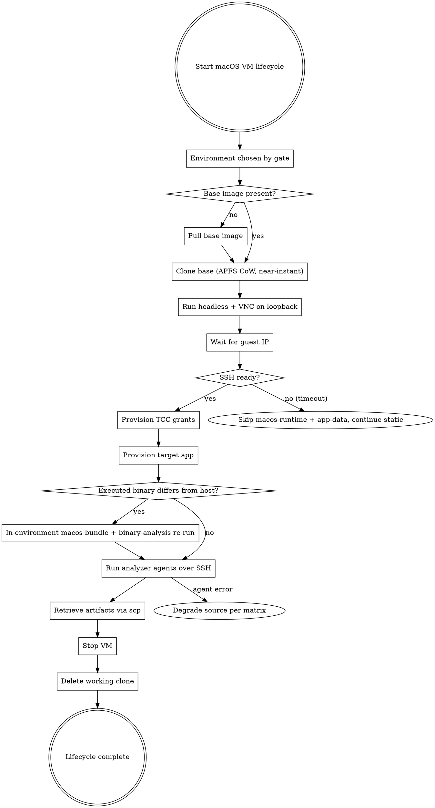

# macOS VM Execution

Native macOS GUI applications cannot run inside a Linux container, so macOS runtime analysis substitutes a **disposable macOS environment**: a Tart or Lume virtual machine, or — only under an explicit user affirmation — a throwaway host user account. The user's own account and data are never touched. Because every environment is pristine, analysis is full READ+WRITE. Single exemption: `macos-bundle` static analysis runs host-side (it reads zero personal data and must run before any VM exists).

## The Principle

The disposable macOS substrate is to macOS targets what the container is to Linux targets: the place the target runs so the host never does. The container earns safety through **isolation** — the target cannot touch anything outside it. The VM earns safety through **disposability** — the environment is pristine, cloned for this analysis, and destroyed after, so nothing the target does matters. That is the trade: we give up the container's hard isolation and get back a throwaway machine, and disposability is precisely what makes full read+write safe. A destructive probe that would be reckless against the user's real account is free against a clone we are about to delete. Bundle static analysis is the one thing that stays on the host, because it inspects bytes on disk, needs no running target, and must happen before an environment is even chosen.

## Environment Values

The `**Environment:**` field of the environment artifact takes exactly one of four values. The orchestrator chooses which — it owns the `AskUserQuestion` gate and the availability narrowing below. This skill defines only the mechanics of each value.

| Environment | Substrate | Who provisions | What read+write means | Cleanup obligation |
|-------------|-----------|----------------|-----------------------|--------------------|
| `vm-tart` | Tart VM (Virtualization.framework) | Orchestrator gate clones from a base image | Full read+write inside a disposable guest | `stop` then `delete` the working clone; keep the base |
| `vm-lume` | Lume VM (Virtualization.framework) | Orchestrator gate clones from a base image | Full read+write inside a disposable guest | `stop` then `delete` the working clone; keep the base |
| `host-direct` | Throwaway macOS user account on this Mac | The **user**, manually, outside the plugin | Full read+write inside that disposable account | User deletes their disposable account; plugin does nothing |
| `none` | No runtime environment available | — | No execution; static modes only | Nothing to clean up |

`none` is not an error. It means every runtime option was unavailable or declined, and the pipeline continues with static analysis alone.

## Host Requirements & Availability Detection

This is the analog of container-execution's runtime detection. It never fails the run; it **narrows the options the gate can offer**. Guard every probe — the tools may be absent.

```bash
# 1. Apple Silicon is mandatory. Virtualization.framework macOS guests are ARM-only.
if [ "$(uname -m)" != "arm64" ]; then
  echo "x86_64 host: vm-tart and vm-lume unavailable. Only host-direct or none."
fi

# 2. Backend presence.
command -v tart >/dev/null 2>&1 && echo "tart present" || echo "tart absent"
command -v lume >/dev/null 2>&1 && echo "lume present" || echo "lume absent"

# Lume also runs an API daemon; presence of the binary is not readiness.
if command -v lume >/dev/null 2>&1; then
  curl -s -o /dev/null -w '%{http_code}' http://127.0.0.1:3000/lume/vms 2>/dev/null \
    | grep -q '^2' && echo "lume API up" || echo "lume API down"
fi

# 3. OS version and disk headroom (base images are 25-50 GB; want ~60 GB free).
sw_vers -productVersion
FREE_GB=$(df -g "$HOME" | tail -1 | awk '{print $4}')
[ "${FREE_GB:-0}" -ge 60 ] && echo "disk ok (${FREE_GB}G)" || echo "disk low (${FREE_GB}G)"

# 4. The 2-running-guest kernel ceiling. Count what is already up.
if command -v tart >/dev/null 2>&1; then
  # `tart list --running` is NOT a valid flag (tart 2.32.1). Parse the State column (last field).
  RUNNING=$(tart list 2>/dev/null | awk 'NR>1 && $NF=="running"' | grep -c .)
  [ "$RUNNING" -ge 2 ] && echo "2 guests already running: VM options unavailable this run"
fi
if command -v lume >/dev/null 2>&1; then
  lume ls 2>/dev/null   # inspect running count similarly
fi
```

**The 2-running-macOS-guest ceiling is kernel-enforced.** Virtualization.framework refuses to boot a third macOS guest regardless of RAM or CPU. If two are already up, both VM options are unavailable for this run — treat it exactly like an absent backend.

**Provenance to record with the environment artifact.** Tart is Cirrus Labs' tool, historically at `github.com/cirruslabs/tart` and distributed via Homebrew (`brew install cirruslabs/cli/tart`); its base images are hosted under `ghcr.io/cirruslabs/` (e.g. `macos-sequoia-base`, `macos-tahoe-base`). Cirrus Labs was reported acquired around 2026-04 with the licensing moving to a more permissive footing (free on personal machines) — confirm the current repo/license at install time rather than assuming. Lume is MIT-licensed at `github.com/trycua/cua` under `libs/lume`. Prebuilt images ship with credentials `admin`/`admin` (Tart) or `lume`/`lume` (Lume), auto-login enabled, and SSH plus passwordless sudo preconfigured — **but no TCC grants** (see §9).

Unavailability of a backend narrows the gate's option set. It is never an error and never halts the pipeline.

## VM Naming

```
greenfield-${WORKSPACE_SLUG}-target
```

Deterministic (the same workspace resolves to the same VM name), does not leak the target's identity, and leaves room for a second concurrent analysis in a different workspace up to the 2-guest ceiling.

## Lifecycle



Two failure exits: an environment that never becomes reachable **skips** the `macos-runtime` and `app-data` modes and continues with host-side static analysis; an agent failure against a reachable environment **degrades** that source per the pipeline's degradation matrix (the failure is data, not a halt).

## Backend Command Table

Tart and Lume are interchangeable substrates; the orchestrator picks one and exports `GF_ENV` accordingly. Record the resolved **base-image digest** in the environment artifact.

| Operation | Tart | Lume |
|-----------|------|------|
| Pull base | `tart pull <image>` | `lume pull <image>` |
| Clone (CoW) | `tart clone <base> "$GF_VM"` | `lume clone <base> "$GF_VM"` |
| Boot headless + VNC | `tart run --no-graphics --vnc "$GF_VM" &` | `lume run "$GF_VM" --no-display --vnc &` |
| Address | `tart ip "$GF_VM"` | `lume ip "$GF_VM"` |
| Credentials | `admin` / `admin` | `lume` / `lume` |
| Stop | `tart stop "$GF_VM"` | `lume stop "$GF_VM"` |
| Delete | `tart delete "$GF_VM"` | `lume delete "$GF_VM"` |
| Reclaim space | `tart prune` | `lume prune` |
| Recovery boot | `tart run --recovery "$GF_VM"` | `lume run "$GF_VM" --recovery` |

The design leans on two properties baked into these images:

- **Auto-login.** A real Aqua (window-server) console session already exists at the login screen's far side. This is *why* SSH-driven `osascript` UI scripting works at all — there is a graphical session to attach to. Without auto-login there is no window server and every UI query returns empty.
- **Passwordless sudo + SSH.** Provisioning (TCC inserts, quarantine strips, installs) needs root without an interactive prompt, and every command arrives over SSH.

## The Execution Convention (Normative)

**Other skills depend on this section verbatim.** Skill snippets throughout the macOS capability are written as plain in-environment commands — `sqlite3 ...`, `osascript -e ...`, `screencapture ...`, `swiftc ...`. Agents never run those raw. They run them through these wrappers, which the orchestrator defines once per dispatch from the exported variables below. The wrapper name encodes *which kind of work it is*, and choosing the wrong one is the dominant failure mode of the whole capability.

The orchestrator exports these variables into every dispatch prompt:

| Variable | Meaning | Example |
|----------|---------|---------|
| `GF_ENV` | The environment value | `vm-tart` |
| `GF_VM` | The working VM name | `greenfield-acmetasks-target` |
| `GF_SSH` | The SSH login target | `admin@192.168.64.7` |
| `GF_GUEST_WORKSPACE` | In-guest output directory | `/Users/admin/gf-out` |

### `gf_exec '<cmd>'` — non-GUI work

For anything that does not touch the window server: `sqlite3`, `ls`, `plutil`, `defaults read`, file plumbing, checksums.

```bash
# vm-tart / vm-lume
ssh -o StrictHostKeyChecking=no admin@"$(tart ip "$GF_VM")" '<cmd>'
# host-direct
bash -lc '<cmd>'
```

### `gf_gui '<cmd>'` — anything touching the window server

For AppleScript / System Events, Accessibility (AX) queries, `screencapture` — anything that needs the Aqua session.

```bash
# vm-tart / vm-lume — SSH, become root to enter the auto-login Aqua session, then drop
# back to the user so TCC attributes the call to the user + binary (not root).
ssh -o StrictHostKeyChecking=no admin@"$(tart ip "$GF_VM")" \
  "sudo launchctl asuser $(id -u admin) sudo -u admin <cmd>"
# host-direct — already in a graphical session
<cmd>
```

**A bare `osascript` or `screencapture` run straight over SSH can execute in the detached SSH session rather than the Aqua session. When it does, it returns an empty AX tree, an empty window list, or a wallpaper-only screenshot — and it exits 0. The output looks exactly like a legitimate finding and is not one. This is the single most failure-prone mechanic in the entire macOS capability.** Attachment is image- and configuration-dependent: on a base image that auto-logs in the same user you SSH as, bare calls have been observed to succeed, which is exactly why the failure is dangerous — a run that works on one image degrades silently on another. Do not test whether the bare form happens to work; route GUI work through `gf_gui` unconditionally so the attachment is explicit. `sudo launchctl asuser $(id -u admin) sudo -u admin` is the fix: `launchctl asuser` re-parents the command into the logged-in user's GUI session so the window server answers — but switching audit sessions needs root (a bare `launchctl asuser` from an SSH shell fails with `Could not switch to audit session: Operation not permitted`), so it must run under `sudo`, and the inner `sudo -u admin` drops back to the user so TCC attributes the call to the user + binary rather than root. Every GUI-touching command goes through `gf_gui`, never `gf_exec`.

**TCC attribution note (verified on Tahoe):** when a command is launched this way over SSH, the *responsible* process macOS evaluates for TCC is `/usr/libexec/sshd-keygen-wrapper`, **not** `osascript`/`screencapture`. All app-agnostic grants and every per-app Automation grant must be keyed to that binary (see §9). The exec convention also does not inherit a login PATH — Homebrew tools live at `/opt/homebrew/bin`, which a non-login SSH shell omits, so wrap tool calls in `bash -lc '…'` or use absolute paths.

### `gf_windows` — enumerate on-screen windows and their CGWindowIDs

`screencapture -x -o -l <CGWindowID>` composites the window from the WindowServer: immune to occlusion, and the app need not be frontmost. It needs a **CGWindowID**, and no shell built-in prints one. `/usr/bin/swift` and `/usr/bin/swiftc` ship with the Command Line Tools — present in the CLT-only base images — so the run compiles a small `CGWindowListCopyWindowInfo` enumerator for itself.

**The source.** The agent writes this verbatim, host-side, to `workspace/raw/macos/runtime/tools/gf-windowlist.swift`:

```swift
import CoreGraphics
import Foundation

if CommandLine.arguments.contains("--version") { print("gf-windowlist 1"); exit(0) }

let opts: CGWindowListOption = [.optionOnScreenOnly, .excludeDesktopElements]
guard let wins = CGWindowListCopyWindowInfo(opts, kCGNullWindowID) as? [[String: Any]] else { exit(1) }

func flat(_ v: Any?) -> String {
    return (v as? String ?? "").replacingOccurrences(of: "\t", with: " ")
}

print("id\tpid\tlayer\talpha\towner\ttitle\tx\ty\tw\th")
for win in wins {
    let b = win[kCGWindowBounds as String] as? [String: Double] ?? [:]
    func g(_ k: String) -> String { return String(Int(b[k] ?? 0)) }
    let cols = [
        String(win[kCGWindowNumber as String] as? Int ?? -1),
        String(win[kCGWindowOwnerPID as String] as? Int ?? -1),
        String(win[kCGWindowLayer as String] as? Int ?? 0),
        String(format: "%.2f", win[kCGWindowAlpha as String] as? Double ?? 0),
        flat(win[kCGWindowOwnerName as String]),
        flat(win[kCGWindowName as String]),
        g("X"), g("Y"), g("Width"), g("Height"),
    ]
    print(cols.joined(separator: "\t"))
}
```

**Build recipe.** Write host-side, copy in, compile, check the stamp:

```bash
gf_exec "mkdir -p $GF_GUEST_WORKSPACE/tools"
gf_put workspace/raw/macos/runtime/tools/gf-windowlist.swift "$GF_GUEST_WORKSPACE/tools/gf-windowlist.swift"
gf_exec "/usr/bin/swiftc -O -module-name gfwindowlist \
         $GF_GUEST_WORKSPACE/tools/gf-windowlist.swift -o $GF_GUEST_WORKSPACE/tools/gf-windowlist"
gf_exec "$GF_GUEST_WORKSPACE/tools/gf-windowlist --version"   # must print exactly: gf-windowlist 1
```

Writing the source host-side and copying it in is deliberate. A heredoc would have to survive `ssh "sudo launchctl asuser … sudo -u admin …"` — two layers of shell quoting wrapped around a body full of quotes, backslashes and `\t` escapes — and a single mangled escape yields a program that still compiles and prints the wrong thing. Copying also makes the tool an **auditable artifact**: the exact source that produced every window id in the evidence sits in the workspace beside it. (`-module-name` is not optional: swiftc derives the module name from the output filename and rejects the hyphen in `gf-windowlist`.)

**Compile with `gf_exec`. Run with `gf_gui`.** `swiftc` is ordinary file work and belongs on `gf_exec`; the binary queries the window server and belongs on `gf_gui`. Where the SSH session is not attached to the Aqua session, the same binary run over plain `gf_exec` returns **the header row and almost nothing else, exit 0** — a plausible-looking empty desktop that is really the detached session having no window server to ask. Header-only output is therefore never evidence of an empty desktop; it is a routing or attachment fault until proven otherwise.

```bash
# the wrapper — every environment, always gf_gui
gf_gui "$GF_GUEST_WORKSPACE/tools/gf-windowlist"

# WRONG — on an unattached session this exits 0, prints a header, and every downstream capture silently degrades
gf_exec "$GF_GUEST_WORKSPACE/tools/gf-windowlist"
```

**Build timing.** Lazily, **once per run, in Phase 0 preflight** — never mid-run. A compile in the middle of an interaction sequence costs seconds at exactly the moment window state is changing. A provisioned base **may** pre-compile the binary as a convenience, but the `--version` check is unconditional: a generic base predates any given skill version, and a stale `gf-windowlist` that prints a different stamp — or none — is rebuilt from the source this run shipped.

**Fallback ladder.**

| Rung | Mechanism | Cost |
|------|-----------|------|
| 1 | Compiled binary at `$GF_GUEST_WORKSPACE/tools/gf-windowlist` | ~10 s once, then instant |
| 2 | Interpreter mode: `gf_gui "/usr/bin/swift $GF_GUEST_WORKSPACE/tools/gf-windowlist.swift"` | ~1–2 s **per call** |
| 3 | Enumeration unavailable | The consuming skill degrades its capture scope |

Rung 3 is a **capability gap, not a run failure**: the run continues with a narrower capture scope and records that it did.

**Output contract.** TSV on stdout, one row per on-screen window, **front-to-back**, with the header row:

```
id	pid	layer	alpha	owner	title	x	y	w	h
```

Reading the columns:

- **Front-to-back ordering is load-bearing.** The topmost window owned by a pid is its first row. An attached sheet is its own window id listed **before** its parent, so "first row for this pid" resolves sheets with no special case.
- **Layers observed:** app windows `0`; an open menu `101`; Dock `20`; menu bar `24`; the Notification Center container `21`; NC widgets negative. Filter `layer==0` for real app windows.
- **Match on pid, never on owner name.** `kCGWindowOwnerName` is not the AX process name and is not stable across apps.
- **Blank titles with populated geometry mean the Screen Recording grant is missing** (§9) — ids, pids, layers, owners and bounds resolve without it; `kCGWindowName` does not. Uniformly empty `title` across every row is an attribution failure, not a broken enumerator.
- `.optionOnScreenOnly` **excludes minimized and hidden windows.** A window that vanished from the list may have been minimized rather than closed; that is a state observation, not an error.

> **Stale ids are dangerous — this is the one silent-garbage path in window capture.** After a window is minimized its id disappears from the list, but `screencapture -x -o -l <stale id>` still **exits 0 and writes a plausible ~189 KB PNG of the last-known content**. Nothing about the file says it is stale. **Always re-verify the id is present in a fresh `gf_windows` list immediately before capturing** — not once at the top of a phase, immediately before each shutter.

### `gf_get <guest-path> <host-path>` / `gf_put <host-path> <guest-path>`

```bash
# vm-*  : gf_get
scp -r -o StrictHostKeyChecking=no admin@"$(tart ip "$GF_VM")":<guest-path> <host-path>
# vm-*  : gf_put
scp -r -o StrictHostKeyChecking=no <host-path> admin@"$(tart ip "$GF_VM")":<guest-path>
# host-direct : both degrade to a copy
cp -R <src> <dst>
```

### `gf_snapshot <label>` / `gf_rollback <label>`

```bash
# vm-*  : snapshot = clone the working VM to a labelled pristine copy
tart clone "$GF_VM" "${GF_VM}-snap-<label>"
# vm-*  : rollback = discard the working VM and re-clone from the labelled copy
tart delete "$GF_VM" && tart clone "${GF_VM}-snap-<label>" "$GF_VM"
```

**host-direct has no snapshot or rollback** — a user account cannot be cloned mid-session. Under host-direct these wrappers are no-ops and any probe that would depend on rollback safety is simply not run.

### Worked example — one snippet, three environments

A skill file contains the snippet `osascript -e 'tell app "System Events" to count processes'`. It touches the window server, so it is `gf_gui` work:

```bash
# vm-tart
ssh -o StrictHostKeyChecking=no admin@"$(tart ip "$GF_VM")" \
  "sudo launchctl asuser $(id -u admin) sudo -u admin osascript -e 'tell app \"System Events\" to count processes'"

# vm-lume
ssh -o StrictHostKeyChecking=no lume@"$(lume ip "$GF_VM")" \
  "sudo launchctl asuser $(id -u lume) sudo -u lume osascript -e 'tell app \"System Events\" to count processes'"

# host-direct
osascript -e 'tell app "System Events" to count processes'
```

### Timeout idiom

GUI scripting is slow; the default command timeout is 60 s (see §14). Wrap every wrapped call and treat exit 124 as a timeout observation, exactly as container-execution does:

```bash
timeout 60 gf_exec 'sqlite3 ~/Library/... "SELECT count(*) FROM ..."' > out.txt
[ $? -eq 124 ] && echo "TIMEOUT after 60s" >> out.txt
```

## Target Provisioning

Two acquisition paths; the chosen one is recorded in the environment artifact's `**Target acquisition:**` field.

### Path A — copy the host bundle (default when the app is installed)

```bash
gf_put /Applications/Foo.app /Applications/
gf_exec 'xattr -dr com.apple.quarantine /Applications/Foo.app'
# Re-verify INSIDE the guest so the guest verdict matches host signing.md
gf_exec 'codesign --verify --deep --strict /Applications/Foo.app; \
         spctl -a -v /Applications/Foo.app'
```

If the bytes are identical to the host bundle, the host-side `macos-bundle` analysis already describes the executed binary — **no re-run needed**.

### Path B — vendor download inside the guest

For URL targets, or Mac App Store apps that fail receipt validation when copied (a copied MAS build refuses to launch in the guest — fetch the vendor's direct-download build instead; many vendors ship a trial):

```bash
gf_exec 'curl -L -o /tmp/foo.dmg https://vendor.example/Foo.dmg'
gf_exec 'shasum -a 256 /tmp/foo.dmg'          # record guest-side checksum
gf_exec 'hdiutil attach /tmp/foo.dmg'          # or: installer -pkg /tmp/foo.pkg -target /
```

Record the URL and the guest-side checksum in the artifact.

### Executed-binary-differs handoff

When acquisition is Path B, **or** when the in-guest `CFBundleShortVersionString` or signing authority differs from host `signing.md`, the executed artifact is not the one host-side analysis described. Trigger an **in-environment re-run** of `macos-bundle-analysis` and `binary-analysis` against the executed artifact, and record the host-vs-environment diff — for example, a host MAS build carrying `_MASReceipt` and an Apple distribution signature versus a Developer-ID trial carrying a Sparkle updater.

This is a **documented handoff to those skills, not work this skill performs.** The diff is written to:

```
workspace/raw/macos/bundle/environment-diff.md
```

### Wrinkles

- Trial licensing and sign-in prompts are expected in a pristine VM. Any account creation is the user's call, done over VNC; credentials never enter the workspace.
- First-launch Gatekeeper dialogs are dismissed over VNC, or pre-empted by the `xattr -dr com.apple.quarantine` strip above.

## TCC (Permission) Provisioning

Neither image family pre-grants TCC. Document the path honestly rather than pretending grants exist:

1. **SIP.** The `ghcr.io/cirruslabs/macos-*-base` images **ship with SIP already disabled** (verified: `csrutil status` → "disabled"), so no action is needed for them. Only a from-scratch `-vanilla` image requires disabling it, via `tart run --recovery "$GF_VM"` then `csrutil disable` in the recoveryOS terminal over VNC — a one-time manual step, which is why §10 uses a provision-once / clone-per-run pattern.

2. **Insert grants with SIP off.** `INSERT OR REPLACE` into the system TCC database (`/Library/Application Support/com.apple.TCC/TCC.db`) for `kTCCServiceAccessibility` and `kTCCServiceScreenCapture`, and into the user database for `kTCCServiceAppleEvents`. **Key the grant to the process macOS holds *responsible*, which for SSH-driven automation is `/usr/libexec/sshd-keygen-wrapper` — not `osascript`/`screencapture` (verified: the consent prompt names the wrapper).** The cirruslabs base images already grant `sshd-keygen-wrapper` Accessibility, ScreenCapture, and AppleEvents→`com.apple.systemevents`, which is why app-agnostic UI scripting works out of the box; grant `osascript`/`screencapture` too as belt-and-suspenders. A **per-app** Automation grant (to script a specific target app) is a `kTCCServiceAppleEvents` row with `client='/usr/libexec/sshd-keygen-wrapper'` and the target's bundle id in `indirect_object_identifier`. Compute the `csreq` blob per binary (works on Tahoe):
   ```bash
   codesign -d -r- /usr/libexec/sshd-keygen-wrapper 2>&1 | awk -F ' => ' '/designated/{print $2}' \
     | csreq -r- -b /tmp/w.csreq
   HEX=$(xxd -p /tmp/w.csreq | tr -d '\n')   # → X'$HEX' in the csreq column
   ```
   Grant Full Disk Access to the shell if group-container data must be read. Note Screen Recording worked from a plain TCC.db write on this Tahoe image; if a build enforces the separate `replayd` periodic re-consent gate, the visual skill degrades to AX-only. **The Screen Recording grant also governs `kCGWindowName`** — window ids, pids, layers, alphas, owners and bounds enumerate without it, titles do not. A `gf_windows` list with populated geometry and uniformly blank titles is a Screen Recording attribution failure, not a broken enumerator.

3. **Verify, never assume.** The TCC schema drifts between macOS releases (column sets and `auth_value` semantics have changed). Every grant is immediately followed by a probe — the same probes the gate's preflight doctor runs — and **the probe outcome, not the `INSERT` exit code, is what gets recorded.**

4. **Fallback.** VNC in, click through System Settings once to grant by hand, then `gf_snapshot` the result so the click-through is never repeated.

## Provisioned-Base Two-Tier Pattern

Grants and installs are expensive and one-time; runs are cheap and repeated. So the design is two tiers:

- **Tier 1 — the provisioned base.** The user builds a base image *once*: SIP disabled, TCC granted, and (optionally) the target app installed. This is documented and doctor-verified. **It is not automated per run** — it involves recoveryOS steps and manual verification.
- **Pre-compiling `gf-windowlist` into a base is an optional convenience, never a dependency.** Nothing may assume the binary exists: the `--version` check and the lazy rebuild in Phase 0 preflight run unconditionally, because a generic base predates any skill version. host-direct has no base image at all, so there the lazy build is the only path.
- **Tier 2 — the per-run clone.** Each analysis does `tart clone` of that base in seconds (APFS copy-on-write) and works in the clone.

The availability probe distinguishes **"provisioned base available"** (grants present, expect a fast start) from **"raw base only — expect one-time setup"** so the gate can set the user's expectations correctly.

## Snapshot / Rollback

Read+write means a destructive probe can wedge the guest into a state later probes can't recover from. Guard against it with clones:

- `gf_snapshot pristine` **before the first launch** so onboarding is replayable, and again **before any irreversible probe**.
- `gf_get` all evidence **before** a rollback. Rollback discards the guest filesystem; anything not pulled to the host is gone.
- CoW clones are near-instant and cheap, so snapshot liberally.

host-direct has no snapshot (§7) — under it, destructive probes that would need rollback safety are simply not run.

## Artifact Retrieval

Agents write in-guest to `$GF_GUEST_WORKSPACE` (e.g. `/Users/admin/gf-out/`), then pull to the host:

```bash
gf_get /Users/admin/gf-out/ workspace/raw/macos/
```

**Never share the host workspace into the guest** — no mounts, no shared folders. The flow is one-way pull only. Tar large evidence sets in-guest before pulling:

```bash
gf_exec 'tar czf /tmp/evidence.tgz -C /Users/admin/gf-out .'
gf_get /tmp/evidence.tgz workspace/raw/macos/
```

**The Layer 1 gate counts files on the host.** Evidence left sitting in the guest does not exist as far as the pipeline is concerned. Pull before you stop.

## host-direct Mode

> **WARNING — host-direct runs the real target on THIS Mac.** It executes the target and writes to a real macOS user account on this machine. It is permitted **only** when this Claude Code session is already running inside a throwaway macOS user account that the user created for this analysis.
>
> **The plugin performs NO detection and NO automation here.** It never guesses whether the current account is disposable, and it never creates, configures, or deletes accounts. The user's affirmation at the gate is the *only* signal that this mode is safe. If that affirmation is absent, host-direct is not an option.

The account management is **written advice for the user to copy-paste — never executed by the plugin**:

```bash
# The USER runs these, by hand, not the plugin:
sudo sysadminctl -addUser gfanalysis -fullName "Greenfield Analysis" -password - -admin
# log in to gfanalysis via fast user switching, run the analysis there, then:
sudo sysadminctl -deleteUser gfanalysis -secure
```

Caveats to surface to the user: grant TCC to the terminal in *that account's* System Settings; do not sign into iCloud or an Apple ID in it; it has no access to the primary user's data (that is the point).

What still holds under host-direct: artifacts go to `workspace/`; the artifact records the account short name in `**Host account:**`; the same wrappers are used and simply degrade to direct execution (§7).

**Tooling the run builds for itself goes in the workspace, nowhere else.** Anything the run compiles — `gf-windowlist` above all — is written to `$GF_GUEST_WORKSPACE/tools/` and never to `/usr/local/bin`, `~/bin`, or anything on a login PATH. That is what "install nothing into the account" means in practice: the binary leaves when the workspace does. Delete `tools/` at the end of a host-direct run, after the evidence has been pulled.

**Boundary rule.** host-direct does full in-app read+write, *including within-app destructive flows*. But the two probe classes that can escape the app/account boundary are **VM-only**:

- **URL-scheme handoffs** to other applications, and
- **`shortcuts run`** (which touches shared, cross-account services).

Under host-direct these two are **recorded as not-exercised-in-this-environment**, never run.

## Resource Limits

| Resource | Default | Notes |
|----------|---------|-------|
| Guest CPU | ~4 cores | Backend default |
| Guest memory | ~8 GB | Backend default |
| Disk per image | 25–50 GB | Base image footprint |
| **Running macOS guests** | **max 2** | **Kernel-enforced by Virtualization.framework** |
| Guests per workspace | 1 | One working VM per analysis |
| Command timeout | 60 s | GUI scripting is slow; `timeout 60` on wrapped calls |
| VNC bind | 127.0.0.1 | Loopback only, never `0.0.0.0` |
| Networking | NAT | Guest behind host NAT |

## Error Handling

| Failure | Response |
|---------|----------|
| Image pull fails | Mark that VM backend unavailable, re-ask the gate |
| Boot timeout / no IP | Capture `tart list`, `stop`, retry **once**, then degrade |
| SSH refused | Wait-loop with a capped number of retries, then treat as no-IP |
| 2-guest ceiling hit | VM options unavailable this run (not an error) |
| Disk exhaustion | Emit `tart prune` advice, mark VM unavailable |
| TCC probe fails after grants | Fall back to the VNC manual path (§9.4); if still failing, degrade |
| Guest panic / hang | `tart stop` then `tart delete`, mark the source degraded |
| `swiftc` absent, or `gf-windowlist` fails to compile | Fall back to `/usr/bin/swift` interpreter mode (~1–2 s per call); if that also fails, enumeration is unavailable and the consuming skill degrades its capture scope — a capability gap, not a run failure |
| `gf_windows` returns only the header row | Almost always a routing mistake — the binary was run through `gf_exec` instead of `gf_gui`. Re-run through `gf_gui` before believing it. A genuinely empty list from `gf_gui` means there is no window server: that is the hard environmental gate, not a degradation |

The distinction that governs all of the above: **failures about the target are behavioral data** (record and continue); **failures about the environment are gates** (they narrow options or degrade a source, they never crash the pipeline).

## Cleanup Guarantee

At pipeline end **and on abort**, always `stop` then `delete` the working VM, while keeping the provisioned base image:

```bash
tart stop "$GF_VM" 2>/dev/null || true
tart delete "$GF_VM" 2>/dev/null || true
```

Honor `--keep-vm`: when set, do not delete, and print the exact reclaim command in the run summary so the user can remove it later:

```
Kept VM per --keep-vm. Delete it with:  tart delete greenfield-<slug>-target
```

host-direct has no cleanup beyond the user deleting their own disposable account.

## Non-Negotiable Security Restrictions

- **Never** mount or share the host home directory into a guest.
- **Never** forward the SSH agent or copy host credentials or keys into a guest.
- **Never** copy the host user's application data into a guest.
- **Never** analyze in the user's primary account.
- **Never** reuse a VM across analyses without re-cloning from the pristine base.
- **Never** bind VNC to anything but `127.0.0.1`.
- All captured output lands under `workspace/raw/macos/`.

## The Environment Artifact

Path `workspace/environment/runtime-environment.md`. **Written by the orchestrator gate ONLY.** Skills verify and read it — they never create it. Other files quote the exact bold labels below, so they are a contract; do not rename them.

```markdown
# Runtime Environment
- **Environment:** vm-tart            # vm-tart | vm-lume | host-direct | none
- **Target:** <app name>
- **Bundle ID:** <bundle-id>
- **Signature verdict:** PASS (ref: workspace/raw/macos/bundle/signing.md)
- **VM name:** greenfield-<slug>-target        # vm-* only
- **Base image:** ghcr.io/cirruslabs/macos-sequoia-base:latest@sha256:...   # vm-* only
- **SSH target:** admin@192.168.64.7            # vm-* only
- **Guest workspace:** /Users/admin/gf-out      # vm-* only
- **Host account:** gfanalysis                  # host-direct only
- **Disposable-account affirmation:** user affirmed this session runs in an isolated, disposable macOS user account created for this analysis   # host-direct only
- **Target acquisition:** copied from host bundle | vendor download <url>
- **Access mode:** read+write (pristine environment)
- **Recorded:** <ISO 8601 timestamp>
```

**Skill-verification rule (others copy this verbatim):** the artifact must exist and `**Environment:**` must be one of `vm-tart`, `vm-lume`, or `host-direct`. A value of `none`, or a missing artifact, is a **hard environmental gate** — the consuming skill records it in its own preflight file and exits.
